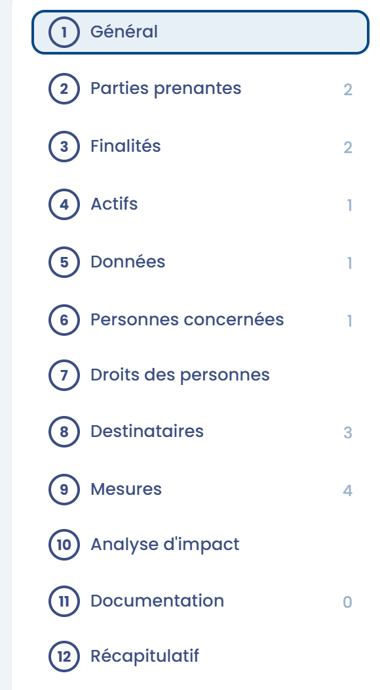

# Registre "Responsable de traitement"

## Introduction

L'article 30 du RGPD prévoit des obligations spécifiques pour le _registre du responsable de traitement_ de données personnelles et pour le _registre du sous-traitant_. Si votre organisme agit à la fois en tant que sous-traitant et en tant que responsable de traitement, votre registre doit donc clairement distinguer les deux catégories d'activités.

**En pratique, dans cette hypothèse, la CNIL vous recommande de tenir 2 registres :**

1. un pour les traitements de données personnelles dont vous êtes vous-même responsable,
2. un autre pour les traitements que vous opérez, en tant que sous-traitant, pour le compte de vos clients.

La suite de cette page traite uniquement du registre "Responsable de traitement".

## Le registre "Responsable de traitement"

Pour chaque traitement, le registre d'un responsable de traitement indique au minimum :

1. le cas échéant, **le nom et les coordonnées** du [responsable conjoint du traitement](https://www.cnil.fr/fr/reglement-europeen-protection-donnees/chapitre4#Article26)
2. les **finalités** du traitement, c'est-à-dire l'objectif pour lequel vous avez collecté les données
3. les catégories de **personnes concernées** (client, prospect, salarié, etc.)
4. les catégories de **données personnelles** (par exemple : identité, situation familiale, économique ou financière, données bancaires, données de connexion, données de localisation, etc.)
5. les catégories de **destinataires** auxquels les données personnelles ont été ou seront communiquées, y compris les sous-traitants auxquels vous faites appel
6. les **transferts** de données personnelles vers un pays tiers ou une organisation internationale et, dans certains cas très particuliers, les garanties prévues pour ces transferts ;
7. les **délais prévus pour l'effacement** des différentes catégories de données, c'est-à-dire la durée de conservation, ou à défaut les critères permettant de la déterminer
8. dans la mesure du possible, **une description générale des mesures de sécurité techniques et organisationnelles** que vous mettez en œuvre

Dans Dastra, un traitement créé en tant que responsable de traitement est documenté en 12 sections : **Général**, **Parties prenantes**, **Finalités**, **Actifs**, **Données**, **Personnes concernées**, **Droits des personnes**, **Destinataires**, **Mesures**, **Analyse d'impact**, **Documentation** et **Récapitulatif**. Les paragraphes ci-dessous indiquent dans quelle section est documentée chaque information exigée par l'article 30.

<figure><figcaption>
Les différentes sections d'un traitement "responsable de traitement" dans Dastra
</figcaption></figure>

## Les acteurs

Documentés dans la section **Parties prenantes** :

* L'identité et les coordonnées du responsable de traitement&#x20;
* L'identité et les coordonnées du DPO, le cas échéant&#x20;
* L'identité et les coordonnées du représentant, le cas échéant&#x20;
* Le ou les responsables conjoints du traitement, le cas échéant

## Les finalités

Documentées dans la section **Finalités** :

* Toutes les finalités liées à l'activité qui implique le traitement

## La base légale

Chaque finalité est associée à sa base légale, également dans la section **Finalités** :

* Respect d'une obligation légale&#x20;
* Exécution d'un contrat&#x20;
* Intérêt légitime de l'entreprise ou d'un tiers&#x20;
* Intérêt public&#x20;
* Consentement&#x20;
* Sauvegarde des intérêts vitaux de la personne concernée ou d'une autre personne

## L'inventaire des données et des personnes concernées

Documenté dans les sections **Personnes concernées** et **Données** :

* Types de personnes concernées&#x20;
* Catégories de données&#x20;
* Délais de suppression des données ou règle applicable

## Les destinataires et les transferts de données hors EEE

Documentés dans la section **Destinataires** :

* Identification des destinataires, dont les destinataires internes (service concerné par le traitement), les organismes externes (partenaires commerciaux ou institutionnels), les sous-traitants (hébergeur, fournisseur de solution), la personne concernée le cas échéant et les responsables conjoints&#x20;
* Pour chaque destinataire, identification des transferts hors de l'Espace économique européen (EEE) et des outils juridiques utilisés (règles d'entreprise contraignantes pour les transferts hors UE avec des filiales, clauses contractuelles types, pays reconnu comme adéquat, etc.)

## Les mesures de sécurité

Documentées dans la section **Mesures** :

* Mesures techniques et organisationnelles mises en place pour sécuriser chaque traitement&#x20;
* Par exemple, chiffrement des données, pseudonymisation, limitation des accès

***


Vous pouvez changer le type d'un traitement (passer d'un traitement créé en tant que responsable de traitement à un traitement créé en tant que sous-traitant, et inversement).\
[La procédure est disponible ici](https://doc.dastra.eu/features/ropa/faq#comment-changer-le-type-dun-traitement-passer-dun-traitement-cree-en-tant-que-responsable-de-traitem)


## Pour aller plus loin


[gerer-votre-registre.md](establish.md)

