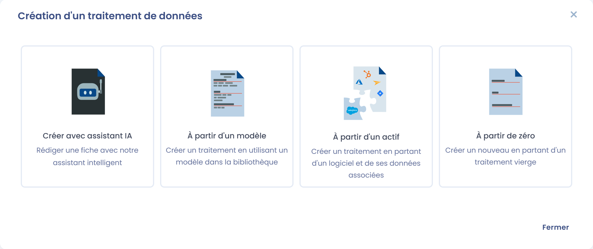
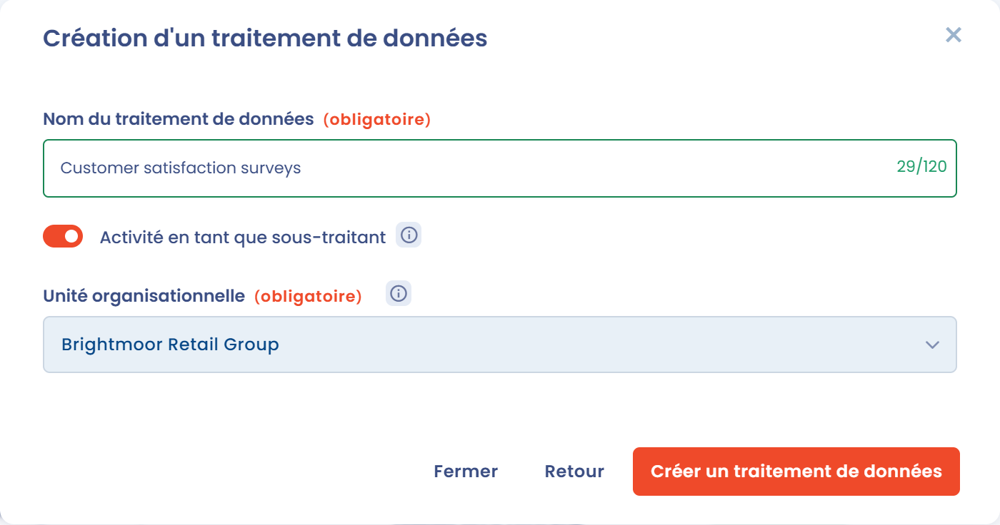
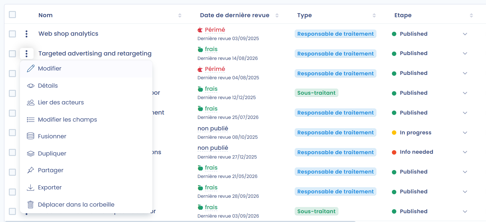

# Déclarer un traitement

## Qu'est-ce qu'un traitement ?

Un traitement est une opération ou un ensemble d'opérations portant sur des données personnelles, par exemple la gestion de la paie. L'ensemble des traitements constitue le registre des traitements.

## Créer un traitement

Pour créer un traitement, ouvrez le registre des traitements et cliquez sur **Créer un traitement de données**. La fenêtre **Création d'un traitement de données** propose quatre options :

* **Créer avec assistant IA** : décrivez votre traitement en quelques mots et laissez notre Assistant IA (Beta) le générer pour vous, quand cette fonctionnalité est activée dans votre espace de travail. Le bouton IA situé à côté de **Créer un traitement de données** ouvre directement cette option.
* **À partir d'un modèle** : partez d'un de nos modèles prédéfinis (voir [Utiliser un modèle de traitement](templates.md)).
* **À partir d'un actif** : créez un traitement à partir d'un actif et des données qui lui sont associées.
* **À partir de zéro** : créez un nouveau traitement entièrement vierge.

<figure><figcaption>
Choix du mode de création du nouveau traitement
</figcaption></figure>

Avec **À partir de zéro**, saisissez le **Nom du traitement de données**, sélectionnez l'**Unité organisationnelle** et cliquez sur **Créer un traitement de données**. Vous arrivez ensuite sur le questionnaire, où vous pouvez ajouter toutes les informations requises.

## Créer un traitement en tant que sous-traitant

Pour créer un traitement en tant que sous-traitant, activez l'interrupteur **Activité en tant que sous-traitant** au moment de la création avec **À partir de zéro** (ou **Créer avec assistant IA**).

<figure><figcaption>
Création d'un traitement en tant que sous-traitant
</figcaption></figure>

Vous arrivez alors directement sur la documentation d'un traitement en tant que sous-traitant. Vous pouvez y déclarer vos responsables de traitement (en général, vos clients) dans la section **Clients**.

## Modifier un traitement

Pour modifier un traitement existant, cliquez sur sa ligne dans le registre, ou ouvrez le menu en bout de ligne et choisissez **Modifier** :

<figure><figcaption>
Ouverture d'un traitement pour le modifier
</figcaption></figure>

Les sections du questionnaire sont listées à gauche de l'écran. Cliquez sur une section pour y accéder directement, ou utilisez les boutons **Retour**, **Aller à la section** et **Suivant** en bas de la page. Cliquez sur **Enregistrer** pour sauvegarder votre travail.

Suivez ensuite chaque étape du questionnaire, en commençant par la section suivante :


[remplir-le-questionnaire](activity/README.md)

