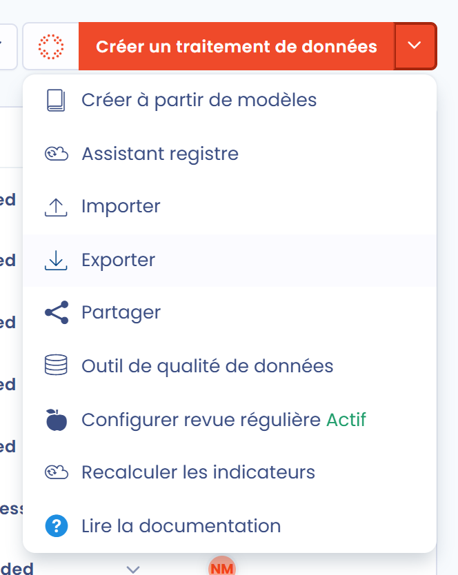
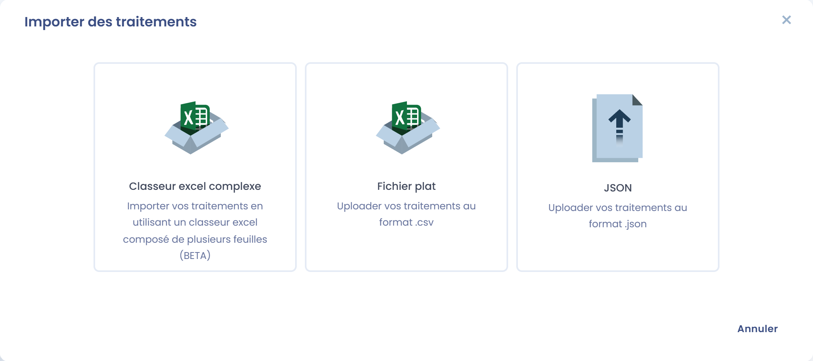
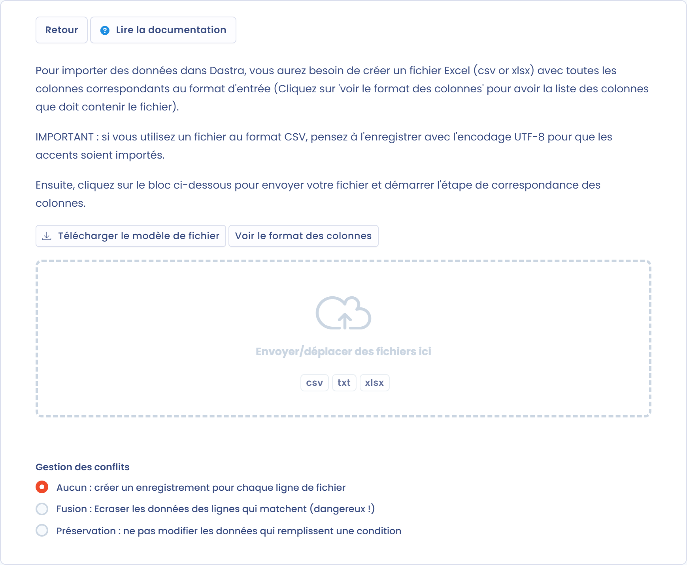
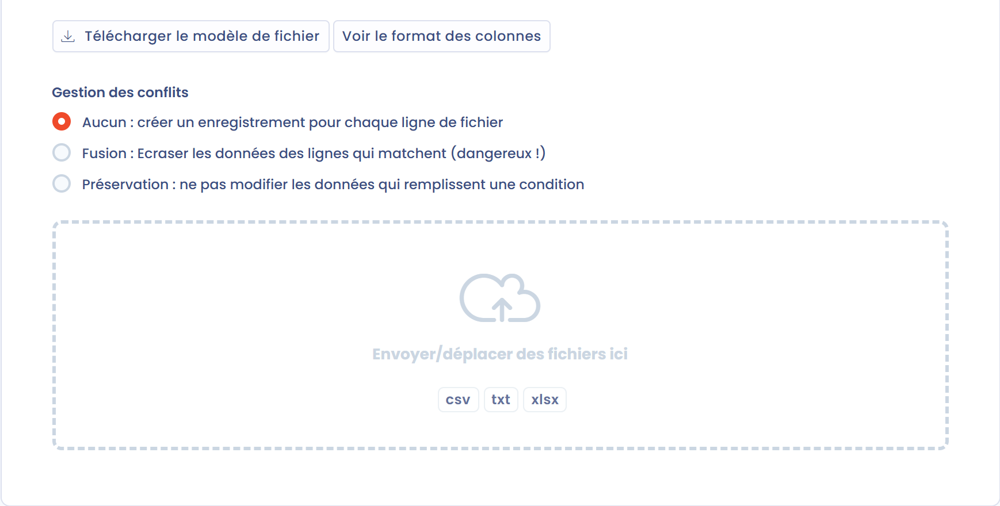
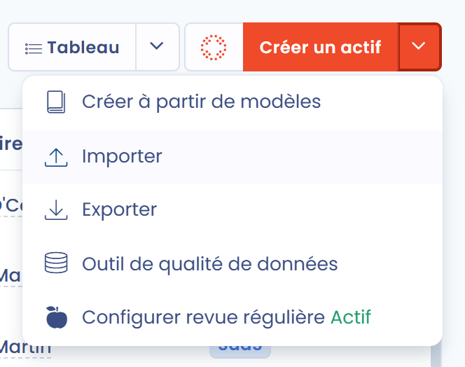

# Exporter / importer le registre

## Export du registre



Pour exporter l'ensemble du registre, ouvrez le registre des traitements, cliquez sur la flèche à droite du bouton **Créer un traitement de données**, puis sélectionnez **Exporter**.

<figure><figcaption>
Menu déroulant du registre avec la fonctionnalité d'export
</figcaption></figure>

Dans la fenêtre qui s'ouvre, sous **Choisissez le format d'export que vous souhaitez**, sélectionnez PDF, Word, HTML, CSV, Excel, JSON ou Markdown. Pour les formats PDF, Word et HTML, sélectionnez aussi le type d'export sous **Sélectionnez un type d'export** (**Complet**, **RGPD (Article 30)**, **Notice d'information standard** ou **Politique de conservation des données**). Cliquez ensuite sur **Télécharger le fichier**. Votre registre est exporté.

Selon le format, des options supplémentaires sont disponibles, par exemple :

* **Regrouper par unité organisationnelle** (PDF, Word, HTML), pour regrouper les traitements par unité organisationnelle
* **Ajouter les indicateurs de Progression, qualité et sensibilité à l'export** et **Exporter les tâches associées** (PDF et HTML, type Complet)
* **Tableur complexe (plusieurs feuilles)** (Excel)
* **Utiliser les noms de colonnes ou états natifs (Recommandé pour importer les données)** et **Exporter des colonnes spécifiques**, qui vous permet de choisir les colonnes à exporter (CSV et Excel)
* **Exporter pour un client**, pour produire un export destiné à un seul de vos clients, sans les données des autres clients

Les exports PDF, Word et HTML contiennent jusqu'à 500 traitements, et les exports CSV, Excel, JSON et Markdown jusqu'à 10 000. Un avertissement s'affiche dans la fenêtre si votre sélection dépasse cette limite.

Pour un registre volumineux, l'export JSON est préparé en arrière-plan. Vous pouvez continuer à travailler pendant ce temps. Une notification vous informe de son avancement et le fichier se télécharge dès qu'il est prêt.

### Format RGPD (Article 30)

Le format RGPD (Article 30) correspond à ce qu'exige le RGPD. L'export contient uniquement les champs que l'article 30 rend obligatoires dans le registre des traitements. Les informations contenues sont :

* Nom du traitement, et identité du responsable de traitement (ou du sous-traitant), de son représentant et de son DPO
* Finalités (sans les bases légales)
* Catégories de personnes concernées et de données personnelles, et durées de conservation
* Destinataires et transferts éventuels hors UE
* Mesures de sécurité

### Format complet

Le format complet est le format natif de Dastra. Vous exportez l'ensemble des champs qui composent le traitement.


Vous pouvez aussi exporter un ou plusieurs traitements du registre, au lieu du registre entier. Pour cela, cochez les cases à gauche des traitements concernés, puis cliquez sur **Choisir une action groupée** et **Exporter**. Pour exporter un seul traitement, vous pouvez aussi utiliser **Exporter** dans le menu en bout de ligne.


## Import du registre

Cliquez sur la flèche à droite du bouton **Créer un traitement de données**, puis sélectionnez **Importer**. La fenêtre **Importer des traitements** propose trois formats :

* **Classeur excel complexe** : importez vos traitements depuis un classeur Excel composé de plusieurs feuilles (Beta)
* **CSV** : importez vos traitements depuis un fichier CSV
* **JSON** : importez des traitements exportés auparavant depuis Dastra au format JSON, par exemple depuis un autre espace de travail

<figure><figcaption>
Choix du format d'import
</figcaption></figure>

### Import avec le classeur Excel complexe



Importer un registre existant peut être fastidieux si vous avez de nombreux traitements. Le classeur Excel complexe vous permet d'importer vos traitements en masse, en une seule fois. Dastra reconnaît les données du classeur pour créer les traitements et les référentiels associés.

1. Choisissez **Classeur excel complexe**.
2. Cliquez sur **Télécharger le modèle de fichier** et remplissez-le avec vos données.
3. Sélectionnez l'**Unité organisationnelle** dans laquelle les traitements seront créés.
4. Déposez votre fichier complété pour lancer l'import.


Aucune unité organisationnelle n'est créée pendant l'import. Les données des champs qui ne font pas partie du modèle sont placées dans les champs de description HTML.


### Import standard, étape par étape

Pour vous éviter de remplir chaque traitement à la main et pour prendre en charge tous les formats de registre possibles, Dastra a conçu une méthodologie fondée sur le principe du **découpage du registre en domaines de données**. 7 étapes sont conseillées pour importer l'ensemble d'un registre existant dans Dastra.


Ces étapes ne sont pas obligatoires, mais elles sont fortement conseillées, en particulier lorsque le registre contient de nombreux traitements.


Consultez notre bibliothèque de modèles de traitements : [https://www.dastra.eu/fr/data-processing/referentials](https://www.dastra.eu/fr/data-processing/referentials)

La page d'import fonctionne de la même façon à chaque étape. Elle est décrite en détail dans [Importer vos données (Excel, Csv)](../general/import.md).

### Étape 1 : import des libellés de traitements

Pour importer les libellés de vos traitements existants, cliquez sur la flèche à droite de **Créer un traitement de données**, sélectionnez **Importer**, puis choisissez **CSV**. La page **Import des données** s'ouvre.

Cliquez sur **Télécharger le modèle de fichier** pour obtenir un fichier d'exemple, et sur **Voir le format des colonnes** pour afficher la liste des colonnes attendues, leurs règles et leurs valeurs possibles.

<figure><figcaption>
Téléchargement du modèle de fichier
</figcaption></figure>

Remplissez le fichier avec vos traitements. Les principales colonnes sont :

| Colonne          | Description                                  | Valeurs possibles                                   |
| ---------------- | -------------------------------------------- | --------------------------------------------------- |
| Label            | Nom du traitement (obligatoire)              |                                                     |
| Ref              | Référence interne                            |                                                     |
| Processing state | État du traitement                           | "Study", "BeingDeployed", "InProduction", "Stopped" |
| Description      | Description courte du traitement             |                                                     |

Sélectionnez l'**Unité organisationnelle**, puis déposez votre fichier :

<figure><figcaption>
Choix de l'unité organisationnelle avant le dépôt du fichier
</figcaption></figure>

Faites correspondre les colonnes de votre fichier avec les champs Dastra à l'étape **Correspondances**, puis cliquez sur **Continuer** pour lancer l'import.

Les libellés de vos traitements sont importés.

### Étape 2 : import du référentiel des actifs

Pour importer vos applications et actifs existants, allez dans le module **Référentiels**, onglet **Actifs**, cliquez sur la flèche à droite de **Créer un actif**, puis sélectionnez **Importer** :

<figure><figcaption>
Import des actifs
</figcaption></figure>

Téléchargez ensuite le modèle de fichier, remplissez-le avec vos actifs (utilisez **Voir le format des colonnes** pour la liste des colonnes) et importez-le comme à l'étape 1.

Vos actifs sont importés.

### Étape 3 : import du référentiel des parties prenantes

Reprenez la même procédure depuis le module **Référentiels**, onglet **Acteurs**.

Votre référentiel des parties prenantes recense toutes les parties prenantes d'un traitement : des personnes morales comme les sous-traitants, les clients ou les responsables conjoints, ou des personnes physiques comme les interlocuteurs d'un traitement.

Ce référentiel sert d'annuaire interne à l'espace de travail. Pour chaque partie prenante, vous pouvez définir un type qui la caractérise. Par exemple, pour ajouter vos sous-traitants, ajoutez-les tous comme parties prenantes, puis associez chaque sous-traitant aux traitements concernés.

### Étape 4 : import du référentiel des mesures de sécurité

Reprenez la même procédure depuis le module **Référentiels**, onglet **Mesures**.

### Étape 5 : import du glossaire de données

Reprenez la même procédure depuis le module **Référentiels**, onglet **Glossaire de données**.

### Étape 6 : import du référentiel des jeux de données

Reprenez la même procédure depuis le module **Référentiels**, onglet **Jeux de données**.

#### Export / import des jeux de données avec leurs champs de données

Vous pouvez exporter et importer vos jeux de données **avec les champs de données qui leur sont associés**. Cela facilite la migration d'une cartographie des données existante ou la mise à jour en masse de votre glossaire de données.

**Exporter les jeux de données avec leurs champs**

Depuis le module **Référentiels**, onglet **Jeux de données** :

1. Sélectionnez les jeux de données à exporter, ou exportez la liste complète
2. Cliquez sur **Exporter**
3. Choisissez le format CSV ou Excel et cliquez sur **Télécharger le fichier**

Le fichier exporté contient, pour chaque jeu de données, son nom, sa description, sa règle de conservation et la liste de ses champs de données. Dans cette colonne, chaque champ de données s'écrit sous la forme `nom#sensibilité#catégorie`, et les champs de données sont séparés par `|`. Activez **Utiliser les noms de colonnes ou états natifs (Recommandé pour importer les données)** si vous prévoyez de réimporter le fichier.

**Importer des jeux de données avec leurs champs**

Le fichier d'import suit le même format que l'export. Pour chaque jeu de données, renseignez ses champs de données dans la colonne dédiée, par exemple `Nom#Current#CivilStatus|Salaire#HighlyPersonalNature#EconomicFinancialData`. Lors de l'import :

* Les champs de données qui n'existent pas encore dans le glossaire de données sont **créés automatiquement**
* Les champs de données déjà présents (même nom) sont **associés** au jeu de données, sans doublon


Cette fonctionnalité est particulièrement utile pour harmoniser la cartographie des données entre plusieurs espaces de travail, ou pour initialiser un nouvel espace de travail à partir d'une cartographie existante.


### Étape 7 : construction des liens

Maintenant que tous les référentiels sont importés, modifiez chaque traitement et renseignez ses informations à partir des données importées, en suivant le guide ci-dessous :


[remplir-le-questionnaire](activity/README.md)


Les liens sont construits.
