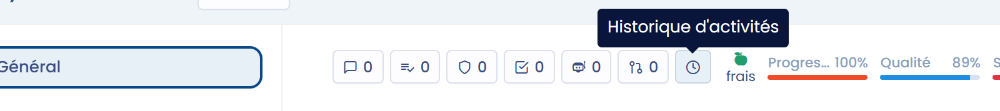
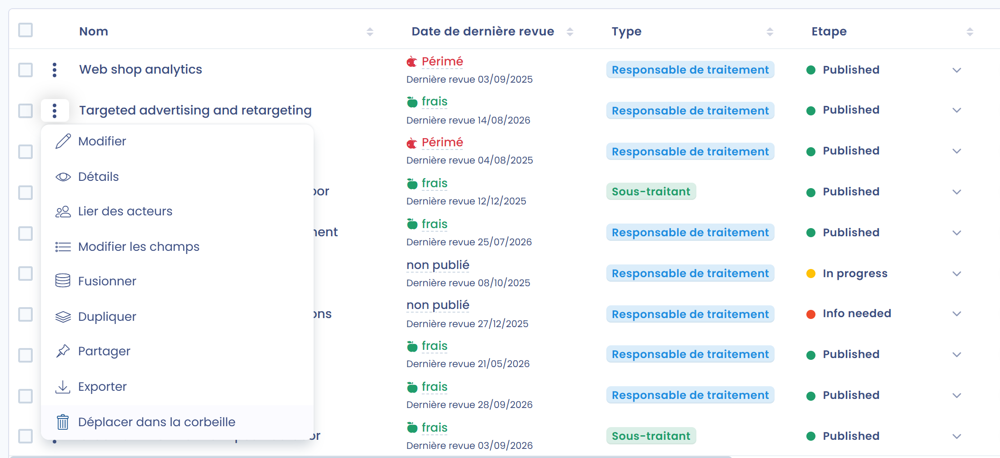
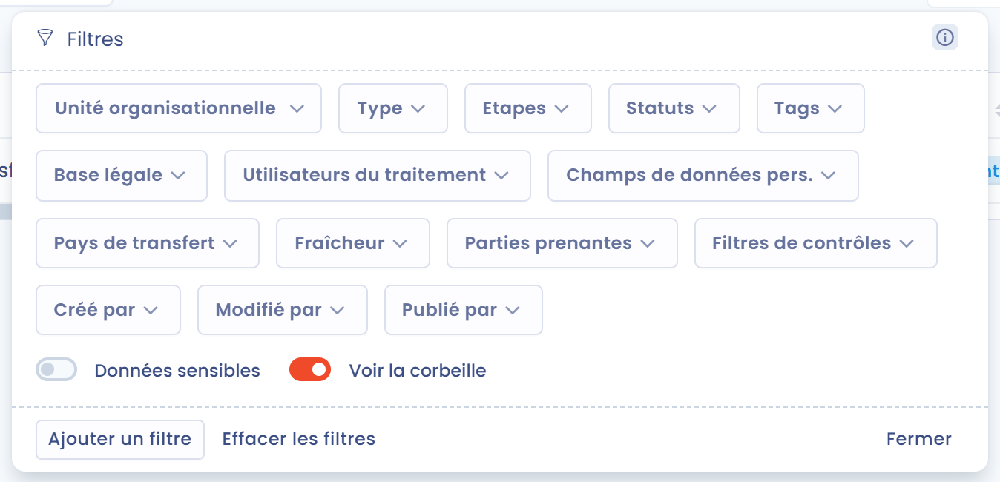
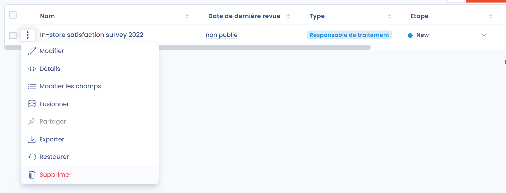
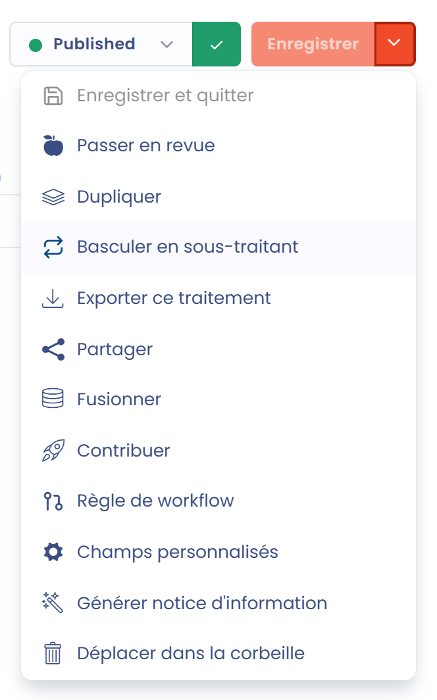
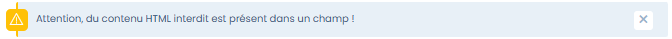
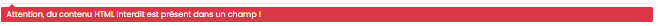

# FAQ

## Comment afficher l'historique des modifications d'un traitement ?

Pour tous les traitements, vous pouvez afficher l'historique des modifications ainsi que le détail des changements.&#x20;

Cliquez sur l'icône en forme d'horloge (**Historique d'activités**) en haut de la page du traitement.

<figure><figcaption>
Bouton d'accès à l'historique
</figcaption></figure>

Cliquez sur **Détails des changements** sur une entrée pour comparer les versions. Depuis cet écran, un bouton **Restaurer** vous permet de revenir à cette version, si votre rôle l'autorise.

Attention, les modifications d'unités organisationnelles ne sont pas tracées.

## Est-il possible d'ajouter automatiquement des éléments dans le champ "parties prenantes" d'un nouveau traitement ?

Non, les parties prenantes ne peuvent pas être mises à jour automatiquement par un workflow automatisé.&#x20;

Vous pouvez en revanche créer un champ personnalisé au niveau des parties prenantes, qui peut être modifié par le workflow automatisé.

## Comment supprimer un traitement ?

Pour supprimer un traitement, vous devez d'abord le placer dans la corbeille avec **Déplacer dans la corbeille**. Ensuite, en affichant la corbeille depuis les filtres, vous pouvez supprimer définitivement le traitement. Ce passage par la corbeille protège contre les suppressions hâtives.&#x20;

Pour placer un traitement dans la corbeille, ouvrez le menu en bout de ligne et choisissez **Déplacer dans la corbeille**.

<figure><figcaption>
Placer un traitement dans la corbeille
</figcaption></figure>

Affichez ensuite la corbeille : cliquez sur **Filtres** et cochez **Voir la corbeille**.

<figure><figcaption>
Affichage de la corbeille
</figcaption></figure>

Enfin, ouvrez le menu en bout de ligne et choisissez **Supprimer**. Vous pouvez aussi choisir **Restaurer** pour remettre le traitement dans le registre.

<figure><figcaption>
Suppression définitive d'un traitement
</figcaption></figure>

## Comment permettre à des utilisateurs d'utiliser les jeux de données sans pouvoir les modifier ?

Vos relais DPO peuvent avoir besoin d'utiliser dans leurs traitements les jeux de données que vous mettez à leur disposition, sans en créer de nouveaux ni modifier les champs de données qu'ils contiennent. Les liens avec les autres traitements restent ainsi cohérents.

Dans ce cas, créez un rôle personnalisé. Rendez-vous dans les rôles : [https://app.dastra.eu/general-settings/roles](https://app.dastra.eu/general-settings/roles) (voir [Rôles et permissions](../settings/roles.md)).

Créez ensuite un rôle personnalisé avec les permissions suivantes :

* **Registre et traitements de données** : Lecture, Ecriture
* **Cartographie des données et référentiels** : Lecture

Attribuez ensuite ce rôle aux utilisateurs concernés. Ils pourront utiliser les jeux de données dans leurs traitements, mais pas modifier les éléments de la cartographie des données.

## Comment ajouter des parties prenantes ou des destinataires sur plusieurs traitements ?

Vous pouvez ajouter des parties prenantes ou des destinataires sur plusieurs traitements à la fois avec les actions groupées.

Dans la vue **Tableau**, sélectionnez les traitements avec les cases à cocher. Le bouton **Choisir une action groupée** apparaît.

Choisissez **Lier des acteurs**, sélectionnez **Ajouter**, choisissez les acteurs, puis leur **Type** (par exemple partie prenante ou destinataire) et leur catégorie, et validez. Si votre sélection mélange des traitements en tant que responsable de traitement et en tant que sous-traitant, seul le type partie prenante est disponible.

La même fenêtre, avec **Supprimer** sélectionné, retire des parties prenantes des traitements sélectionnés.

## Comment obtenir la liste des actifs par unité organisationnelle ?

Vous pouvez obtenir la liste des actifs par unité organisationnelle grâce aux liens entre les actifs et les traitements.

Utilisez l'export Excel des traitements. Filtrez le registre par unité organisationnelle, sélectionnez les traitements et exportez-les. Dans la fenêtre d'export, activez **Exporter des colonnes spécifiques** et conservez uniquement la colonne des actifs pour obtenir les actifs de cette unité organisationnelle. Vous pouvez aussi conserver uniquement les colonnes unité organisationnelle et actifs pour obtenir les actifs de toutes les unités organisationnelles en une seule fois.

La [cartographie des données du registre](visualization/data-map.md) présente aussi cette information sous forme graphique.

## Comment dupliquer un registre dans un autre espace de travail ?

Vous pouvez dupliquer un registre et ses traitements de plusieurs façons :

* soit en [exportant puis en réimportant](export-import.md) les traitements au format JSON,
* soit en allant dans l'espace de travail cible et en créant les traitements avec **Créer à partir de modèles** : dans **Source de données de la bibliothèque**, sélectionnez l'espace de travail qui contient le registre d'origine.

## Comment changer le type d'un traitement (passer d'un traitement créé en tant que responsable de traitement à un traitement créé en tant que sous-traitant, et inversement) ?

Ouvrez le traitement, cliquez sur la flèche à droite de **Enregistrer**, puis cliquez sur **Basculer en sous-traitant** ou **Basculer en responsable de traitement** :

<figure><figcaption>
Changement du type d'un traitement
</figcaption></figure>

Quand vous repassez un traitement de sous-traitant en responsable de traitement, les clients qui lui sont liés sont retirés. Une confirmation vous est demandée au préalable.

## Message d'erreur : "Le champ Label est requis."&#x20;

Ce message apparaît généralement quand un champ a été laissé vide lors de la réponse à un questionnaire.

## Message d'erreur : "Attention, du contenu HTML interdit est présent dans un champ !"

<figure><figcaption>
Attention, du contenu HTML interdit est présent dans un champ !
</figcaption></figure>

\
Ce message signifie que du code HTML (généralement placé entre chevrons `< >`) est présent dans un champ où le HTML n'est pas autorisé (pour des raisons de sécurité). 

\
Le message suivant permet d'identifier le champ concerné :

<figure><figcaption>
Attention, du contenu HTML interdit est présent dans un champ !
</figcaption></figure>

## Message d'erreur : "L'identifiant de l'utilisateur n'existe pas dans votre organisation." à l'enregistrement d'un traitement

Ce message signifie qu'un utilisateur retiré de votre espace de travail est toujours défini comme **Approbateur** dans les parties prenantes du traitement.

Retirez l'utilisateur supprimé des parties prenantes du traitement pour résoudre le problème.


Si vous ne trouvez pas la réponse dans ce guide, vous pouvez [contacter notre support](../../getting-started/support/request.md).

