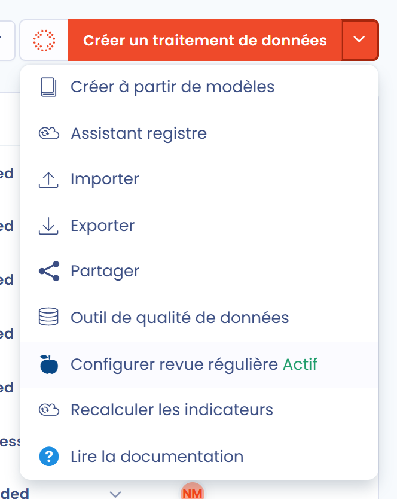
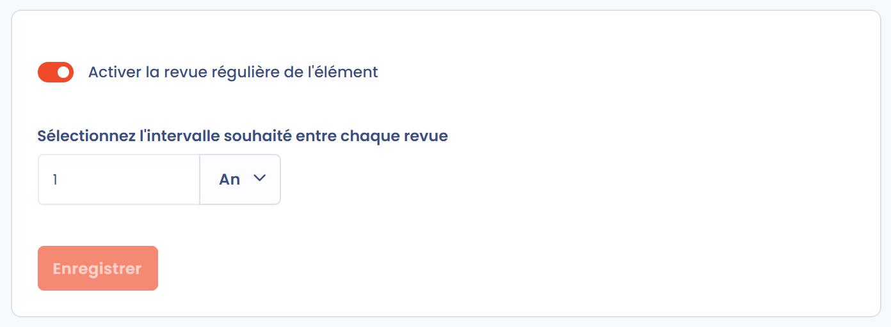
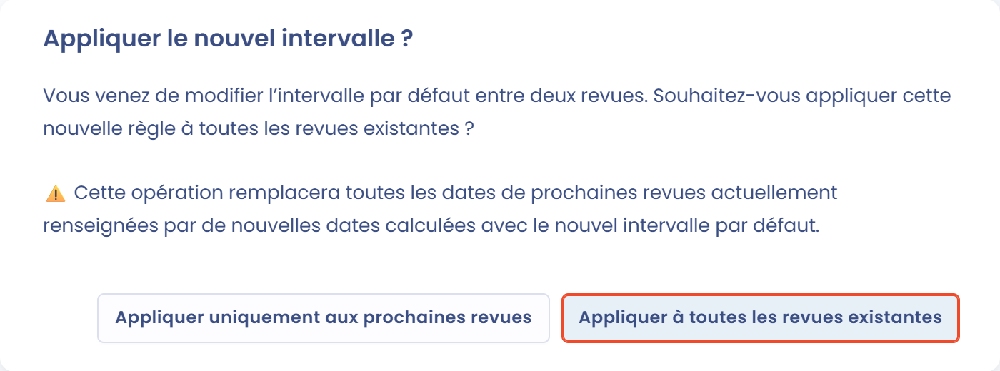
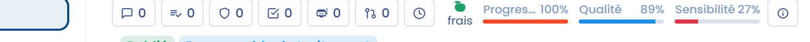
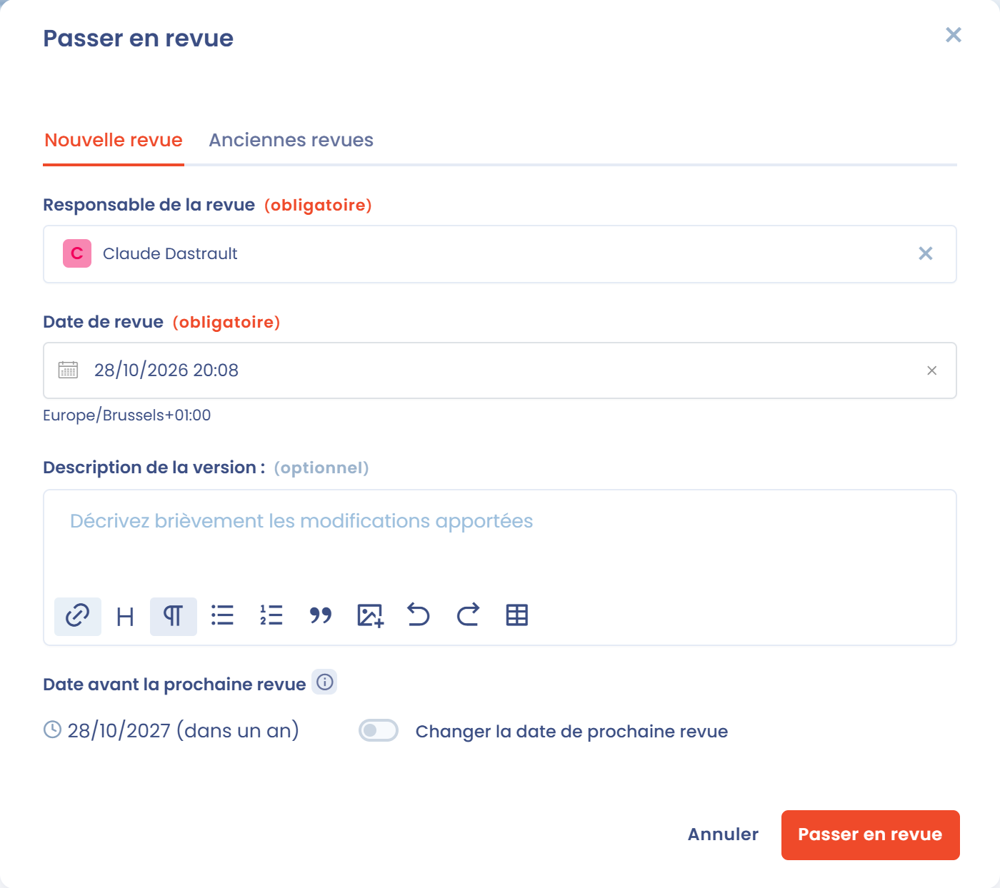

# Fraîcheur des traitements

La fraîcheur d'un traitement indique à quand remonte sa dernière revue. Une fois les revues régulières activées, chaque revue fixe une date de prochaine revue, et la fraîcheur diminue à l'approche de cette date. C'est un moyen simple de vous assurer que les informations de votre registre des traitements sont revues régulièrement et restent à jour.


Les revues régulières sont aussi disponibles pour d'autres éléments, comme les acteurs, les actifs, les contrats ou les systèmes d'IA. Le mécanisme commun est décrit dans [Revue régulière (fraîcheur)](../regular-review.md). Cette page détaille son fonctionnement pour les traitements.


## Activer l'option de fraîcheur des traitements

La fraîcheur des traitements est facultative et désactivée par défaut. Elle se configure pour tout l'espace de travail, dans les réglages de l'espace de travail, sous **Revues régulières**.

Pour ouvrir ce réglage depuis votre registre, cliquez sur la flèche à côté du bouton **Créer un traitement de données**, puis sur **Configurer revue régulière**. L'entrée du menu indique aussi l'état actuel de l'option, **Actif** ou **Désactivé**.

<figure><figcaption>
L'entrée Configurer revue régulière du menu Créer un traitement de données
</figcaption></figure>

Dans les réglages **Revues régulières** :

1. Sélectionnez **Traitement de données** dans le sélecteur de type d'élément.
2. Activez **Activer la revue régulière de l'élément**.
3. Dans **Sélectionnez l'intervalle souhaité entre chaque revue**, saisissez l'intervalle entre deux revues, en années, en mois ou en jours.
4. Cliquez sur **Enregistrer**.

Seuls les utilisateurs qui disposent de la permission **Configuration avancée** peuvent modifier ce réglage.

<figure><figcaption>
Les réglages Revues régulières pour les traitements
</figcaption></figure>

L'intervalle s'applique à tous les traitements de l'espace de travail. La date de prochaine revue d'un traitement correspond à la date de sa dernière revue plus cet intervalle, sauf si une date spécifique a été choisie lors de la revue (voir [Passer en revue un traitement](#passer-en-revue-un-traitement)).

Lorsque vous enregistrez un nouvel intervalle, Dastra vous demande s'il doit s'appliquer aux revues déjà enregistrées :

* **Appliquer à toutes les revues existantes** : les dates de revue déjà planifiées sont recalculées avec le nouvel intervalle, qui les remplace ;
* **Appliquer uniquement aux prochaines revues** : les dates de revue déjà planifiées sont conservées, et le nouvel intervalle s'applique à partir de la prochaine revue.

<figure><figcaption>
Choisissez si le nouvel intervalle s'applique aux revues existantes
</figcaption></figure>


**Exemple :** vous fixez un intervalle de 1 an. Un traitement revu le 15 janvier 2026 a une date de prochaine revue au 15 janvier 2027. Il s'affiche **Frais** pendant la plus grande partie de l'année, **Bientôt périmé** pendant les derniers 10 % de l'intervalle (un peu plus d'un mois), puis **Périmé** une fois sa date de prochaine revue dépassée, jusqu'à ce qu'il soit de nouveau revu.


## Désactiver l'option de fraîcheur des traitements

Pour désactiver l'option, retournez dans les réglages **Revues régulières**, sélectionnez **Traitement de données**, désactivez **Activer la revue régulière de l'élément** et cliquez sur **Enregistrer**.

Les indicateurs de fraîcheur ne s'affichent alors plus. Chaque traitement conserve son historique de revues et sa date de dernière revue, qui sont réutilisés si vous réactivez l'option plus tard.

## Indicateurs de fraîcheur

La fraîcheur ne s'affiche que pour les traitements **publiés** qui ont été **revus au moins une fois**. Un traitement peut se trouver dans l'un des états suivants :

| État                    | Signification                                                                                      |
| ----------------------- | -------------------------------------------------------------------------------------------------- |
| Frais (vert)            | Le traitement a été revu récemment et ne demande pas d'attention immédiate.                        |
| Bientôt périmé (orange) | Les derniers 10 % de l'intervalle entre deux revues ont commencé. La revue est à planifier.        |
| Périmé (rouge)          | La date de prochaine revue est dépassée. Le traitement n'est plus conforme à la politique de revue. |
| Revue en attente        | Le traitement est publié mais n'a jamais été revu.                                                 |

Un traitement encore à l'état de brouillon s'affiche comme **non publié** dans la liste, et **En attente de revue** sur sa fiche.

### Sur la fiche du traitement

Sur un écran large, l'indicateur de fraîcheur se trouve en haut du panneau de droite de la fiche du traitement. Il affiche la barre **Fraîcheur**, qui diminue à l'approche de la date de prochaine revue, l'état et sa couleur, un lien **Passer en revue** et le nombre de jours restants ou de retard.

Sur un écran plus petit, le panneau de droite est masqué. L'état (par exemple **Frais**) s'affiche dans l'en-tête de la fiche, à côté des indicateurs **Progression**, **Qualité** et **Sensibilité**. Cliquez dessus pour ouvrir la fenêtre **Passer en revue**.

<figure><figcaption>
Sur un écran plus petit, l'indicateur de fraîcheur s'affiche dans l'en-tête de la fiche
</figcaption></figure>

### Dans la liste de votre registre

La colonne **Date de dernière revue** affiche l'état de fraîcheur de chaque traitement et la date de sa dernière revue. Survolez l'état pour voir le nombre de jours restants ou de retard. Cette colonne est ajoutée à votre vue de liste lorsque vous activez l'option. Vous pouvez aussi l'ajouter aux colonnes affichées à tout moment.

Vous pouvez également afficher la colonne **Date de revue prévisionnelle**, qui indique la date de prochaine revue enregistrée pour chaque traitement, et filtrer votre registre avec le filtre **Fraîcheur** (disponible sous **Filtres**), avec les valeurs **Frais**, **En attente** (publié mais jamais revu) ou **Périmé**.

## Passer en revue un traitement

Vous pouvez passer en revue un traitement à tout moment, sans attendre sa date de prochaine revue. La revue nécessite un accès en écriture au registre des traitements. Ouvrez la fenêtre **Passer en revue** :

* depuis la fiche du traitement : cliquez sur l'indicateur de fraîcheur, sur le lien **Passer en revue** du panneau de droite, ou sur **Passer en revue** dans le menu à côté du bouton **Enregistrer** ;
* depuis la liste : cliquez sur la cellule de la colonne **Date de dernière revue**.

Pour passer en revue plusieurs traitements à la fois, sélectionnez-les dans la liste, puis choisissez **Passer en revue** dans **Choisir une action groupée**.

<figure><figcaption>
La fenêtre Passer en revue
</figcaption></figure>

Dans l'onglet **Nouvelle revue**, renseignez :

* **Responsable de la revue** (obligatoire) : l'utilisateur qui a réalisé la revue, vous-même par défaut ;
* **Date de revue** (obligatoire) : la date du jour par défaut ;
* **Description de la version** (facultatif) : une courte description de ce qui a été vérifié ou modifié ;
* **Date avant la prochaine revue** : calculée à partir de la date de revue et de l'intervalle défini pour l'espace de travail. Pour appliquer une date spécifique à ce traitement, activez **Changer la date de prochaine revue** et sélectionnez une nouvelle date (au plus tôt le lendemain).

Cliquez sur **Passer en revue** pour enregistrer. Un nouveau cycle de fraîcheur démarre à la date de revue et court jusqu'à la date de prochaine revue.

Lorsque la fenêtre est ouverte pour un seul traitement, l'onglet **Anciennes revues** liste ses revues passées. Cet onglet propose aussi le bouton **Supprimer toutes les revues**, qui efface l'historique des revues. Après confirmation, les dates de dernière et de prochaine revue sont effacées et l'indicateur de fraîcheur ne s'affiche plus. Cette action est irréversible.

## Informations importantes sur le fonctionnement de la fraîcheur

L'enregistrement d'un traitement ne vaut pas revue. La date de dernière revue est indépendante de la date de dernière mise à jour de la fiche. Pour (re)lancer le cycle de fraîcheur d'un traitement, vous devez le passer en revue.

Le passage d'un traitement à la dernière étape de son workflow peut aussi enregistrer une revue. La fenêtre de changement d'étape affiche alors un interrupteur **Passer en revue**, activé par défaut.
