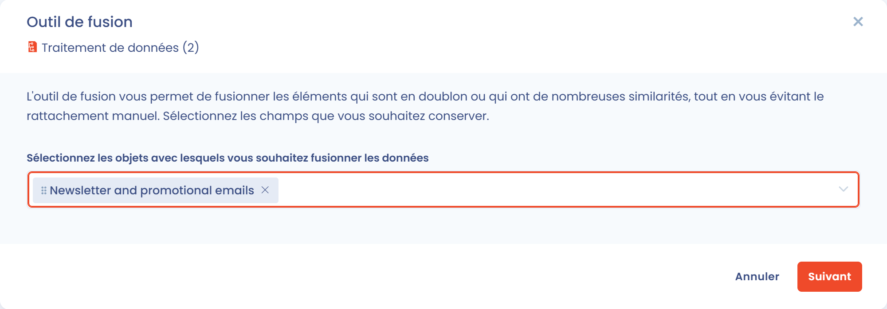
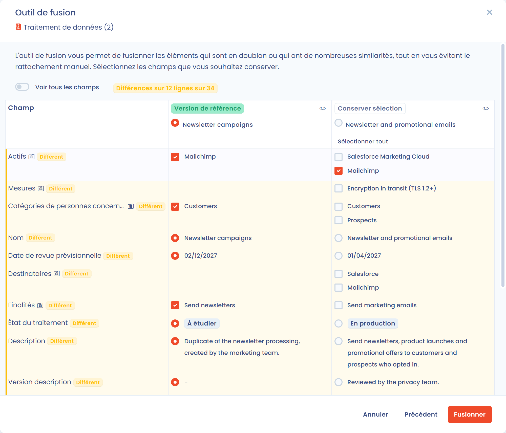

# Fusion des traitements

## Introduction

La fusion des traitements vous permet de **regrouper plusieurs traitements en un seul**, en conservant les informations que vous choisissez et les éléments qui leur sont liés. Elle est particulièrement utile pour **rationaliser votre registre des traitements**, supprimer les doublons et garder une documentation cohérente.

Un des traitements est conservé comme **version de référence**. Vous choisissez, champ par champ, les valeurs à reprendre des autres traitements, puis ces autres traitements sont supprimés.

La fusion nécessite un accès en écriture au registre des traitements. Quand la gestion des tâches, la gestion des risques ou les questionnaires sont activés dans votre espace de travail, vous avez aussi besoin d'un accès en écriture à ces modules, pour que les éléments liés puissent être rattachés à la version de référence.

## Lancer une fusion

Vous pouvez lancer une fusion depuis trois endroits :

* **Depuis la liste, pour plusieurs traitements** : sélectionnez les traitements à fusionner (moins de 30), cliquez sur **Choisir une action groupée**, puis sur **Fusionner**. La comparaison s'ouvre directement.
* **Depuis la liste, pour un traitement** : ouvrez le menu d'actions en bout de ligne et cliquez sur **Fusionner**.
* **Depuis la fiche d'un traitement** : cliquez sur la flèche à côté du bouton **Enregistrer**, puis sur **Fusionner**.

<figure><figcaption>
L'entrée Fusionner du menu d'actions d'un traitement
</figcaption></figure>

Quand vous partez d'un seul traitement, la fenêtre **Outil de fusion** vous demande d'abord de choisir les traitements avec lesquels le fusionner. Sélectionnez-les dans **Sélectionnez les objets avec lesquels vous souhaitez fusionner les données**, puis cliquez sur **Suivant**.

<figure><figcaption>
Sélection des traitements avec lesquels fusionner
</figcaption></figure>

## Choisir les valeurs à conserver

La fenêtre **Outil de fusion** compare les traitements côte à côte, avec une colonne par traitement.

1. Cochez, dans l'en-tête de sa colonne, le traitement à conserver. Il devient la **Version de référence** et garde son identifiant et son historique. Les autres colonnes affichent le badge **Conserver sélection** : ces traitements sont supprimés une fois la fusion confirmée, et seuls les champs que vous y sélectionnez sont reportés sur la version de référence.
2. Pour chaque champ à valeur unique, sélectionnez la colonne dont vous voulez conserver la valeur.
3. Pour chaque champ qui contient une liste (finalités, jeux de données, destinataires, mesures de sécurité, etc.), cochez les éléments à conserver, quel que soit le traitement d'origine. Ils sont regroupés dans la version de référence.
4. Cliquez sur **Fusionner**.

<figure><figcaption>
La fenêtre Outil de fusion
</figcaption></figure>

Pour faciliter la comparaison :

* chaque champ dont la valeur diffère d'un traitement à l'autre est marqué **Différent**, et un compteur indique le nombre de lignes concernées ;
* le tableau affiche uniquement les lignes qui diffèrent. Activez **Voir tous les champs** pour afficher tous les champs comparables. Les champs identiques masqués conservent la valeur de la version de référence ;
* le bouton **Sélectionner tout**, sous l'en-tête d'une colonne, retient les valeurs de cette colonne sur toutes les lignes qui diffèrent. **Annuler la sélection** revient en arrière. Une valeur vide ne remplace jamais une valeur renseignée.

La section **Objets liés conservés** indique combien d'analyses de risques, de tâches et de réponses aux questionnaires sont liées aux traitements fusionnés. Ces éléments sont rattachés automatiquement à la version de référence, si bien qu'aucun élément lié aux traitements supprimés n'est perdu.

Une fois la fusion effectuée, un message la confirme avec un lien **Afficher l'élément** qui ouvre la version de référence.


Les traitements autres que la version de référence sont supprimés à la confirmation de la fusion, et cette opération est irréversible. Vérifiez vos choix avant de cliquer sur **Fusionner**, et exportez les traitements au préalable si vous souhaitez garder une copie de leur contenu.


## Détecter automatiquement les doublons

Pour repérer les traitements qui sont probablement des doublons, cliquez sur la flèche à côté du bouton **Créer un traitement de données**, puis sur **Outil de qualité de données**. Les doublons détectés sont listés avec un score de confiance, et vous pouvez les fusionner depuis cet écran.


[merge.md](../general/merge.md)


## Cas d'usage courants

| Cas                                  | Exemple                                                                      | Bénéfice                                           |
| ------------------------------------ | ---------------------------------------------------------------------------- | -------------------------------------------------- |
| **Rationalisation**                  | Deux traitements "Gestion RH" et "Gestion du personnel"                      | Éviter les doublons et simplifier la maintenance   |
| **Réorganisation**                   | Traitements similaires créés dans plusieurs unités organisationnelles        | Garder un seul traitement, à jour                  |
| **Harmonisation entre entités**      | Traitements équivalents documentés séparément par plusieurs filiales         | Faciliter la gouvernance et le reporting global    |
| **Nettoyage du registre**            | Doublons créés lors d'un import initial                                      | Améliorer la clarté et la fiabilité du registre    |

## Bonnes pratiques

1. **Vérifiez la compatibilité** : fusionnez uniquement des traitements dont les finalités sont identiques ou très proches.
2. **Gardez une analyse juridique cohérente** : évitez de fusionner des traitements qui reposent sur des bases légales différentes.
3. **Documentez votre décision** : expliquez les raisons de la fusion dans une discussion interne sur la version de référence.


La fusion des traitements vous aide à garder un registre propre et à jour tout en réduisant la charge administrative. Vous gardez la main sur chaque valeur reportée.

