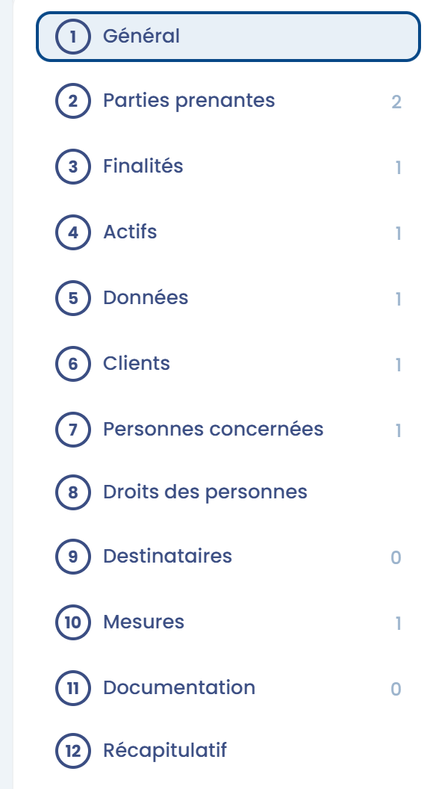
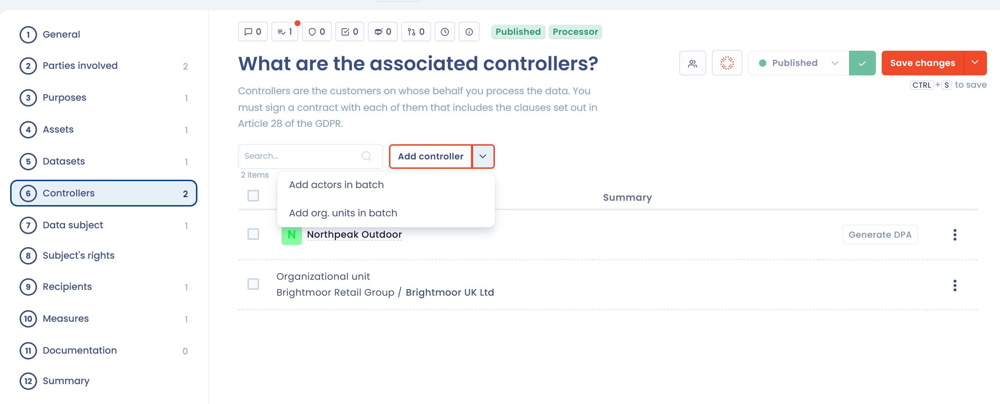

# Registre "Sous-traitant"

## Introduction

L'article 30 du RGPD prévoit des obligations spécifiques pour le _registre du responsable de traitement_ de données personnelles et pour le _registre du sous-traitant_. Si votre organisme agit à la fois en tant que sous-traitant et en tant que responsable de traitement, votre registre doit donc clairement distinguer les deux catégories d'activités.

**En pratique, dans cette hypothèse, la CNIL vous recommande de tenir 2 registres :**

1. un pour les traitements de données personnelles dont vous êtes vous-même responsable,
2. un autre pour les traitements que vous opérez, en tant que sous-traitant, pour le compte de vos clients.

La suite de cette page traite uniquement du registre "Sous-traitant".

## Le registre "Sous-traitant"

Chaque sous-traitant doit tenir un registre moins étendu.&#x20;

Ce registre contient :&#x20;

* les **coordonnées du sous-traitant**, de son représentant le cas échéant et de son DPO&#x20;
* les **coordonnées de tous les responsables de traitement pour le compte desquels le sous-traitant agit** (en général, les clients)&#x20;
* les **catégories de données** traitées&#x20;
* les **destinataires**&#x20;
* les **transferts** hors EEE&#x20;
* les **mesures de sécurité**

Dans Dastra, un traitement créé en tant que sous-traitant est documenté en 12 sections : **Général**, **Parties prenantes**, **Finalités**, **Actifs**, **Données**, **Clients**, **Personnes concernées**, **Droits des personnes**, **Destinataires**, **Mesures**, **Documentation** et **Récapitulatif**.

Par rapport à un traitement en tant que responsable de traitement, la section **Clients** vous permet de déclarer les responsables de traitement pour le compte desquels vous agissez (en général, vos clients), et il n'y a pas de section **Analyse d'impact**.

<figure><figcaption>
Les différentes sections d'un traitement "sous-traitant" dans Dastra
</figcaption></figure>

## La section Clients

La section **Clients** liste les responsables de traitement pour le compte desquels vous traitez les données, en général vos clients. Vous devez signer un contrat avec chacun d'eux, qui comprend les clauses prévues à l'article 28 du RGPD.

<figure><figcaption>
La section Clients d'un traitement en tant que sous-traitant
</figcaption></figure>

Pour déclarer un client :

1. Cliquez sur **Ajouter client/RT**.
2. Choisissez **Répertoire des acteurs (recommandé)** pour sélectionner une partie prenante de votre référentiel, ou **Sélectionner une unité organisationnelle**.
3. Si vous le souhaitez, décrivez vos opérations dans **Décrire les opérations effectuées sur les données**.
4. Si le client est aussi destinataire des données, activez **Le client/responsable du traitement est-il destinataire des données ?**. Sous **A quelles données a-t-il accès ?**, choisissez **Accès à toutes les données (par défaut)** ou **Accès à certains jeux de données** et cochez les jeux de données concernés.
5. Validez.

Pour ajouter plusieurs clients à la fois, cliquez sur la flèche à droite de **Ajouter client/RT**, puis choisissez **Ajouter acteurs en masse** pour sélectionner plusieurs parties prenantes, ou **Ajouter unités org. en masse** pour sélectionner plusieurs unités organisationnelles.

Le menu en bout de ligne vous permet de **Modifier** le client, **Modifier l'acteur** ou de le **Supprimer**. Lorsque votre espace de travail utilise le module Contrats, **Générer DPA** crée l'accord de sous-traitance du client. Pour supprimer plusieurs clients, cochez-les puis cliquez sur **Supprimer**.

Pour transmettre à un client uniquement ses propres données, utilisez l'option **Exporter pour un client** de la fenêtre d'export : le fichier exclut alors les autres clients (voir [Exporter / importer le registre](export-import.md)).

***


Vous pouvez changer le type d'un traitement (passer d'un traitement créé en tant que responsable de traitement à un traitement créé en tant que sous-traitant, et inversement).\
[La procédure est disponible ici](faq.md#comment-changer-le-type-dun-traitement-passer-dun-traitement-cree-en-tant-que-responsable-de-traitem)

Quand vous repassez un traitement de sous-traitant en responsable de traitement, les clients qui lui sont liés sont retirés.


## Pour aller plus loin


[le-registre-responsable-de-traitement.md](controller.md)

