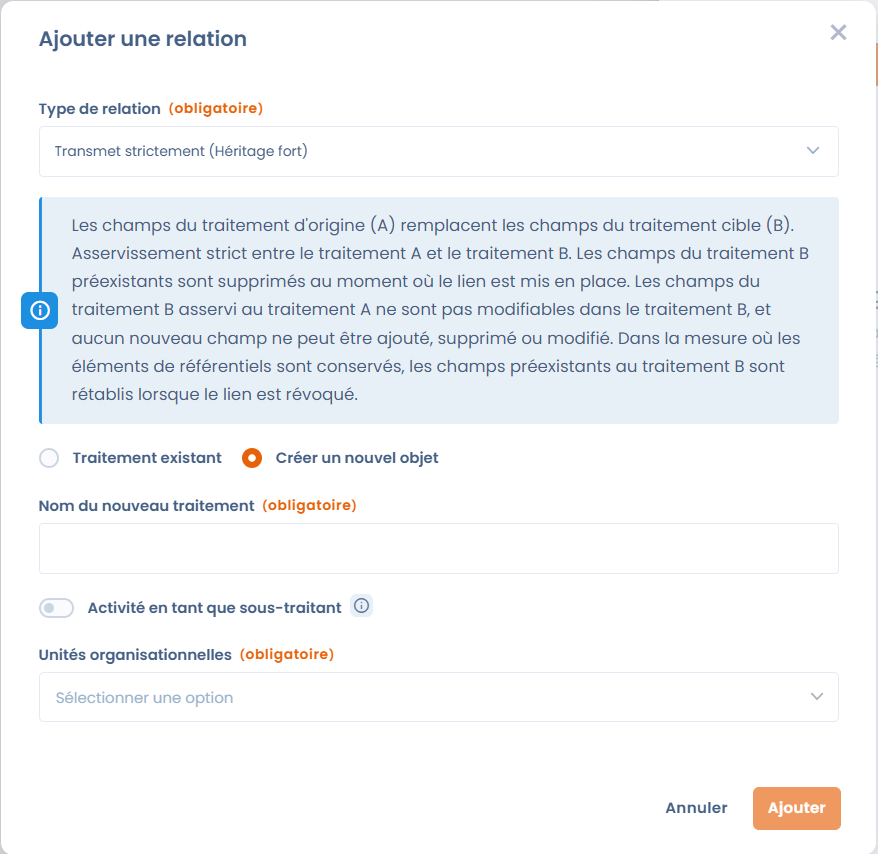

# Créer des relations entre les traitements

Dans Dastra, vous pouvez créer des relations entre vos traitements pour faciliter leur gestion.

Ces relations sont possibles entre des traitements situés dans un même espace de travail.

## Pourquoi créer des relations entre les traitements ?

Les relations entre les traitements peuvent servir à matérialiser les relations de responsabilité entre les différentes entités responsables de traitement.

Par exemple, dans un groupe de sociétés, vous pouvez relier un traitement réalisé par la société mère aux traitements réalisés par ses filiales. C'est souvent le cas des traitements relatifs à l'administration générale du groupe, comme la gestion des ressources humaines, la comptabilité ou la gestion des fournisseurs.

> Une société mère X gère la paie pour le compte de ses filiales Y et Z. Dans l'entité X, un traitement « Gestion de la paie » (ST1) est créé en tant que sous-traitant. Depuis ST1, vous créez une relation **Transmet strictement (Héritage fort)** avec deux traitements (RT1 et RT2), situés dans Y et Z et créés en tant que responsable de traitement.
>
> Toute mise à jour de ST1 est alors automatiquement répercutée dans RT1 et RT2.

## Ajouter une relation

Sur la fiche d'un traitement, cliquez sur le bouton **Relations inter-traitements** dans la barre d'outils en haut de la fiche. Le bouton indique le nombre de relations existantes.

<figure><figcaption>
Le panneau Relations inter-traitements d'un traitement
</figcaption></figure>

Le panneau **Relations inter-traitements** liste les relations existantes, regroupées par type, avec l'unité organisationnelle de chaque traitement lié et la date de création de la relation. Cliquez sur un traitement pour l'ouvrir dans un nouvel onglet, ou cliquez sur l'icône de corbeille pour supprimer la relation.

Pour créer une relation, cliquez sur **Ajouter une relation**, puis :

1. Sélectionnez le **Type de relation**. Une description du type sélectionné s'affiche en dessous.
2. Choisissez **Traitement existant** pour relier des traitements qui existent déjà, ou **Nouveau traitement** pour créer le traitement lié en même temps.
3. Pour un traitement existant, sélectionnez son **Unité organisationnelle**, puis le traitement dans **Sélectionner le(s) objet(s) attaché(s)**.
4. Pour un nouveau traitement, saisissez le **Nom du nouveau traitement**, activez **Activité en tant que sous-traitant** si nécessaire, et sélectionnez son unité organisationnelle.
5. Cliquez sur **Ajouter**.

<figure><figcaption>
La fenêtre Ajouter une relation
</figcaption></figure>

Vous pouvez créer des relations avec plusieurs traitements en une seule fois :

* avec **Transmet strictement (Héritage fort)** ou **Transmet (Héritage faible)**, vous pouvez sélectionner plusieurs traitements existants ;
* avec **Est le parent de**, **Est relatif à**, **Transmet strictement (Héritage fort)** ou **Transmet (Héritage faible)**, l'option **Nouveau traitement** permet de sélectionner plusieurs unités organisationnelles. Un nouveau traitement est créé dans chacune d'elles.

Vous pouvez sélectionner jusqu'à 50 traitements ou unités organisationnelles à la fois.


Les relations ne peuvent être créées qu'avec des traitements situés dans le même espace de travail.


## Types de relations

Il existe deux types de relations :

1. **Relations déclaratives** : elles établissent un lien simple entre deux traitements, sans dépendance fonctionnelle.
2. **Relations fonctionnelles** : elles transmettent ou font hériter des champs d'un traitement à un autre.

### Relations déclaratives

#### Est l'enfant de

Relation hiérarchique qui permet une lecture structurée des traitements, **sans dépendance fonctionnelle** entre les champs.

> Le traitement A est hiérarchiquement rattaché au traitement B.

#### Est le parent de

Relation hiérarchique qui permet une lecture structurée des traitements, **sans dépendance fonctionnelle** entre les champs.

> Le traitement A est hiérarchiquement au-dessus du traitement B.

#### Est relatif à

Lien logique simple entre deux traitements, **sans aucune dépendance** entre leurs champs.

> Le traitement A est lié au traitement B.

#### Est copié par

Cette relation garde la trace des copies réalisées à partir de ce traitement. Elle est créée automatiquement lorsque vous utilisez **Dupliquer** sur un traitement.

> Le traitement A est la source (de la copie) du traitement B.

#### Est une copie de

Cette relation garde la trace du traitement à partir duquel une copie a été réalisée. Elle est créée automatiquement lorsque vous utilisez **Dupliquer** sur un traitement.

> Le traitement A est une copie du traitement B.


**Est copié par** et **Est une copie de** sont uniquement créées automatiquement. Elles ne peuvent pas être sélectionnées dans la fenêtre **Ajouter une relation**.


### Relations fonctionnelles

Les relations fonctionnelles transmettent des champs d'un traitement à un autre, ou font hériter un traitement des champs d'un autre.

#### Transmet strictement (Héritage fort)

Le traitement source **A** transmet ses champs au traitement dépendant **B**.


À l'exception des champs de l'onglet 1 **« Général »** et des documents ajoutés au traitement dans l'onglet 11 **« Documentation »**.


Cela crée une relation stricte entre **A (source)** et **B (dépendant)** :

* les champs préexistants de **B** sont supprimés à la création de la relation ;
* les champs hérités de **A** ne peuvent être ni modifiés ni supprimés dans **B**, et aucun nouveau champ ne peut être ajouté dans **B** ;
* toute modification faite dans **A** est automatiquement répercutée dans **B**.

Si la relation est supprimée, les champs hérités redeviennent modifiables et les champs d'origine de **B** sont restaurés (les éléments de vos référentiels sont conservés).

#### Hérite strictement de (Héritage fort)

Le traitement **A** dépend du traitement **B** et hérite de ses champs.


À l'exception des champs de l'onglet 1 **« Général »** et des documents ajoutés au traitement dans l'onglet 11 **« Documentation »**.


Cela crée une relation stricte entre **B (source)** et **A (dépendant)** :

* les champs préexistants de **A** sont supprimés à la création de la relation ;
* les champs hérités de **B** ne peuvent être ni modifiés ni supprimés dans **A**, et aucun nouveau champ ne peut être ajouté dans **A** ;
* toute modification faite dans **B** est automatiquement répercutée dans **A**.

Si la relation est supprimée, les champs hérités redeviennent modifiables et les champs d'origine de **A** sont restaurés (les éléments de vos référentiels sont conservés).

Un traitement qui dépend d'un autre en héritage fort affiche un bandeau **Héritage du traitement de données** avec un lien vers sa source, et ses onglets hérités sont verrouillés.


Un traitement ne peut dépendre que d'**un seul traitement source à la fois**.


#### Transmet (Héritage faible)

Le traitement source **A** transmet automatiquement ses champs au traitement dépendant **B**.


À l'exception des champs de l'onglet 1 **« Général »** et des documents ajoutés au traitement dans l'onglet 11 **« Documentation »**.


Cela crée une relation d'héritage faible entre **A (source)** et **B (dépendant)** :

* les champs hérités de **A** ne peuvent pas être modifiés dans **B** ;
* **B** peut ajouter, modifier ou supprimer ses propres champs ;
* toute modification faite dans **A** est automatiquement répercutée dans **B**.

Si la relation est supprimée, les champs hérités redeviennent modifiables et les champs préexistants de **B** sont conservés.

#### Hérite de (Héritage faible)

Le traitement **A** dépend du traitement **B** et hérite automatiquement de ses champs.


À l'exception des champs de l'onglet 1 **« Général »** et des documents ajoutés au traitement dans l'onglet 11 **« Documentation »**.


Cela crée une relation d'héritage faible entre **B (source)** et **A (dépendant)** :

* les champs hérités de **B** ne peuvent pas être modifiés dans **A** ;
* **A** peut ajouter, modifier ou supprimer ses propres champs ;
* toute modification faite dans **B** est automatiquement répercutée dans **A**.

Si la relation est supprimée, les champs hérités redeviennent modifiables et les champs préexistants de **A** sont conservés.


Un traitement ne peut dépendre que d'**un seul traitement source à la fois**.


## Tableau de synthèse des relations

| Type de relation                                                                                                   | Onglet 1 « Général » | Onglets 2 à 10 (champs métier) | Documents ajoutés dans l'onglet 11 « Documentation » | Champs propres au traitement dépendant         |
| ------------------------------------------------------------------------------------------------------------------ | -------------------- | ------------------------------ | ---------------------------------------------------- | ---------------------------------------------- |
| **Relations déclaratives** (Est l'enfant de / Est le parent de / Est relatif à / Est copié par / Est une copie de) | Sans impact          | Sans impact                    | Sans impact                                          | Sans impact                                    |
| **Transmet strictement (Héritage fort)**                                                                           | Non transmis         | Transmis                       | Non transmis                                         | Ajout, modification et suppression impossibles |
| **Hérite strictement de (Héritage fort)**                                                                          | Non hérité           | Hérité                         | Non hérités                                          | Ajout, modification et suppression impossibles |
| **Transmet (Héritage faible)**                                                                                     | Non transmis         | Transmis                       | Non transmis                                         | Ajout, modification et suppression possibles   |
| **Hérite de (Héritage faible)**                                                                                    | Non hérité           | Hérité                         | Non hérités                                          | Ajout, modification et suppression possibles   |
