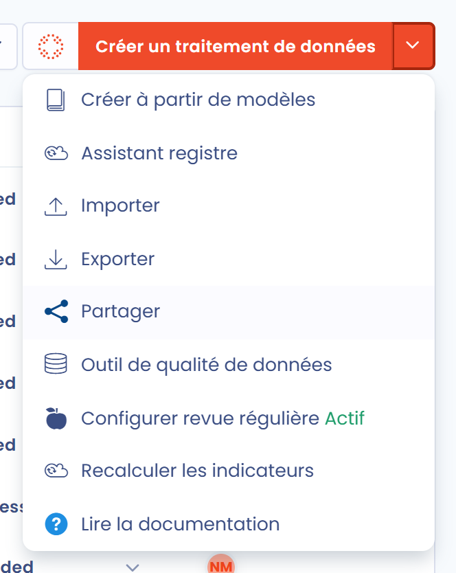
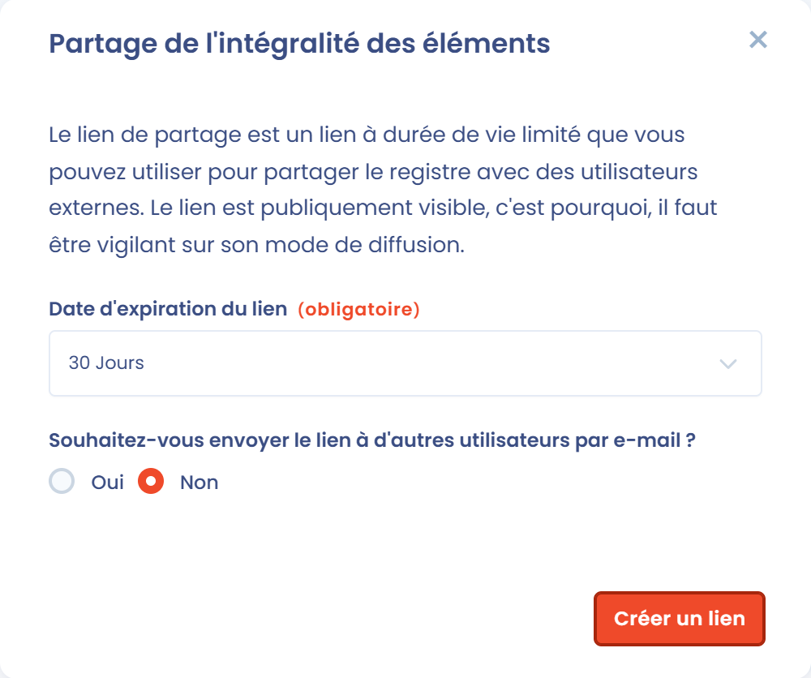
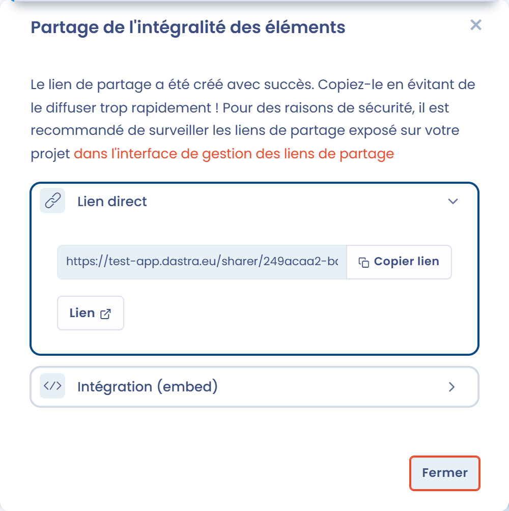
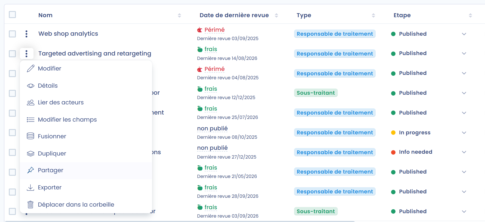
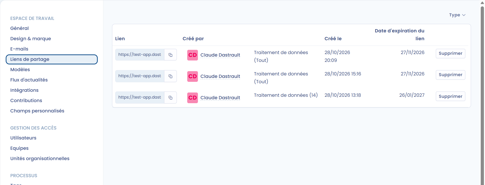

# Partager le registre



Un lien de partage donne à des utilisateurs externes un accès en lecture à votre registre des traitements, ou à certains de ses traitements, sans compte Dastra. Le partage nécessite la permission **Configuration avancée**.


Le lien de partage est publiquement visible. Toute personne qui en dispose peut l'ouvrir jusqu'à son expiration. Soyez vigilant sur son mode de diffusion et, pour des raisons de sécurité, surveillez les liens de partage exposés dans votre espace de travail.


## Partage de l'intégralité du registre

Depuis le module **Registre des traitements**, cliquez sur la flèche à côté du bouton **Créer un traitement de données**, puis sur **Partager**.

<figure><figcaption>
L'entrée Partager du menu Créer un traitement de données
</figcaption></figure>

La fenêtre **Partage de l'intégralité des éléments** s'ouvre :

1. Sélectionnez la **Date d'expiration du lien**.
2. Dans **Souhaitez-vous envoyer le lien à d'autres utilisateurs par e-mail ?**, choisissez **Oui** pour envoyer le lien par e-mail, puis saisissez les **Emails des destinataires** et, si vous le souhaitez, un **Message personnalisé**.
3. Cliquez sur **Créer un lien**.

Le partage ne comprend que les traitements au statut « Publié ». Les traitements en brouillon ne sont pas partagés avec cette fonction. Pour partager un traitement en brouillon, partagez-le individuellement (voir ci-dessous).

<figure><figcaption>
La fenêtre Partage de l'intégralité des éléments
</figcaption></figure>

Les durées de vie disponibles pour les liens sont les suivantes :

* 2 jours
* 30 jours (par défaut)
* 120 jours
* Illimité

Une fois créé, le lien est copié dans votre presse-papiers. La fenêtre propose alors deux rubriques :

* **Lien direct** : copiez le lien avec **Copier lien**, ou ouvrez-le avec **Lien** ;
* **Intégration (embed)** : réglez la **Largeur** et la **Hauteur**, puis copiez le code pour intégrer le registre partagé dans un autre site, comme votre intranet.

Cliquez sur **Fermer** pour fermer la fenêtre.

<figure><figcaption>
Le lien de partage une fois créé
</figcaption></figure>

## Génération d'un lien de partage pour un traitement de données

Pour partager un seul traitement, ouvrez le menu d'actions au bout de sa ligne dans la liste, puis cliquez sur **Partager**. La fenêtre **Génération d'un lien de partage pour 1 élément** s'ouvre. Procédez ensuite comme décrit ci-dessus.

<figure><figcaption>
L'entrée Partager du menu d'actions d'un traitement
</figcaption></figure>

Vous pouvez aussi partager un traitement depuis sa fiche : cliquez sur la flèche à côté du bouton **Enregistrer**, puis sur **Partager**.

Pour partager plusieurs traitements, sélectionnez-les dans la liste, cliquez sur **Choisir une action groupée**, puis sur **Partager**.

Les traitements partagés de cette façon peuvent l'être quel que soit leur statut (publié ou brouillon). Les traitements placés dans la corbeille ne peuvent pas être partagés.

## Gérer les liens de partage

Tous les liens de partage créés dans votre espace de travail sont centralisés dans les réglages de l'espace de travail, sous **Liens de partage**.

Pour chaque lien, la liste affiche le lien lui-même (que vous pouvez copier), l'utilisateur qui l'a créé, le type des éléments partagés et leur nombre (**Tout** pour un registre entier), la date de création, la date d'expiration et les e-mails des destinataires. Vous pouvez filtrer la liste par **Type** et cliquer sur **Supprimer** pour retirer un lien qui ne doit plus être utilisé.

<figure><figcaption>
Les réglages Liens de partage
</figcaption></figure>
