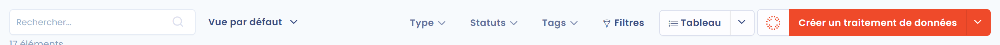
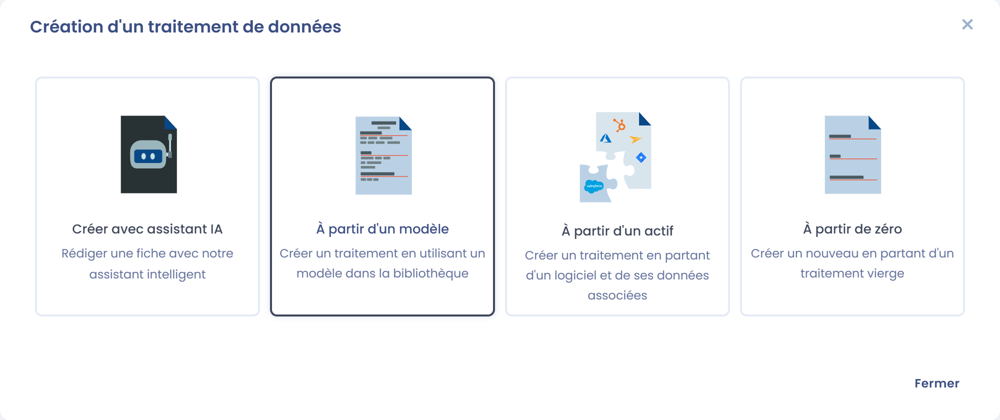
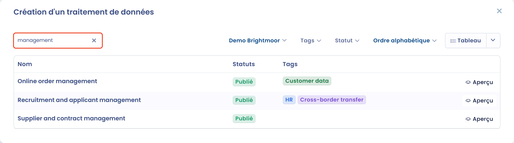
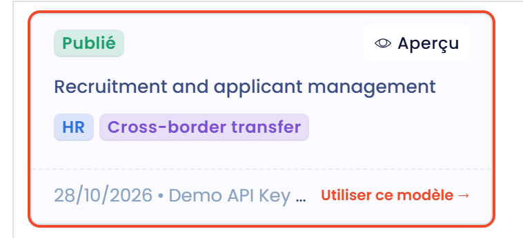
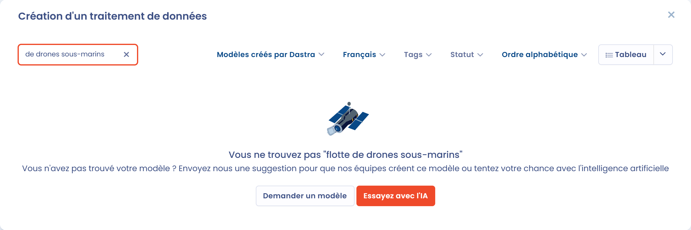
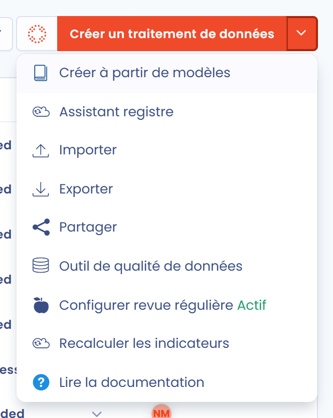

# Utiliser un modèle de traitement

Dastra vous permet de constituer votre registre des traitements à partir de modèles conçus par nos experts.

Les modèles de traitement vous font gagner du temps dans la saisie des traitements courants.

## Créer un traitement à partir d'un modèle

Cliquez sur **Créer un traitement de données**

<figure><figcaption>
Le bouton Créer un traitement de données
</figcaption></figure>

et sélectionnez **À partir d'un modèle**.

<figure><figcaption>
L'option À partir d'un modèle
</figcaption></figure>

Vous pouvez ensuite rechercher des modèles de traitement avec la barre de recherche.

<figure><figcaption>
Recherche dans la bibliothèque de modèles
</figcaption></figure>

Plusieurs filtres vous aident à trouver le bon modèle :

* **Source de données de la bibliothèque** vous permet de choisir la bibliothèque à parcourir : les **Modèles créés par Dastra**, ou la bibliothèque de votre partenaire si votre organisation en a une.
* Le sélecteur de **langue** affiche les modèles de la bibliothèque Dastra dans d'autres langues.
* Les **Tags** vous permettent de filtrer les modèles par secteur d'activité.
* **Statut** et **Trier par** (**Le plus récent**, **Plus populaires**, **Ordre alphabétique**) affinent et ordonnent les résultats.

Vous pouvez afficher les résultats sous forme de liste ou de cartes.

Pour **consulter le contenu d'un modèle** avant de l'utiliser, cliquez sur son bouton **Aperçu**.

<figure><figcaption>
Aperçu d'un modèle avant de l'utiliser
</figcaption></figure>

Cliquez sur le modèle que vous voulez utiliser, vérifiez le **Nom du traitement de données**, choisissez l'**Unité organisationnelle**, puis cliquez sur **Créer un traitement de données**. Vous arrivez sur le nouveau traitement, que vous pouvez adapter à votre organisation.

## Suggérer un modèle de traitement

Si votre recherche ne renvoie aucun modèle de la bibliothèque Dastra, vous pouvez cliquer sur **Demander un modèle** pour le suggérer à notre équipe. Saisissez le **Nom du modèle souhaité**, ajoutez si besoin des **Informations complémentaires**, puis cliquez sur **Envoyer**. Vous pouvez aussi cliquer sur **Essayez avec l'IA** pour générer le traitement avec notre Assistant IA.

<figure><figcaption>
Suggestion d'un nouveau modèle
</figcaption></figure>

## Créer plusieurs traitements à partir de modèles en une seule fois

Vous pouvez sélectionner plusieurs modèles de traitement et les importer en une seule fois depuis la bibliothèque.

Ouvrez le menu du bouton **Créer un traitement de données** (la flèche à sa droite), puis choisissez **Créer à partir de modèles**.

<figure><figcaption>
L'entrée Créer à partir de modèles
</figcaption></figure>

Dans le panneau qui s'ouvre, renseignez **Source de données de la bibliothèque** et **Choisissez l'unité organisationnelle de destination**, puis cochez un ou plusieurs modèles et cliquez sur **Ajouter**.

<figure><figcaption>
Sélection de plusieurs modèles dans la bibliothèque
</figcaption></figure>

Le bouton **Détails** vous permet de prévisualiser un modèle.&#x20;

Vos traitements sont ensuite créés en arrière-plan.
