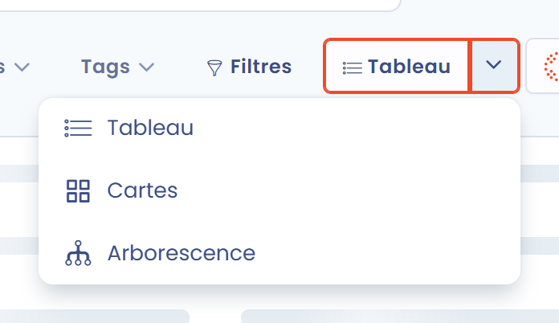

# Visualisation des données

## Introduction

Dans Dastra, les **données** de votre registre des traitements peuvent être **visualisées** de plusieurs manières :

* sous forme de tableau, de cartes ou d'**arborescence** organisée par entités et départements,
* sous forme de **cartographie** des données du registre,
* sous forme de carte des **transferts** de données.

## Modifier la vue du registre

Pour modifier la manière dont les traitements s'affichent dans votre registre, allez dans le module **Registre des traitements** : dans le menu de gauche, cliquez sur **Traitements de données**, puis sur **Registre des traitements**. Par défaut, les traitements s'affichent dans la vue **Tableau**. Dans la barre d'outils, cliquez sur la **flèche à droite** du bouton **Tableau** et choisissez une autre vue.

<figure><figcaption>
Les vues disponibles pour le registre
</figcaption></figure>

Trois vues sont disponibles :

* **Tableau** : la vue standard du registre des traitements, sous forme de tableau dont vous pouvez ajuster les colonnes, le tri et les filtres ;
* **Cartes** : une carte par traitement, avec ses principales informations et ses indicateurs ;
* **Arborescence** : les traitements organisés par entités et départements.


[visualiser-larborescence-des-traitements.md](tree.md)


## Visualiser la cartographie de votre registre et les transferts

La cartographie des données du registre et la carte des transferts sont disponibles depuis le menu de gauche, sous **Traitements de données** : cliquez sur **Cartographie** ou sur **Transferts**. L'entrée **Transferts** s'affiche lorsque la carte des transferts est activée pour votre espace de travail.


[visualiser-la-cartographie-des-donnees.md](data-map.md)



[visualiser-la-carte-des-transferts.md](transfers-map.md)


## Aller plus loin


[la-gestion-des-risques](../../risks/README.md)

