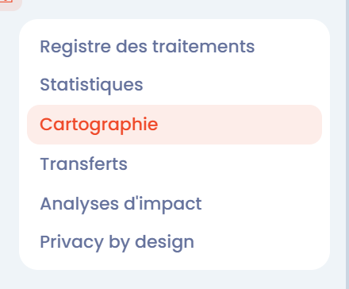
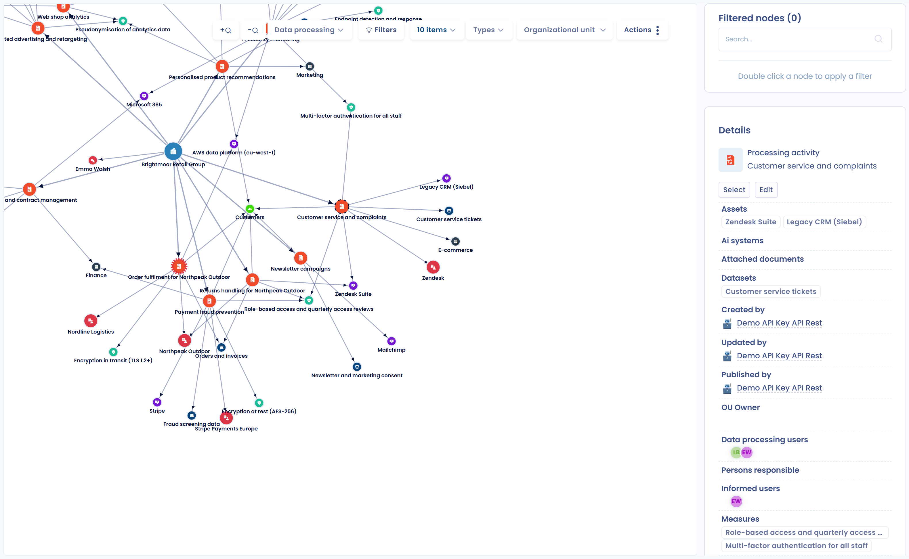

# Visualiser la cartographie des données du registre



## Introduction

Dans Dastra, les données peuvent être visualisées de plusieurs manières. L'une d'elles est la **cartographie des données** du registre des traitements.

Cette vue permet d'explorer, d'analyser et de comprendre les liens entre les éléments de votre registre : traitements, unités organisationnelles, acteurs, actifs, jeux de données, mesures de sécurité, transferts, etc.

## Visualiser la cartographie des données du registre

Pour visualiser la cartographie de votre registre, dans le menu de gauche, cliquez sur **Traitements de données**, puis sur **Cartographie**.

<figure><figcaption>
L'entrée Cartographie du menu Traitements de données
</figcaption></figure>

Vous pouvez alors **visualiser la cartographie des données de votre registre**.

<figure><figcaption>
Exemple de cartographie
</figcaption></figure>

La barre d'outils au-dessus de la cartographie permet :

* de zoomer et dézoomer ;
* de limiter la cartographie à certains traitements, à une unité organisationnelle ou à l'aide de filtres ;
* de choisir les **Types** d'éléments à afficher ;
* dans le menu **Actions**, de réinitialiser le zoom, de passer en plein écran, d'imprimer la cartographie et d'activer le **Fond sombre**, la **Légende des noeuds** ou la **Légende des liens**.

Cliquez sur un élément de la cartographie pour afficher ses **Détails du noeud** dans le panneau de droite, avec un bouton **Modifier** pour l'ouvrir.


Une fois la cartographie affichée, **double-cliquez** sur un élément pour l'ajouter aux **Noeuds filtrés** et centrer la cartographie sur lui. La barre de recherche du panneau **Noeuds filtrés** permet aussi de trouver un élément et de l'ajouter comme filtre. Cliquez sur **Effacer les filtres** pour afficher de nouveau toute la cartographie.


## Aller plus loin


[visualiser-la-carte-des-transferts.md](transfers-map.md)

