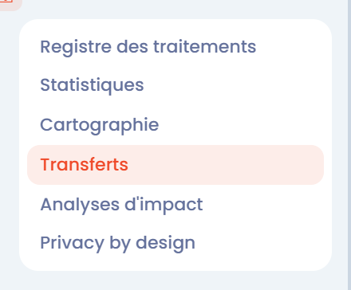
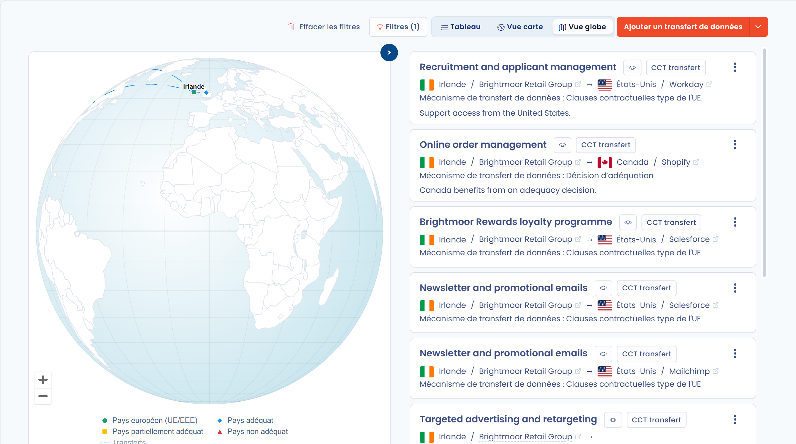

# Visualiser la carte des transferts



## Introduction

Dans Dastra, les données peuvent être visualisées de plusieurs manières. L'une d'elles est la **carte des transferts** de données.

Cette vue permet d'explorer, d'analyser et de comprendre les transferts géographiques des données de votre registre.

## Visualiser la carte des transferts

Pour visualiser la carte des transferts, dans le menu de gauche, cliquez sur **Traitements de données**, puis sur **Transferts**.

<figure><figcaption>
L'entrée Transferts du menu Traitements de données
</figcaption></figure>

Vous pouvez alors **visualiser la carte des transferts**. Trois vues sont disponibles depuis les boutons de la barre d'outils :

* **Vue globe** (par défaut) : les transferts sur un globe ;
* **Vue carte** : les transferts sur une carte du monde à plat ;
* **Tableau** : les transferts sous forme de tableau.

Dans les vues cartographiques, la liste des transferts s'affiche à côté de la carte. Utilisez le bouton fléché au bord de la carte pour la masquer ou l'afficher. Les filtres de la barre d'outils permettent de restreindre les transferts affichés. Activez ou désactivez **Afficher les ST ultérieurs** (activé par défaut) pour inclure ou exclure les transferts des sous-traitants ultérieurs. Le menu à côté du bouton **Ajouter un transfert de données** permet d'imprimer la carte ou d'exporter les transferts.

<figure><figcaption>
Exemple de transferts de données
</figcaption></figure>

Sur la carte, les pays sont colorés selon leur statut : **Pays européen (UE/EEE)**, **Pays adéquat**, **Pays partiellement adéquat** et **Pays non adéquat**.


Cliquez sur le point correspondant à un pays pour accéder au détail de ses transferts.


La fenêtre **Détails des transferts entrants/sortants de ce pays** indique le statut du pays (pays européen, pays adéquat, pays partiellement adéquat ou pays non adéquat) et liste ses transferts en **Entrée** et en **Sortie**.

## Aller plus loin


[la-gestion-des-risques](../../risks/README.md)

