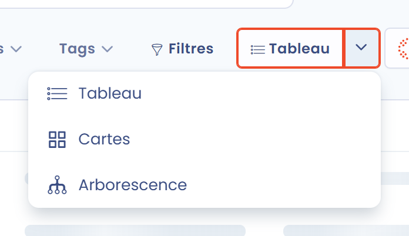
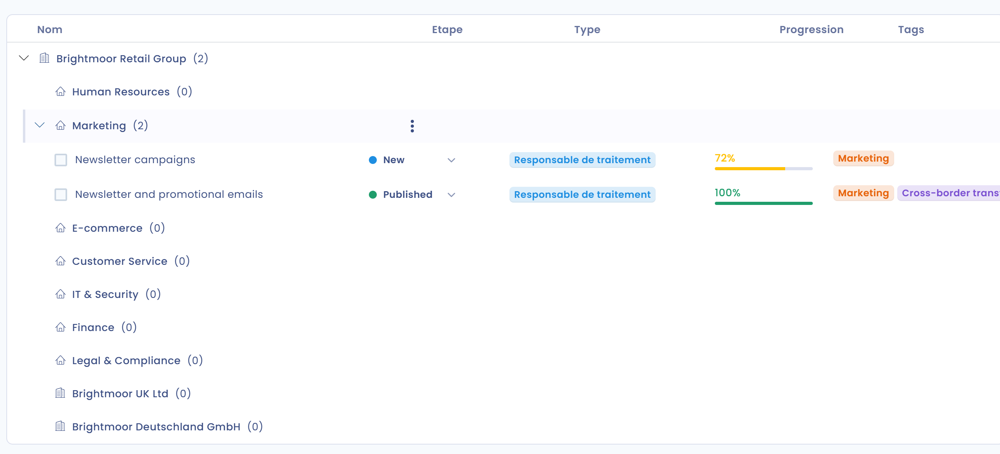

# Visualiser l'arborescence des traitements

## Introduction

Dans Dastra, les données peuvent être visualisées de plusieurs manières. L'une d'elles est l'**arborescence des traitements**, organisée par entités et départements.

Cette vue montre en particulier à quelles entités et à quels départements vos traitements sont rattachés.

## Visualiser l'arborescence des traitements

Pour visualiser l'arborescence des traitements, allez dans le module **Registre des traitements**, cliquez sur la flèche à droite du bouton **Tableau**, puis sélectionnez **Arborescence**.

<figure><figcaption>
Flèche à droite du bouton Tableau et menu déroulant
</figcaption></figure>

Vous pouvez alors **visualiser l'arborescence** de vos traitements.

<figure><figcaption>
L'arborescence des traitements dans Dastra
</figcaption></figure>

Chaque entité et chaque département s'affiche avec le nombre de traitements qui lui sont rattachés. Lorsqu'elles sont renseignées, son adresse et son représentant sont accessibles depuis l'icône d'aide à côté de son nom. Cliquez sur la flèche en début de ligne pour déplier une unité organisationnelle et afficher ses sous-unités et ses traitements, avec leur **Etape**, leur **Type**, leur **Progression** et leurs **Tags**.

Cliquez sur un traitement pour afficher ses détails. Son menu d'actions, affiché au survol de la ligne, permet de le modifier, le dupliquer, l'exporter, le partager ou le placer dans la corbeille.


Les filtres au-dessus de l'arborescence permettent d'adapter la vue à vos besoins. Les utilisateurs qui gèrent les unités organisationnelles peuvent aussi modifier une unité ou ajouter une unité enfant depuis son menu d'actions, et utiliser **Créer un département** dans le menu à côté du bouton **Créer un traitement de données**.


## Aller plus loin


[creer-et-parametrer-des-entites-et-departements.md](../../../getting-started/setup/organizational-units.md)

