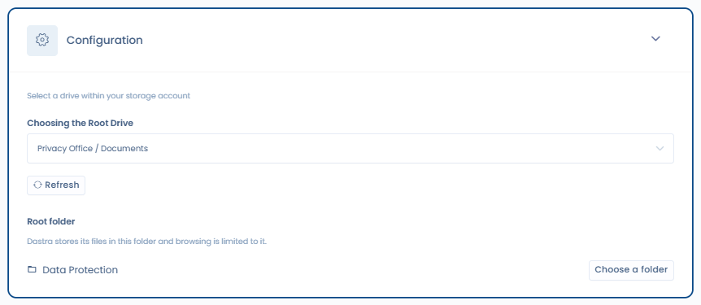

# Intégrations OneDrive & SharePoint / Google Drive

## Intérêt d'un stockage cloud personnalisé

Par défaut, la [GED de Dastra](../files/README.md) repose sur Azure Blob Storage : fichiers chiffrés, analysés par antivirus, et redondés sur un second serveur. Pour en savoir plus, consultez [la documentation sécurité](../../security/general.md).

Dans certaines organisations, ce stockage fait doublon avec un système de fichiers cloud déjà en place (SharePoint, OneDrive, Google Drive). Dastra s'intègre nativement avec ces fournisseurs afin d'éviter cette duplication :

* **Microsoft OneDrive & SharePoint** : un OneDrive ou une **bibliothèque de documents SharePoint** de votre environnement Microsoft 365 ;
* **Google Drive**.

<figure><figcaption>
Les fichiers peuvent être stockés dans Dastra, OneDrive &#x26; SharePoint ou Google Drive
</figcaption></figure>

## Type de connexion : OAuth utilisateur


Cette intégration repose sur une **authentification OAuth avec les credentials d'un compte utilisateur**. Ce n'est pas une connexion applicative via l'API Microsoft Graph ou l'API Google.

Cela signifie concrètement :

* La connexion est établie **au nom de l'utilisateur** qui configure l'intégration
* L'accès aux fichiers dépend des **permissions de ce compte**
* Si ce compte est désactivé ou ses tokens révoqués, l'intégration cesse de fonctionner jusqu'à reconnexion
* Il est recommandé d'utiliser un **compte de service dédié** (non personnel) pour configurer cette intégration


## Configurer l'intégration

Ouvrez **Réglages espace de travail** > **Intégrations**, puis cliquez sur **Microsoft OneDrive & SharePoint** ou **Google Drive**.

Cliquez sur **Ajouter l'intégration**. Vous êtes redirigé vers la page de connexion du fournisseur, qui vous demandera d'autoriser l'accès à votre stockage.

### Choisir le lecteur (OneDrive & SharePoint uniquement)

Après authentification, Dastra liste les lecteurs auxquels le compte connecté a accès. Choisissez celui que Dastra utilisera dans **Choisir le Drive racine** :

| Option | Description | Recommandation |
| --- | --- | --- |
| **<Site> / <Bibliothèque>** (ex. `Root site / Documents`) | Une bibliothèque de documents d'un site SharePoint de votre organisation | Recommandé en entreprise : espace partagé, non lié à un compte personnel |
| **Your personal drive** | OneDrive personnel du compte connecté | À éviter en production : donne accès à l'ensemble du drive personnel |

Cliquez sur **Rafraîchir** si un site ou une bibliothèque que vous venez de créer n'apparaît pas encore.


Si vous optez pour le drive personnel, il est fortement recommandé d'utiliser un compte de service dédié ne contenant pas de fichiers personnels. Vous pouvez aussi créer un [site SharePoint dédié](https://learn.microsoft.com/fr-fr/sharepoint/create-site-collection) pour isoler les fichiers Dastra.


### Choisir un dossier racine (OneDrive & SharePoint uniquement)

Par défaut, Dastra utilise la **racine du lecteur**. Vous pouvez le limiter à un dossier du lecteur :

1. Sous **Dossier racine**, cliquez sur **Choisir un dossier**.
2. Parcourez le lecteur et cliquez sur **Sélectionner** sur le dossier à utiliser. **Utiliser la racine du lecteur** revient au comportement par défaut.
3. Enregistrez la configuration.

Dastra stocke alors ses fichiers dans ce dossier, et la navigation depuis Dastra y est limitée : les utilisateurs ne peuvent pas remonter au-dessus. C'est la façon la plus simple de partager un seul dossier d'une bibliothèque SharePoint avec Dastra, sans exposer le reste de la bibliothèque.

<figure><figcaption>
Choix du lecteur et du dossier racine
</figcaption></figure>


Le dossier racine limite ce que Dastra affiche et l'endroit où il écrit. Il ne modifie pas les droits du compte connecté dans Microsoft 365 : ce compte garde l'accès à tout ce qu'il pouvait déjà ouvrir. Pour restreindre aussi l'accès côté Microsoft, connectez l'intégration avec un compte de service qui n'a accès qu'à la bibliothèque ou au dossier choisi.


Si le dossier racine est supprimé ou déplacé dans SharePoint ou OneDrive, Dastra affiche une erreur qui invite à choisir un autre dossier dans les réglages de l'intégration.

## Attacher des fichiers cloud à une entité Dastra

Depuis n'importe quelle entité (traitement, tâche, acteur…), vous pouvez attacher des fichiers stockés dans votre cloud :

1. Ouvrez le panneau de fichiers de l'entité
2. Sélectionnez la **source de données** en haut à gauche du panneau

3. Naviguez dans votre lecteur via le gestionnaire de fichiers
4. Cliquez sur **Sélectionner dans le gestionnaire** pour attacher le fichier

Vous pouvez également envoyer de nouveaux fichiers directement depuis Dastra vers votre lecteur.

Un stockage dont le cas d'usage est désactivé dans les réglages de l'intégration n'est plus proposé comme source de données.

## Limitations

### OneDrive & SharePoint

* La connexion repose sur OAuth utilisateur, pas sur Microsoft Graph API. Si le compte ayant configuré l'intégration est désactivé, la connexion est interrompue.
* Dastra ne travaille que dans le lecteur choisi, et dans son dossier racine lorsqu'il est défini.
* Pour les environnements entreprise, préférez une bibliothèque de documents SharePoint plutôt que le drive personnel.

### Google Drive

* Seuls les fichiers **créés depuis Dastra** peuvent être ajoutés ou modifiés dans Google Drive. Dastra n'a pas les droits d'accès aux fichiers existants créés directement dans Drive : c'est une limitation du connecteur OAuth.
* Les fichiers créés dans Dastra peuvent être partagés sans restriction avec d'autres collaborateurs.
