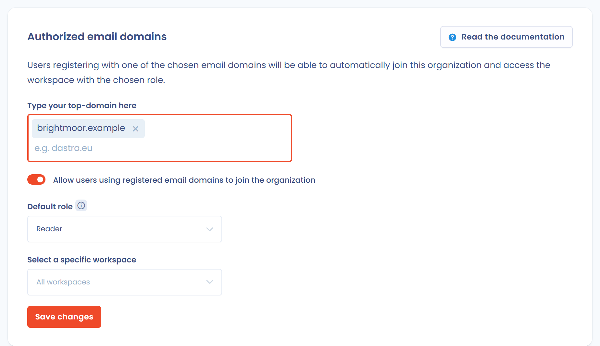

# Domaines emails

Cette page explique comment permettre aux futurs collaborateurs de rejoindre votre organisation sans votre intervention. Elle s'adresse aux propriétaires de l'organisation.

## Rôle des domaines e-mail

Les domaines e-mail permettent d'affecter directement vos futurs collaborateurs à un espace de travail, avec le rôle que vous avez choisi, sans action de votre part.

## Configurer les domaines e-mail

Le bloc **Domaines email autorisés** se trouve en haut de la page **Single sign on** : ouvrez **Paramètres de l'organisation** > **Single sign on**.

<figure><figcaption>
Le bloc Domaines email autorisés, en haut de la page Single sign on
</figcaption></figure>

1. Dans **Saisissez vos domaines e-mails (top-level uniquement)**, saisissez chaque domaine (par exemple `dastra.eu`), puis appuyez sur Entrée ou cliquez sur **Ajouter**.
2. Activez **Permettre aux utilisateurs utilisant des domaines mails enregistrés de rejoindre l'organisation**.
3. Dans **Rôle par défaut**, choisissez le rôle attribué aux futurs utilisateurs. Le rôle **Invité (aucun accès aux données)** est proposé par défaut.
4. Dans **Sélection d'un espace de travail spécifique**, choisissez l'espace de travail concerné, ou laissez **Tous les espaces de travail**.
5. Cliquez sur **Enregistrer**.

Le rôle et l'espace de travail ne sont modifiables que lorsque l'option de l'étape 2 est activée.


Vous ne pouvez ajouter que des domaines préalablement autorisés, c'est-à-dire des domaines pour lesquels un utilisateur de votre organisation a déjà validé une adresse e-mail.

Les domaines de messagerie personnelle (gmail, hotmail, etc.) et les domaines identifiés comme jetables sont refusés.


## Impact pour les futurs utilisateurs

Un collaborateur qui s'inscrit sur Dastra doit toujours saisir son adresse e-mail et la valider. Dastra lui propose ensuite de rejoindre votre organisation.

Il clique sur **Rejoindre** et peut commencer à travailler avec vous.
