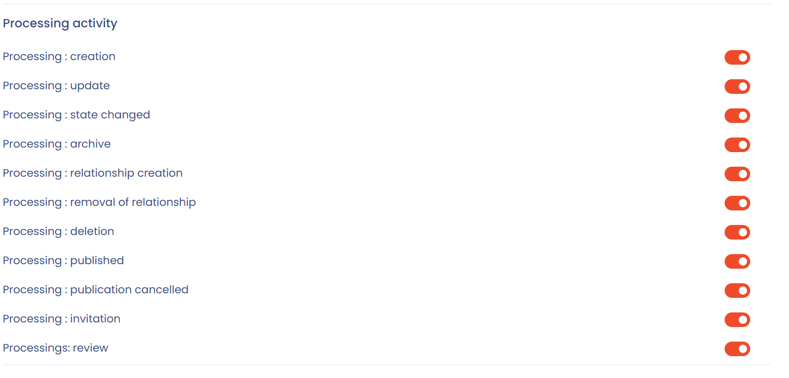

# Notifications

## Vue d'ensemble

Dans Dastra, les notifications vous tiennent informé des activités importantes liées à vos traitements, questionnaires, tâches ou demandes d'exercice de droits.

Il existe **deux types de notifications** :

1. **Le centre de notifications**, intégré directement dans l'application.
2. **Les notifications par e-mail**, que chaque utilisateur personnalise selon ses préférences.

## Centre de notifications dans l'application

Le centre de notifications regroupe les alertes visibles via l'icône de notifications, en haut à droite de l'écran. Il comporte deux onglets : **Notifications** et **Tâches assignées**.

* Il est accessible à tous les utilisateurs de l'espace de travail.
* Il n'est pas personnalisable : il est commun à l'ensemble de l'espace de travail.
* Il contient les notifications générales sur les activités récentes : création, modification ou suppression d'éléments.
* Le bouton **Rafraîchir** recharge la liste, **Afficher plus** ouvre la page d'historique, et l'interrupteur **Mon activité** limite la liste à vos propres actions.

<figure><figcaption>
Le centre de notifications
</figcaption></figure>


Exemple : « Le traitement Gestion du recrutement a été modifié ».


## Notifications par e-mail

Chaque utilisateur choisit depuis son profil les notifications qu'il reçoit par e-mail.

### Comment personnaliser vos notifications

1. Cliquez sur votre **avatar** en haut à droite de Dastra.
2. Sélectionnez **Centre de notifications**.
3. Activez ou désactivez les événements selon vos besoins. Chaque modification est enregistrée aussitôt.

<figure><figcaption>
L'entrée « Centre de notifications » du menu de l'avatar
</figcaption></figure>

La page propose trois blocs : **Notifications push** (notifications de bureau, même lorsque votre navigateur est fermé), **Marketing** (inscription à la newsletter et communication commerciale) et **Notifications d'activité**, qui regroupe les événements par e-mail. L'interrupteur situé en tête de ce dernier bloc active ou désactive tous les événements d'un coup.


Les notifications par e-mail sont idéales pour être alerté des actions nécessitant une réponse rapide (questionnaires, demandes, violations de données, etc.).


### Prérequis : la permission « Notification » dans le rôle

La personnalisation des notifications par e-mail ne fonctionne que si le rôle de l'utilisateur l'y autorise.

Dans la configuration d'un rôle (**Configuration de l'organisation** > **Rôles et permissions**), chaque module dispose d'une case **Notification**. Si cette case n'est pas cochée, les utilisateurs ayant ce rôle ne reçoivent aucune notification par e-mail sur ce module, quelles que soient leurs préférences personnelles. Lorsqu'elle est cochée, ils reçoivent une notification compilée environ une heure après la dernière activité.


Le rôle ouvre ou ferme le droit à la notification. L'utilisateur peut ensuite affiner ses préférences, mais uniquement dans la limite de ce que son rôle autorise.


### Catégories de notifications

Les notifications par e-mail sont organisées par **catégories**, une par type d'objet. Chaque catégorie contient plusieurs événements activables individuellement.

| Catégorie                       | Événements proposés                                                                                                               |
| ------------------------------- | --------------------------------------------------------------------------------------------------------------------------------- |
| Traitement de données           | Création, modification, changement de statut, publication, archivage, suppression, relations, invitation, revue                    |
| Demande                         | Création, modification, changement de statut, nouveau message, assignation, validation de l'identité, suspension, anonymisation   |
| Violation de données            | Création, modification, changement d'état, archivage, invitation                                                                  |
| Tâche                           | Création, modification, changement de statut, mention, assignation, archivage, suppression                                        |
| Commentaire                     | Nouveau message, nouvelle mention                                                                                                 |
| Widget de consentement des cookies | Création d'un widget                                                                                                           |
| Soumission de questionnaire     | Réponse refusée, validée ou finalisée, invitation, annotations, plan d'actions généré, réponse en attente de validation           |
| Modèle de questionnaire         | Création, modification, suppression                                                                                               |
| Trust Center                    | Création, mise à jour                                                                                                             |
| Rapports d'analyse              | Inscription au rapport mensuel                                                                                                    |
| Relations génériques            | Création, suppression d'une relation                                                                                              |
| Evaluation de risque            | Création, modification, changement d'état                                                                                         |
| Point de contrôle               | Création, modification, revue                                                                                                     |
| Contribution                    | Acceptation, refus                                                                                                                |
| Acteur                          | Import, création, modification, changement de statut, suppression, revue                                                          |
| Jeu de données                  | Import                                                                                                                            |
| Actif                           | Import, création, modification, changement de statut, suppression, revue                                                          |
| Catégorie de personne concernée | Import, création, modification, changement de statut, suppression                                                                 |
| Données                         | Import, création, modification, changement de statut, suppression                                                                 |
| Mesure de sécurité              | Import, création, modification, changement de statut, suppression                                                                 |
| Team                            | Ajout ou retrait d'un utilisateur, création, modification, suppression                                                            |
| Unité organisationnelle         | Ajout ou retrait d'une équipe, modification, suppression                                                                          |
| Contrat                         | Création, modification, changement de statut, suppression, revue, signature électronique, assignation, expiration                 |
| Système d'IA                    | Création, modification, changement d'étape, suppression, revue, invitation à compléter                                            |
| Projet de conformité            | Création, archivage, changement de statut                                                                                         |
| Audit de conformité             | Création, archivage, finalisation                                                                                                 |
| Campagne de tests               | Création, finalisation                                                                                                            |
| Reporting personnalisé          | Création, modification, mise à la corbeille, restauration, suppression définitive                                                 |

Par exemple, pour les traitements, vous pouvez activer ou non la modification, le changement de statut ou la suppression d'une relation :

<figure><figcaption>
Les événements de la catégorie Traitement de données
</figcaption></figure>

Pour les questionnaires, vous pouvez choisir de recevoir un e-mail lorsqu'une réponse est refusée ou validée, lors d'une invitation à répondre ou lorsqu'une annotation est ajoutée :

<figure><figcaption>
Les événements de la catégorie Soumission de questionnaire
</figcaption></figure>

## Notifications automatiques

Certaines notifications sont considérées comme **systémiques** : elles sont envoyées automatiquement, même si vous avez désactivé la catégorie correspondante.

Ces notifications sont jugées essentielles à la collaboration :

* Invitation à un **questionnaire**
* **Assignation** à une tâche ou à une demande
* **Mention directe** dans un commentaire (@votre-nom)
* Invitation à compléter le **registre des traitements**
* Envoi immédiat d'une **invitation planifiée** (si l'option est activée)

## Bonnes pratiques

* Activez les e-mails pour les activités nécessitant une action de votre part (questionnaires, demandes, violations de données).
* Consultez régulièrement le centre de notifications pour le suivi global de l'espace de travail.
* Vérifiez votre dossier « Notifications » dans votre boîte mail si vous pensez ne plus recevoir certains messages.
* Pour un DPO : activez toutes les catégories.
* Pour un contributeur : privilégiez les tâches, les commentaires et les questionnaires.

## FAQ

### Je ne reçois plus mes notifications, que faire ?

Vérifiez vos préférences dans **Centre de notifications**, depuis le menu de votre avatar. Assurez-vous également que les e-mails de Dastra ne sont pas redirigés vers le dossier « Promotions » ou « Spam ».


Par défaut, vous ne recevez pas de notification pour les actions que vous effectuez vous-même.


### Puis-je recevoir un résumé mensuel ?

Oui, vous pouvez recevoir un résumé mensuel des activités de votre espace de travail. Dans **Centre de notifications**, activez l'événement **Préférences : inscription au rapport mensuel** de la catégorie **Rapports d'analyse**.

## Voir aussi

* [Paramétrer votre profil utilisateur](../../getting-started/setup/profile.md)
* [Configurer les rôles et permissions](roles.md)
* [Suivre vos questionnaires](../questionnaires/README.md)
