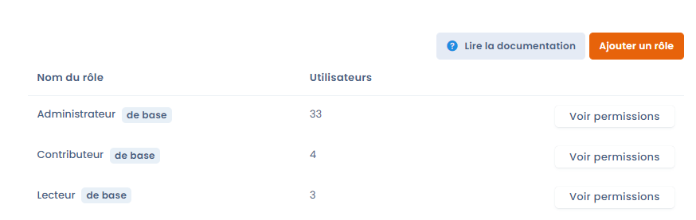
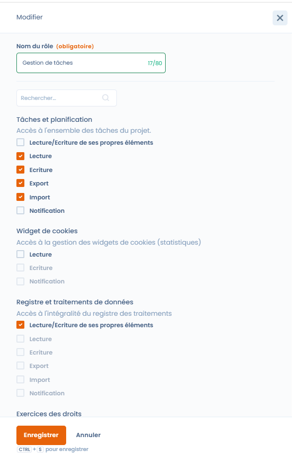

# Rôles et permissions



## Fonctionnement général

Chaque utilisateur peut être associé à 1 ou plusieurs rôles. Les rôles sont eux mêmes associés à une liste de permissions (ex: écrire dans le registre, créer un questionnaire...). Il existe deux manières d'administrer les rôles associés aux utilisateurs.

* Si vous êtes propriétaire, vous pouvez utiliser[ cette interface de gestion de comptes](https://app.dastra.eu/general-settings/users)
* Si vous avez le rôle d'administrateur d'espace de travail, vous pouvez gérer les rôles et permissions des utilisateurs appartenant à votre espace de travail en utilisant [cette interface](https://app.dastra.eu/workspace/573/settings/users).

## Créez vos propres rôles

Pour créez vos propres rôles associés aux permissions, rendez-vous sur [cette page](https://app.dastra.eu/general-settings/roles) :

Vous pouvez créer un "nouveau rôle" personnalisé en cliquant sur le bouton "Ajouter un rôle"

<figure><figcaption></figcaption></figure>

Il est ensuite possible de sélectionner les cases associées aux permissions :

<figure><figcaption>
Création d'un rôle de gestion des tâches
</figcaption></figure>

 

* **Lecture/Modification de ses propres éléments :** Permet aux utilisateurs de voir et modifier uniquement les éléments qui leur sont attribués dans le module.
* **Lecture :** Permet aux utilisateurs de voir tous les éléments du module.
* **Écriture :** Permet aux utilisateurs de modifier tous les éléments existants du module. Dans les modules qui proposent la permission **Création**, l'écriture ne donne pas le droit de créer de nouveaux éléments.
* **Création :** Permet aux utilisateurs de créer de nouveaux éléments dans le module. Cette permission est indépendante de la permission **Écriture**.
* **Export :** Permet aux utilisateurs d'exporter tous les éléments du module.
* **Import :** Permet aux utilisateurs d'importer tous les éléments dans le module.
* **Notification :** Les utilisateurs reçoivent des notifications pour tous les éléments du module.


Il n'est pas possible de sélectionner à la fois "Lecture/Modification de ses propres éléments" et les permissions sur tous les éléments pour le même rôle dans un module, à l'exception de la permission "Création". Les utilisateurs accèdent soit uniquement à leurs éléments, soit à tous les éléments ; la permission "Création" leur permet en plus de créer de nouveaux éléments.


\
Une fois votre rôle personnalisé créé, vous pouvez l'affecter à n'importe quel utilisateur de l'espace de travail au sein de votre organisation.

### Permission Création

Les modules suivants proposent une permission **Création** distincte de la permission **Écriture** :

* Tâches et planification
* Registre et traitements de données
* Exercices des droits
* Violation de données
* Cartographie des données et référentiels
* Gestion des contrats
* Gestion des systèmes d'IA

Dans ces modules, la permission **Création** est cochable avec **Lecture** ou avec **Lecture/Modification de ses propres éléments**. Un rôle qui combine **Lecture/Modification de ses propres éléments** et **Création** permet à l'utilisateur de créer de nouveaux éléments et de modifier uniquement les éléments qui lui sont attribués. Pour qu'un rôle puisse modifier les éléments existants sans en créer, cochez **Écriture** sans cocher **Création**.

Les rôles par défaut **Administrateur** et **Contributeur** incluent la permission **Création** dans ces modules.

<figure><figcaption>
Permission Création combinée à la modification de ses propres éléments
</figcaption></figure>

## Cloner un rôle existant

Pour gagner du temps lors de la création d'un nouveau rôle à partir d'une configuration existante, vous pouvez **cloner un rôle** en un seul clic. Ouvrez le rôle à dupliquer, puis cliquez sur **"Cloner"**. Un nouveau rôle reprenant l'intégralité des permissions du rôle source est créé immédiatement — il ne reste plus qu'à le renommer et à ajuster les permissions souhaitées.

Cette fonctionnalité est particulièrement utile pour décliner des variantes d'un rôle (ex. un rôle "Contributeur DPO" légèrement différent du rôle "Contributeur") sans repartir d'une page blanche.
