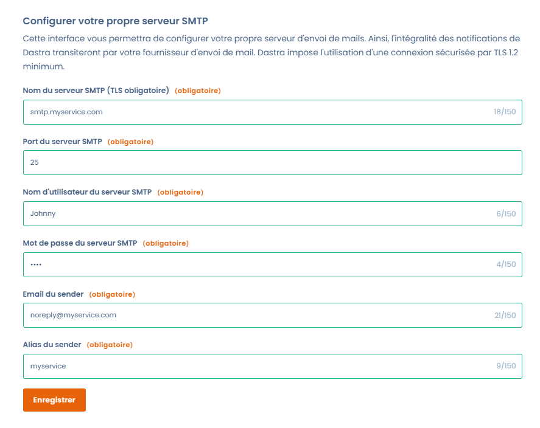

# Configuration du SMTP



Cette page explique comment router les e-mails de Dastra vers votre propre serveur SMTP. Elle s'adresse aux propriétaires de l'organisation.

## Principe de fonctionnement

Par défaut, Dastra envoie ses e-mails avec son propre service SMTP. Sont concernés :

* les [notifications](../notifications.md) en temps réel (nouveaux commentaires, tâches, etc.) ;
* les e-mails d'échange dans le cadre d'une [demande d'exercice de droits](../../requests/README.md) ;
* les invitations des répondants aux [questionnaires](../../questionnaires/README.md) ;
* les [invitations](../../../getting-started/setup/users.md) de nouveaux utilisateurs.

Une fois votre serveur configuré, tous ces e-mails passent par lui, pour tous les espaces de travail de l'organisation.


Personnaliser le SMTP peut rendre la plateforme instable. N'effectuez cette configuration que si vous êtes certain du bon fonctionnement et de la délivrabilité de votre service d'envoi d'e-mails.


## Intérêt de personnaliser le SMTP

Dastra assure la disponibilité et la sécurité des envois d'e-mails transactionnels. Selon votre politique interne de sécurité, vous pouvez toutefois avoir besoin de maîtriser vous-même le routage de ces e-mails pour contrôler vos flux de messagerie.

## Accès et prérequis

La page se trouve dans **Paramètres de l'organisation** > **SMTP personnalisé**. Elle est réservée aux propriétaires de l'organisation et au plan Enterprise (fonctionnalité de sécurité avancée).

Vous avez deux possibilités :

* connecter un fournisseur (**Outlook (MS Office 365)** ou **Gmail (Google workspace)**) : voir [Intégration des fournisseurs externes](office-365-gmail.md) ;
* renseigner les paramètres de votre serveur SMTP, décrits ci-dessous.

Pour un serveur SMTP, munissez-vous des éléments suivants :

* le nom du serveur SMTP (par exemple `smtp.yourservice.com`) ;
* le port du serveur SMTP (25 par défaut) ;
* le nom d'utilisateur et le mot de passe du serveur ;
* une adresse e-mail d'expéditeur valide (par exemple `noreply@yourservice.com`) : votre fournisseur SMTP doit l'avoir validée ;
* un alias d'expéditeur, c'est-à-dire le nom affiché comme expéditeur (par exemple `Équipe conformité`).


Dastra impose une connexion sécurisée par TLS, en version 1.2 au minimum. Votre serveur SMTP doit la proposer.


## Configuration

1. Ouvrez [la page de configuration du SMTP](https://app.dastra.eu/general-settings/smtp).
2. Dans la section **SMTP Personnalisé**, renseignez **Nom du serveur SMTP (TLS obligatoire)**, **Port du serveur SMTP**, **Nom d'utilisateur du serveur SMTP**, **Mot de passe du serveur SMTP**, **Email du sender** et **Alias du sender**.
3. Cliquez sur **Enregistrer**.

<figure><figcaption>
Le formulaire de configuration du serveur SMTP
</figcaption></figure>

À l'enregistrement, Dastra se connecte à votre serveur et envoie un message de test à l'adresse e-mail de votre compte. Si la connexion échoue, la configuration n'est pas enregistrée et le message d'erreur du serveur s'affiche.

Quand un fournisseur est connecté, le formulaire SMTP personnalisé est désactivé. Cliquez d'abord sur **Supprimer l'intégration** pour utiliser votre propre serveur.

## Tests

Une fois la configuration enregistrée, le bouton **Tester** apparaît. Cliquez dessus et confirmez : Dastra envoie un message de test à l'adresse e-mail de votre compte personnel.

Vous pouvez aussi vérifier que les e-mails de notification proviennent bien de votre serveur. Créez par exemple un commentaire dans un traitement et regardez si vous recevez la notification dans votre boîte aux lettres.

* **Vous ne recevez pas d'e-mail** : soit la notification n'a pas été déclenchée, soit la configuration du SMTP est en cause.
* **Vous recevez un e-mail** : vérifiez que votre serveur SMTP et votre expéditeur figurent dans le détail du message.


[Comment afficher le détail d'un e-mail dans Gmail](https://support.google.com/mail/answer/29436?hl=fr).

[Comment afficher le détail d'un e-mail dans Outlook](https://support.microsoft.com/fr-fr/office/afficher-les-en-t%C3%AAtes-de-message-internet-dans-outlook-cd039382-dc6e-4264-ac74-c048563d212c)

