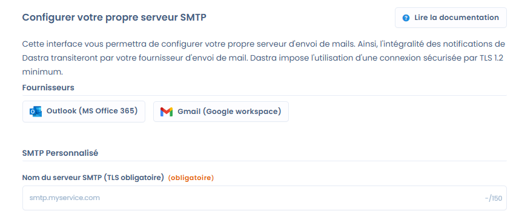
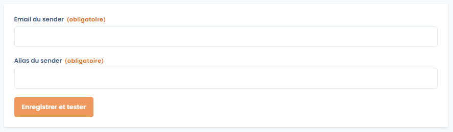
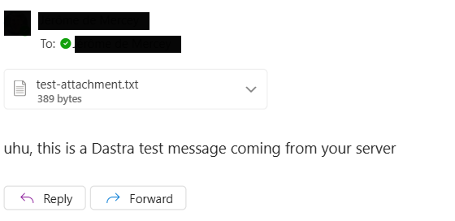

# Intégration des fournisseurs externes (Office 365 / Gmail)

Cette page explique comment envoyer les e-mails de Dastra depuis votre propre compte Office 365 ou Gmail. Elle s'adresse aux propriétaires de l'organisation. Pour utiliser un autre serveur d'envoi, voir [Configuration du SMTP](README.md).

## Objectif

Par défaut, toutes les notifications envoyées par Dastra proviennent de l'adresse `no-reply@dastra.eu`. Avec l'intégration d'un fournisseur de messagerie externe (Office 365 ou Gmail), vous envoyez ces e-mails depuis vos propres adresses. Cela vous permet de :

* renforcer la confiance de vos destinataires, car les e-mails sont envoyés avec votre domaine ;
* centraliser vos journaux d'envoi et de délivrabilité dans votre infrastructure de messagerie ;
* appliquer vos propres règles de sécurité, de conformité et d'archivage.

## E-mails concernés

La configuration s'applique à tous les e-mails envoyés par Dastra dans votre organisation, par exemple :

* les notifications de nouvelles tâches ou de nouvelles demandes ;
* les invitations et les rappels ;
* les alertes de conformité ;
* le suivi des demandes d'exercice de droits, des incidents, des workflows, etc.

Une fois l'intégration activée, tous ces e-mails remplacent `no-reply@dastra.eu` par l'adresse configurée.


Tous les e-mails envoyés depuis l'organisation sont concernés, donc tous les espaces de travail.


## Configurer l'intégration

La configuration est réservée aux propriétaires de l'organisation et au plan Enterprise (fonctionnalité de sécurité avancée).

### Étape 1 : autoriser la connexion au fournisseur

1. Ouvrez [https://app.dastra.eu/general-settings/smtp](https://app.dastra.eu/general-settings/smtp), c'est-à-dire **Paramètres de l'organisation** > **SMTP personnalisé**.
2. Dans la section **Fournisseurs**, cliquez sur **Outlook (MS Office 365)** ou sur **Gmail (Google workspace)**.
3. Une fenêtre s'ouvre pour vous authentifier auprès de Microsoft ou de Google avec OAuth. Utilisez un compte autorisé à envoyer des e-mails avec l'adresse que vous voulez utiliser.
4. Une fois l'authentification réussie, Dastra affiche l'écran de configuration de l'expéditeur.

<figure><figcaption>
Les fournisseurs proposés dans la page SMTP personnalisé
</figcaption></figure>


Dans les réglages de l'espace de travail, la carte d'intégration Office 365 ou Gmail renvoie vers cette même page.


Cette étape est indispensable : sans l'autorisation du fournisseur, Dastra ne peut pas envoyer d'e-mails avec votre compte.

### Étape 2 : renseigner l'expéditeur

<figure><figcaption>
L'écran de configuration de l'expéditeur
</figcaption></figure>

Deux champs sont obligatoires :

1. **Email du sender** : l'adresse utilisée comme expéditeur des notifications (par exemple `notifications@votredomaine.com`).
2. **Alias du sender** : le nom affiché comme expéditeur (par exemple `Équipe conformité - Votre société`).

Cliquez ensuite sur **Enregistrer et tester**.

### Étape 3 : vérifier l'envoi

Dastra envoie un message de test à l'adresse e-mail de votre compte, avec l'expéditeur configuré. Vérifiez dans votre boîte de réception et dans vos journaux Office 365 ou Gmail que le message est bien arrivé.

<figure><figcaption>
Le message de test reçu
</figcaption></figure>

Une fois la connexion établie, la page **SMTP personnalisé** affiche l'e-mail et l'alias de l'expéditeur. Cliquez sur **Supprimer l'intégration** pour revenir à l'envoi par défaut de Dastra ou pour utiliser un autre serveur.

## Points importants

### Journaux d'envoi

Avec votre propre fournisseur, vous maîtrisez vos journaux d'envoi. Les équipes de Dastra ne voient plus les informations de remise, de refus ou de blocage des e-mails.

### Réputation de l'adresse IP et du domaine

Votre infrastructure porte la responsabilité de la bonne délivrabilité. Assurez-vous que :

* vos enregistrements SPF, DKIM et DMARC sont correctement configurés ;
* votre réputation d'expéditeur est bonne ;
* votre domaine et votre adresse IP ne figurent pas sur une liste de spam.

### Impact sur vos destinataires

Les notifications apparaissent comme envoyées directement par votre organisation. Vos destinataires les reconnaissent, et le risque de confusion avec une adresse générique diminue.

## Bonnes pratiques de sécurité

* Limitez les adresses utilisées pour l'envoi (par exemple `no-reply@votredomaine.com` ou `notifications@votredomaine.com`).
* Activez l'authentification multifacteur sur les comptes utilisés pour l'intégration.
* Consultez régulièrement vos journaux d'envoi dans Office 365 ou Gmail pour repérer toute anomalie.

## Questions techniques pour les administrateurs IT

Cette section répond aux questions fréquentes des équipes IT et sécurité lors de la mise en place de l'intégration Office 365.

### Quel modèle d'authentification est utilisé ?

L'intégration Office 365 utilise le flux OAuth 2.0 avec code d'autorisation et des permissions **déléguées** : Dastra envoie les e-mails au nom du compte qui a autorisé la connexion, avec les droits de ce compte. Ce n'est pas une connexion d'application avec consentement administrateur global. Selon la politique de votre environnement Microsoft, un administrateur peut devoir approuver les permissions demandées.

### Quelles permissions Microsoft Graph sont demandées ?

Dastra demande les permissions déléguées suivantes lors de l'autorisation :

| Permission | Usage |
| --- | --- |
| `Mail.Send` | Envoi d'e-mails depuis la boîte du compte connecté |
| `Mail.Send.Shared` | Envoi depuis une boîte aux lettres partagée |
| `offline_access` | Renouvellement de l'accès sans nouvelle connexion |

Pour Gmail, Dastra demande l'accès `https://mail.google.com/`.

### Les boîtes aux lettres partagées sont-elles prises en charge ?

Oui. Pour utiliser une boîte aux lettres partagée (par exemple `privacy@votreentreprise.com`) :

1. Connectez-vous avec votre **compte personnel** disposant du droit d'envoi sur la boîte partagée.
2. Dans le champ **Email du sender**, saisissez l'adresse de la boîte partagée.

Aucune modification de politique Exchange (ApplicationAccessPolicy) n'est nécessaire avec ce fonctionnement.


Vérifiez que votre compte personnel dispose du droit « Envoyer en tant que » ou « Envoyer de la part de » sur la boîte partagée dans Active Directory ou Exchange.


### Faut-il filtrer les adresses IP sources de Dastra ?

Dastra envoie les e-mails avec l'API Microsoft Graph, et non avec un serveur SMTP classique. Les appels passent par l'infrastructure Azure de Microsoft, dont les plages d'adresses IP sont nombreuses (environ 100) et évoluent dans le temps.

Le filtrage par adresse IP n'est pas recommandé pour cette intégration : il serait difficile à maintenir et pourrait interrompre le service lors des mises à jour des plages Azure. La sécurité repose sur OAuth 2.0 et sur l'autorisation donnée par le compte connecté.


Si votre politique de sécurité impose une restriction par adresse IP, consultez les plages publiées par Microsoft pour les services Azure : [https://www.microsoft.com/en-us/download/details.aspx?id=56519](https://www.microsoft.com/en-us/download/details.aspx?id=56519). Cette liste est mise à jour régulièrement.

