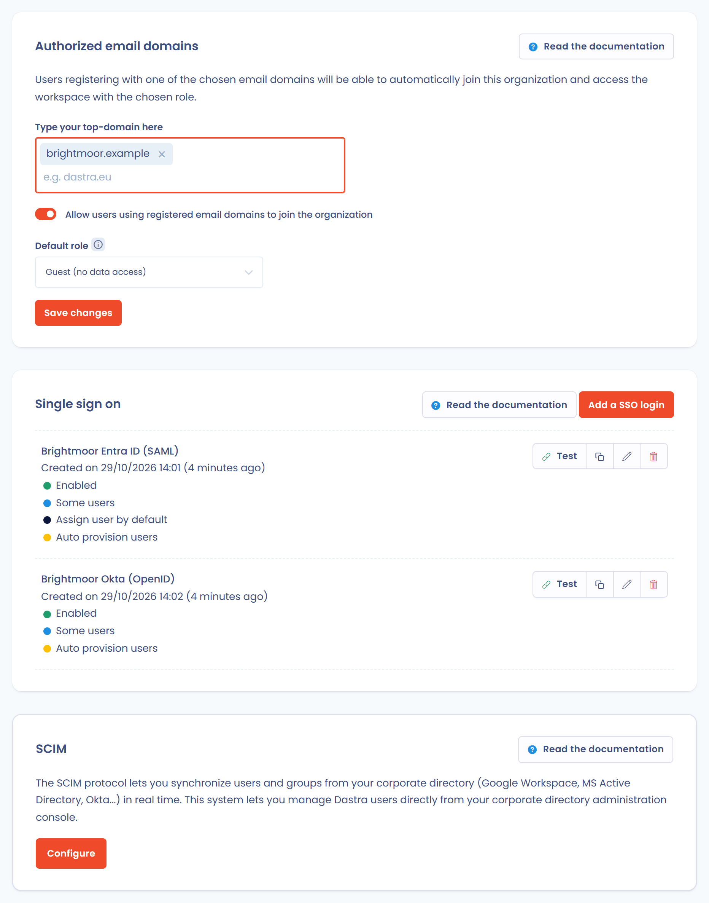

# Single Sign On (SSO)

## Principe de fonctionnement

L'**authentification unique**, souvent désignée par le sigle anglais **SSO** (de single sign-on) est une méthode permettant à un utilisateur d'accéder à plusieurs applications informatiques (ou sites web sécurisés) en ne procédant qu'à une seule authentification.

L'entreprise peut utiliser **son propre système d'authentification** à la place du login local proposé par défaut par Dastra. Parmi les systèmes SSO les plus utilisés, on peut citer Microsoft Active Directory, Google Workspace (ex GSuite), Auth0, etc.

**Le fonctionnement est le suivant :**

Un utilisateur (**User Agent**) va solliciter une connexion au fournisseur de service (**Service Provider**) qui ira solliciter un fournisseur d'identité (**Identity Provider**) qui authentifiera l'utilisateur. Cette authentification est ensuite renvoyée au fournisseur de service, qui acceptera la demande de connexion de l'utilisateur.

Dans notre cas, le User Agent est le **navigateur d'un utilisateur de Dastra**. Le Service Provider est **Dastra** et l'Identity Provider est votre **fournisseur d'authentification favori** (par exemple : Active Directory).


## Mise en place

Un abonnement à Dastra peut compter un ou plusieurs logins SSO, si la fonctionnalité est incluse dans votre abonnement. Pour les gérer, ouvrez **Paramètres de l'organisation** (en bas du menu **Réglages espace de travail**), puis **Single sign on**. Vous arrivez sur [la page de configuration des logins SSO](https://app.dastra.eu/general-settings/sso).


Seul un propriétaire de l'organisation accède à cette page.


<figure><figcaption><p>La page <strong>Single sign on</strong></p></figcaption></figure>

La page réunit trois blocs :

* **Domaines email autorisés**, en haut : voir [Domaines emails](../email-domains.md).
* La liste de vos connexions SSO, que vous alimentez avec **Ajouter un login SSO**.
* **SCIM**, en bas : voir [SCIM](../scim.md).

Pour créer une connexion, cliquez sur **Ajouter un login SSO**, puis choisissez le protocole. Dastra propose deux protocoles d'authentification unique, [**SAML 2**](saml.md) et [**OpenID**](openid.md). Pour accéder à l'aide de configuration, utilisez les liens ci-dessous.


[saml.md](saml.md)



[openid.md](openid.md)



[adfs.md](adfs.md)



[entra-id.md](entra-id.md)



[okta.md](okta.md)



[known-problems.md](known-problems.md)


## Champs du formulaire

Le formulaire d'une connexion SSO s'ouvre dans un panneau latéral qui compte trois sections.

**1. Généralités**

* **Intitulé de la connexion SSO** : le nom de la connexion dans la liste, 80 caractères au maximum.
* **Forcer pour tous les utilisateurs** : tous les utilisateurs doivent se connecter avec ce login SSO. Voir [Activer le SSO pour tous les utilisateurs](#activer-le-sso-pour-tous-les-utilisateurs).
* **Activer** : quand la connexion est désactivée, la connexion par mot de passe reste en vigueur.
* **Assigné par défaut aux nouveaux utilisateurs invités** : Dastra sélectionne cette connexion par défaut lorsque vous invitez un nouvel utilisateur.

**2. Configuration**

* Les champs propres au protocole : voir [SAML 2](saml.md) et [OpenID](openid.md).
* **Le nom du claim contenant l'adresse email** : le nom du claim dans lequel votre fournisseur d'identité renvoie l'adresse e-mail de l'utilisateur. Si Dastra ne retrouve pas les utilisateurs, voir [Problèmes connus](known-problems.md).

**3. Création automatique des utilisateurs**

* **Utilisateur créé si l'utilisateur n'a jamais été invité dans Dastra** : active la création automatique des comptes. Voir [Activer le provisionnement automatique des utilisateurs](#activer-le-provisionnement-automatique-des-utilisateurs).
* **Le rôle assigné par défaut à tous les espaces de travail de l'abonnement si l'utilisateur est créé** : facultatif.
* **Sélection d'un espace de travail spécifique** : facultatif. Quand vous choisissez un espace de travail, un champ apparaît pour le nom du claim de groupe : voir [Binding des équipes](#binding-des-equipes).

## Activer le SSO pour tous les utilisateurs

1. Dans la liste des connexions SSO, cliquez sur la connexion concernée.
2. Dans la section **Généralités**, activez **Forcer pour tous les utilisateurs**.

<figure><figcaption><p>La section <strong>Généralités</strong> de la connexion</p></figcaption></figure>

### Gestion des utilisateurs exemptés de login SSO

Dans certains cas, vous souhaitez **désactiver le SSO pour certains utilisateurs** (par exemple un administrateur de sécurité, un compte de service, un utilisateur qui n'est pas dans votre Active Directory). Vous pouvez renseigner des utilisateurs spécifiques, qui ne seront pas redirigés vers le login SSO de votre organisation. Nous recommandons de nommer au moins un utilisateur disposant d'un compte de service local : il permet de gérer un dysfonctionnement du SSO, par exemple une panne du fournisseur d'identité ou une erreur de configuration.

Ces utilisateurs se connectent à l'application **avec leur mot de passe**.

Pour les nommer, sélectionnez des utilisateurs de votre organisation dans le champ **Utilisateurs spécifiques exemptés de SSO (par exemple, les administrateurs de sécurité)**. Ce champ apparaît lorsque **Forcer pour tous les utilisateurs** est activé.

## Activer le provisionnement automatique des utilisateurs

Si vous souhaitez que les utilisateurs de votre fournisseur d'identité n'aient pas besoin de se créer un compte pour accéder à l'organisation, activez **Utilisateur créé si l'utilisateur n'a jamais été invité dans Dastra** dans la section **Création automatique des utilisateurs**.

Le provisionnement automatique ne fonctionne que si les utilisateurs se connectent avec le lien de votre connexion SSO. Il ne fonctionne pas depuis la page de login classique. Ce lien a la forme suivante :

```
https://account.dastra.eu/Account/ExternalLogin?returnUrl=https://app.dastra.eu&provider={id de votre provider}
```

Les adresses du lien sont celles de votre région. Pour le récupérer, cliquez sur le bouton **Copier le lien** de la carte de la connexion, à droite de **Tester**, puis transmettez-le à vos utilisateurs.

<figure><figcaption><p>Le bouton <strong>Copier le lien</strong> de la carte</p></figcaption></figure>

Après une authentification validée, le compte est créé automatiquement dans Dastra. Les propriétaires de l'organisation reçoivent alors une notification qui indique le nom et l'adresse du compte créé, la date et l'heure, la connexion SSO à l'origine de la création, le rôle attribué par défaut et l'espace de travail concerné le cas échéant. Elle renvoie vers la page **Utilisateurs**, pour attribuer sans délai les droits attendus.


Si le compte d'un utilisateur est supprimé ou invalidé dans le fournisseur d'authentification, son compte n'est pas effacé dans Dastra, mais il ne peut plus se connecter. Vous pouvez épurer ces comptes depuis [la gestion des utilisateurs de l'abonnement](https://app.dastra.eu/general-settings/users).


Vous pouvez choisir **le rôle assigné par défaut** à tous les espaces de travail de l'abonnement.

<figure><figcaption><p>La section <strong>Création automatique des utilisateurs</strong></p></figcaption></figure>


Dastra ne prend pas en charge, pour l'instant, le binding des rôles à partir des propriétés du serveur d'authentification. Si cette fonctionnalité est importante pour vous, signalez-le via la [page de support](https://app.dastra.eu/general-settings/support).


### Binding des équipes

Il est possible de lier les équipes d'un espace de travail à une propriété (claim) renvoyée par votre serveur d'authentification. Sélectionnez l'espace de travail dans **Sélection d'un espace de travail spécifique**, puis renseignez le nom du claim de groupe dans le champ qui apparaît dessous : Dastra provisionne les équipes à partir de ce claim.

## Administrer les logins des utilisateurs

Vous configurez le type de login de chaque utilisateur depuis [la gestion des utilisateurs de l'abonnement](https://app.dastra.eu/general-settings/users) (**Paramètres de l'organisation** > **Utilisateurs**). Ouvrez le profil de l'utilisateur et choisissez le login SSO privilégié dans **Mode de connexion par défaut**. L'utilisateur qui se connecte à Dastra avec son adresse e-mail est alors redirigé vers la page de login du fournisseur d'authentification que vous avez mis en place.

Lorsque le SSO est forcé pour tous les utilisateurs, le profil affiche à la place un message qui l'indique.

Pour modifier le mode de connexion de plusieurs utilisateurs à la fois, cochez-les dans la liste **Utilisateurs**, puis ouvrez **Choisir une action groupée** au-dessus de la liste et choisissez **Modifier le mode de connexion**. Sélectionnez le mode dans **Mode de connexion par défaut**, puis enregistrez. Les utilisateurs externes et ceux soumis à un SSO appliqué à tous ne sont pas modifiés. L'action apparaît lorsque le SSO fait partie de votre offre.

<figure><figcaption><p>Le champ <strong>Mode de connexion par défaut</strong></p></figcaption></figure>

Vous pouvez également définir le type de login lors de l'invitation de nouveaux utilisateurs.

## En cas de problème de connexion SSO

Consultez d'abord les [problèmes connus](known-problems.md). Si le blocage persiste, contactez immédiatement [le support](../../../getting-started/support/request.md).
