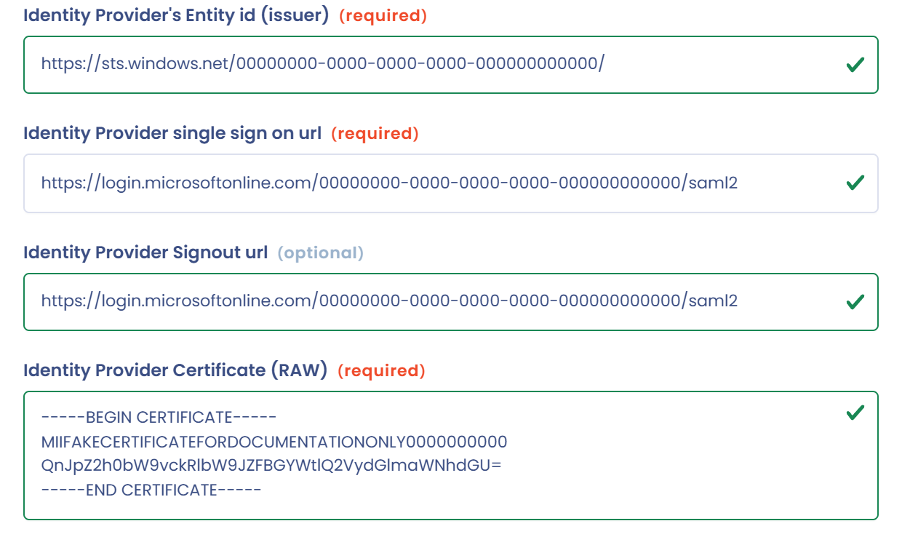

# Active Directory (Microsoft Entra ID)

Découvrez dans le guide vidéo comment configurer le SSO Active Directory (Microsoft Entra ID) pas à pas :



## Configuration de l'application dans Microsoft Entra ID

* Rendez-vous dans le centre d'administration Microsoft Entra : [https://entra.microsoft.com](https://entra.microsoft.com)
* Dans la navigation à gauche, cliquez sur **Entra ID** > **Enterprise apps**
* Cliquez sur **New application**, puis sur **Create your own application**
* Renseignez le nom de l'application, par exemple « Dastra »
* Sélectionnez **Integrate any other application you don't find in the gallery (Non-gallery)**, puis créez l'application
* Dans la section **Manage**, cliquez sur **Single sign-on** et sélectionnez **SAML**
* Vous arrivez sur cette page :

<figure><figcaption></figcaption></figure>

## Configuration du client SSO dans Dastra

### Étape 1 : créez un login SSO SAML dans Dastra

* Allez sur la [page de configuration du SSO de Dastra](https://app.dastra.eu/general-settings/sso) (**Configuration de l'organisation** > **Single sign on**)
* Cliquez sur **Ajouter un login SSO**
* Sélectionnez **SAML2** dans **Choisir le protocole SSO**, puis **Configuration manuelle**
* Saisissez un intitulé de connexion dans **Intitulé de la connexion SSO**, par exemple « Active Directory »

### Étape 2 : configurez le login SSO dans Microsoft Entra ID

* Retournez sur la page de configuration SAML de Microsoft Entra ID
* Cliquez sur **Edit** dans la section **Basic SAML Configuration**
* Saisissez les informations de connexion, affichées en haut du formulaire SAML de Dastra : **Identifier (Entity ID)** et **Reply URL (Assertion Consumer Service URL)** :

<figure><figcaption></figcaption></figure>

* Cliquez sur **Save**
* Allez directement à la section **SAML Certificates** pour **télécharger le certificat au format Base64** :

<figure><figcaption></figcaption></figure>

* Ouvrez le fichier CER avec un éditeur de texte (par exemple le Bloc-notes) et copiez le contenu (Ctrl + C) :

<figure><figcaption></figcaption></figure>

### Étape 3 : ajoutez le certificat au client Dastra

* Retournez dans l'écran de création de la connexion SAML dans Dastra
* Collez le texte du certificat (Ctrl + V) dans le champ **Identity Provider Certificate (RAW)**

### Étape 4 : configurez les URL du fournisseur d'identité dans Dastra

* Dans la section **Set up** de l'application Entra ID, copiez les trois valeurs **Login URL**, **Microsoft Entra Identifier** et **Logout URL** :

<figure><figcaption></figcaption></figure>

* Collez-les dans Dastra en respectant la correspondance suivante :
  * **Login URL** : **Fournisseur d'identité (Identity Provider) single sign on url**
  * **Microsoft Entra Identifier** : **Identity Provider's Entity id (issuer)**
  * **Logout URL** : **Identity Provider Signout url**
* Le formulaire de configuration du SSO dans Dastra doit ressembler à ceci :

<figure><figcaption></figcaption></figure>

* Vous pouvez activer l'option **Utilisateur créé si l'utilisateur n'a jamais été invité dans Dastra**, dans la section **Création automatique des utilisateurs**. Dans ce cas, les comptes de votre annuaire qui n'existent pas encore dans Dastra sont créés au moment de la première connexion :

<figure><figcaption></figcaption></figure>

* Enregistrez vos changements dans Dastra


Avant de lancer le test de la connexion, assurez-vous qu'un utilisateur est bien assigné à la nouvelle application.


### Testez votre connexion SSO

Dans Microsoft Entra ID, cliquez sur le bouton **Test** de la section **Test single sign-on** de l'application. Si tout fonctionne, vous êtes redirigé vers Dastra.


Si vous n'avez pas activé la création automatique des utilisateurs, l'accès est refusé côté Dastra tant que le compte local n'a pas été créé par une invitation.


### Pour aller plus loin


[Problèmes connus](known-problems.md)



[SAML 2](saml.md)

