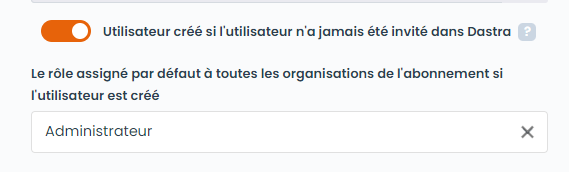
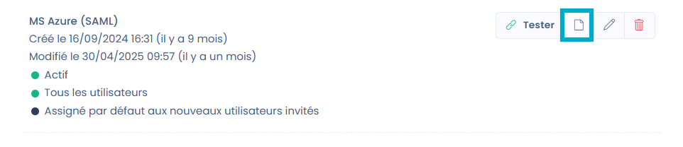
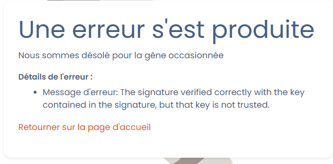

# Problèmes connus

Cette page rassemble les incidents SSO réellement rencontrés par nos clients et la façon de les résoudre. Elle est organisée par **symptôme** : cherchez ce que vous voyez à l'écran.


**Prévoyez toujours un compte d'exception avant d'activer le SSO pour tous.**

Si vous cochez « Forcer pour tous les utilisateurs » et que le SSO tombe en panne (certificat expiré, montée de version de l'IdP, erreur de configuration), **plus personne ne peut se connecter, y compris les propriétaires**. Déclarez au moins un utilisateur dans le champ **« Utilisateurs spécifiques exemptés de SSO »** — idéalement un compte de service local — afin de pouvoir revenir dans la configuration et corriger le tir.

Voir [Gestion des utilisateurs exemptés de login SSO](README.md#gestion-des-dutilisateurs-exemptes-de-login-sso).


## Les 5 vérifications à faire en premier

Avant tout diagnostic approfondi, passez cette liste :

1. **Testez la configuration.** Le bouton **Tester** sur la carte de connexion SSO valide le dialogue avec votre fournisseur d'identité. S'il échoue, le problème est dans la configuration, pas dans le compte utilisateur.
2. **L'utilisateur existe-t-il dans l'organisation ?** Le SSO est rattaché à l'organisation : l'utilisateur doit figurer dans la [liste des utilisateurs](https://app.dastra.eu/general-settings/users).
3. **L'adresse e-mail correspond-elle exactement ?** Dastra rapproche le compte à partir de l'**adresse e-mail renvoyée par le fournisseur d'identité**. Un seul caractère de différence et l'utilisateur n'est pas reconnu.
4. **L'utilisateur est-il habilité sur l'application Dastra côté fournisseur d'identité ?** C'est la cause n° 1 des échecs qui ne concernent qu'une seule personne.
5. **Testez en navigation privée** et vérifiez que **l'horloge du poste est synchronisée** — un décalage d'horloge invalide les jetons.

---

## L'utilisateur n'est pas reconnu par le SSO

### L'adresse e-mail renvoyée par l'IdP ne correspond pas à celle du compte Dastra

C'est, de loin, la cause la plus fréquente. Dastra utilise le **claim e-mail** pour associer l'identité SSO à un compte existant. Si les deux valeurs diffèrent, Dastra considère qu'il s'agit d'un **nouvel** utilisateur ; si la création automatique de compte est désactivée, la connexion est alors **rejetée**.

Cas typiques rencontrés :

- le compte Dastra est `prenom.nom@societe.com` mais l'IdP de recette renvoie `prenom.nom@societe-stg.com` ;
- l'UPN a été modifié côté annuaire (changement de nom, migration de domaine) sans être répercuté dans Dastra ;
- l'utilisateur a été créé dans Dastra avec une forme courte de son adresse (`pnom@…`) alors que l'IdP renvoie la forme longue.

**Résolution** — alignez les deux valeurs, dans un sens ou dans l'autre :

- faites renvoyer par l'IdP exactement l'adresse enregistrée dans Dastra, **ou**
- créez / corrigez le compte Dastra pour qu'il porte l'adresse renvoyée par l'IdP.


Pour connaître la valeur réellement transmise, inspectez l'assertion SAML ou l'ID Token renvoyé par votre IdP (voir [Collecter les éléments de diagnostic](#collecter-les-elements-de-diagnostic)).


### Le nom du claim contenant l'e-mail ne correspond pas

Même lorsque l'adresse est bien transmise, Dastra peut ne pas la trouver : il recherche le claim **par son nom exact**.

Par défaut, Dastra attend le claim :

```
http://schemas.xmlsoap.org/ws/2005/05/identity/claims/emailaddress
```

Or certains IdP publient l'attribut avec un nom court, par exemple :

```xml
Name="emailaddress"
NameFormat="http://schemas.xmlsoap.org/ws/2005/05/identity/claims/emailaddress"
```

Dastra se base sur la propriété **`Name`**, et non sur le `NameFormat` : la valeur est bien présente dans la réponse SAML, mais le claim attendu reste introuvable.

**Résolution** :

1. Ouvrez votre configuration SSO, onglet **Configuration**.
2. Dans le champ **« Le nom du claim contenant l'adresse email »**, remplacez la valeur par le nom réellement publié par votre IdP (ici : `emailaddress`).
3. Enregistrez, puis refaites un test de connexion **depuis une fenêtre de navigation privée** afin de créer une nouvelle session.

### L'utilisateur n'est pas habilité sur l'application côté fournisseur d'identité

Quand un seul utilisateur est bloqué alors que les autres se connectent normalement, le problème est presque toujours côté IdP.

**Résolution** : vérifiez que la personne est bien créée dans votre annuaire **et** qu'elle est assignée à l'application Dastra avec les droits d'accès nécessaires. Un bon test de discrimination consiste à faire connecter l'utilisateur **sans passer par le SSO** (compte exempté ou mot de passe) : si cela fonctionne, le compte Dastra est sain et le blocage vient de l'habilitation côté IdP.

### L'utilisateur est un « utilisateur externe »

Le SSO ne s'applique qu'aux comptes **internes** à votre organisation. Si l'utilisateur possédait déjà un compte Dastra (autre organisation, compte d'essai, compte personnel), son **organisation principale** est une autre organisation : ce sont ses paramètres de sécurité qui s'appliquent, pas les vôtres, et il apparaît chez vous comme **utilisateur externe**.

Vérifiez son statut dans la [liste des utilisateurs de l'organisation](https://app.dastra.eu/general-settings/users). Le rattachement à l'organisation principale ne peut pas être modifié depuis l'interface : contactez le support en précisant l'adresse e-mail concernée.

---

## La création automatique de compte ne fonctionne pas

### « SSO users autoprovisioning is not allowed for your organization »

Ce message signifie que l'option **« Création automatique de compte »** n'est pas activée dans votre configuration SSO. Tant qu'elle est désactivée, seul un utilisateur **déjà invité dans Dastra** peut se connecter en SSO.

**Résolution** : un **propriétaire de l'organisation** active l'option dans la configuration SSO, onglet **Création automatique des utilisateurs**, et choisit le rôle attribué par défaut.

<figure><figcaption></figcaption></figure>


Seul un **propriétaire** peut modifier la configuration SSO. Un administrateur ne voit pas cette page.


### L'option est activée mais les comptes ne sont toujours pas créés

Le provisionnement automatique **ne se déclenche que si l'utilisateur arrive par le lien SSO**. Un utilisateur qui passe par la page de connexion classique n'aura pas de compte créé.

Diffusez à vos utilisateurs le lien de votre connexion SSO, de la forme :

```
https://account.dastra.eu/Account/ExternalLogin?returnUrl=https://app.dastra.eu&provider={id de votre provider}
```

Vous le récupérez avec le bouton **Copier le lien** sur la carte de la connexion SSO :

<figure><figcaption></figcaption></figure>

### Les répondants externes à un questionnaire ne sont pas provisionnés

Une personne qui n'a jamais ouvert le lien SSO n'est pas un utilisateur Dastra : la création automatique ne s'applique donc pas aux répondants invités à un questionnaire externe.

Deux contournements :

- **provisionner les comptes en amont** — voir [l'import d'une liste d'utilisateurs](../../../getting-started/setup/users.md) ;
- diffuser le questionnaire via un **Trust center**, qui propose une connexion SSO aux visiteurs.

---

## Boucle d'authentification ou erreur au retour vers Dastra (OpenID Connect)

Symptômes : boucle de redirection entre Dastra et l'IdP, erreur **« An error was encountered while handling the remote login »**, ou **erreur HTTP 400 lors de la récupération du token**.

Dans ce cas, la redirection vers l'IdP et l'authentification fonctionnent : c'est le **traitement du retour OIDC** qui échoue. Vérifiez les points suivants, dans cet ordre.

### Le champ « Authority/Domain » pointe sur le mauvais endpoint

C'est une erreur de configuration très courante. Ce champ doit contenir **l'URL racine de l'issuer OIDC** — celle qui expose `/.well-known/openid-configuration` — et **non** l'endpoint `/authorize`.

|              |                                                                      |
| ------------ | -------------------------------------------------------------------- |
| ❌ Incorrect | `https://login.exemple.fr/user/IdPOAuth2/authorize/FB6CB139F80BCAEB` |
| ✅ Correct   | `https://login.exemple.fr/user/IdPOAuth2/FB6CB139F80BCAEB`           |

Les endpoints `/authorize` et `/token` sont ensuite découverts automatiquement via le document _well-known_.

### Le type de réponse (response type) est incorrect

Le champ **Response Type** doit reprendre **exactement** une valeur publiée par votre IdP — typiquement `id_token` ou `code`.

Attention aux variantes avec un tiret : une valeur `id-token` au lieu de `id_token` provoque une boucle d'authentification accompagnée d'une erreur 400 à la récupération du token. Vérifiez caractère par caractère.

Si le flux `id_token` échoue, essayez `code` : certains IdP n'autorisent pas le flux implicite.

### L'ID Token est signé en HS256

Selon l'intégration, Dastra peut nécessiter une **signature asymétrique RS256**, avec la clé publique exposée via le `jwks_uri`. Un ID Token signé en **HS256** peut être rejeté à la validation.

Vérifiez côté IdP qu'il est possible de configurer le client Dastra avec une signature **RS256**.

### Les autres causes à écarter

- **L'URL de redirection n'est pas déclarée côté IdP.** Elle doit être enregistrée telle quelle, au format `https://account.dastra.eu/signin-{schemeId}`, dans l'application déclarée chez votre fournisseur (par exemple dans _App Registration → Authentication_ sur Azure).
- **Le `redirect_uri` utilisé n'est pas strictement identique** à celui configuré.
- **L'issuer du token ne correspond pas exactement** à l'URL configurée dans Dastra.
- **Les scopes ne sont pas autorisés.** Conservez `openid profile email` ; vérifiez que les trois sont bien accordés côté IdP.
- **Le claim `email` est absent de l'ID Token.**

### « La valeur du paramètre response_type est inconnu »

Lorsque ce message s'affiche **sur la page de votre fournisseur d'identité** (et non sur Dastra), la redirection fonctionne : le problème est dans la déclaration du client OIDC côté IdP.

Vérifiez :

- les `response_type` autorisés sur l'application déclarée dans votre SSO ;
- la configuration du client OIDC associé à Dastra ;
- le mode de délégation utilisé (CAS/OIDC, par exemple).

---

## Erreurs de certificat (SAML 2)

Vous rencontrez un message d'erreur de ce type :

<figure><figcaption></figcaption></figure>

1. **Assurez-vous d'avoir un certificat valide** — un certificat expiré produit exactement ce symptôme, souvent « du jour au lendemain » sans aucune modification de votre part.
2. **Vérifiez que le copier/coller du certificat n'a pas introduit de saut de ligne ou d'espace** parasite.
3. **Vérifiez que le certificat configuré dans Dastra est bien celui utilisé par l'IdP de l'environnement concerné** : une erreur fréquente consiste à laisser le certificat de recette sur la configuration de production.

### Renouveler un certificat SSO

La mise à jour du certificat se fait directement depuis la [configuration SSO de votre organisation](https://app.dastra.eu/general-settings/sso). En tant que **propriétaire**, remplacez le certificat en place par le nouveau certificat transmis par vos équipes, puis utilisez le bouton **Tester**.


Anticipez l'expiration : programmez le renouvellement **avant** la date d'échéance, et vérifiez que votre compte d'exception SSO fonctionne toujours avant d'intervenir.


### La configuration fonctionne en recette mais pas en production

Lorsque la configuration de production est calquée sur une recette fonctionnelle, trois paramètres diffèrent presque toujours :

- **l'ACS / Reply URL** déclarée côté IdP doit correspondre **exactement** à l'URL de callback de production fournie par Dastra — assurez-vous que l'URL de recette n'a pas été recopiée ;
- **le certificat SAML** doit être celui de l'IdP de production ;
- **le Tenant ID** doit être celui de production. Ce paramètre n'est pas configuré dans Dastra : il se vérifie uniquement côté IdP.

---

## L'utilisateur se connecte mais n'a accès à rien

### « Vous n'êtes pas autorisé à accéder à cette fonctionnalité ou ressource (area/entity) »

Si l'utilisateur **s'authentifie correctement** puis tombe sur cette page au moment de choisir son espace de travail, le problème n'est pas le SSO mais ses **permissions**.

Une cause identifiée en production : l'utilisateur porte un **rôle personnalisé ne contenant aucune permission**. Dastra ne peut alors lui accorder aucun accès et le redirige vers cette page.

**Résolution** : ouvrez le rôle concerné et attribuez-lui **au moins une permission**, correspondant au niveau d'accès attendu. Inutile de vider le cache ou de poursuivre un diagnostic SSO.


[roles-et-permissions.md](../roles.md)


### Erreur « Accès refusé (401) » après la connexion SSO

Avant de suspecter le SSO, vérifiez que **l'horloge du poste est synchronisée avec Internet** : les délais d'expiration des jetons sont comparés à l'heure de la machine. C'est une cause classique de 401 juste après une authentification réussie.

Voir aussi la section 401 des [problèmes connus généraux](../../../other/known-problems.md).

---

## Changement d'adresse e-mail et migration de domaine (UPN)

Dans Dastra, **l'adresse e-mail est l'identifiant structurant du compte** : elle sert à l'identification, aux invitations, à l'authentification et au rattachement aux éléments de la plateforme. Elle n'est donc pas modifiable en masse depuis l'interface d'administration.

Conséquence directe sur le SSO : si l'UPN change côté annuaire sans que l'adresse soit mise à jour dans Dastra, **l'utilisateur n'est plus reconnu**.

| Situation                     | Marche à suivre                                                                                                                                                                                                   |
| ----------------------------- | ----------------------------------------------------------------------------------------------------------------------------------------------------------------------------------------------------------------- |
| Un utilisateur isolé          | **L'utilisateur modifie lui-même son adresse** depuis les réglages de son profil. Cette action ne peut être réalisée que par la personne concernée.                                                               |
| Migration de domaine en masse | Opération exceptionnelle réalisée par Dastra, **en une seule fois**, à partir d'un fichier complet et fiabilisé que vous transmettez (ancienne adresse ↔ nouvelle adresse). Ouvrez un ticket au support en amont. |


Pour une migration de masse, trois règles à retenir :

- **une seule passe** — les migrations partielles successives créent des incohérences sur le SSO, l'identification des utilisateurs, leurs droits et leurs rattachements ;
- **pas d'adresse intermédiaire** — transmettez directement l'adresse **cible définitive** ; un même compte ne peut pas être migré deux fois ;
- **anticipez les effets de bord** — les demandes d'exercice de droits et les questionnaires en cours peuvent contenir les anciennes adresses : indiquez explicitement s'ils doivent être mis à jour.
  


Ne supprimez pas puis ne recréez pas les comptes « pour aller plus vite » : vous perdriez l'historique et le lien entre la personne et les éléments dont elle est responsable. Notez par ailleurs que lorsqu'un utilisateur supprimé est réinvité, son nom et son prénom sont conservés — c'est le comportement attendu.


---

## Deux comptes SSO dans le même navigateur

Il n'est **pas possible de connecter simultanément plusieurs comptes SSO différents** depuis un même navigateur ou un même poste, même en utilisant des profils de navigation distincts.

**Contournement** : connectez-vous au second compte en **authentification classique** (e-mail / mot de passe) plutôt qu'en SSO. Si ce compte est soumis au SSO, déclarez-le dans les **utilisateurs exemptés**.

Ce comportement explique aussi certaines erreurs observées en navigation privée lorsqu'une session SSO est déjà ouverte par ailleurs.

---

## La mire du fournisseur d'identité s'affiche à chaque connexion

En OpenID Connect, le parcours diffère légèrement de SAML :

- **à la première connexion**, l'utilisateur saisit son adresse e-mail sur la page de connexion Dastra ; cela permet d'identifier son organisation et de le rediriger vers votre fournisseur d'identité. Un cookie mémorise alors ce fournisseur comme méthode de connexion privilégiée ;
- **aux connexions suivantes**, l'utilisateur est redirigé automatiquement vers l'IdP sans ressaisir son adresse.

Si la mire de connexion s'affiche systématiquement alors qu'une session est déjà active côté IdP, il peut s'agir d'un paramétrage OIDC qui force l'affichage de l'écran d'authentification. Vérifiez ce point côté fournisseur d'identité et signalez-le au support si le comportement persiste.

---

## Le SSO ne fonctionne plus après une montée de version de l'IdP

Une mise à jour de votre infrastructure d'identité (changement de version d'OpenAM, d'ADFS, migration vers Entra ID…) peut modifier les certificats, les mécanismes de validation et la gestion des flux OIDC. Symptôme typique : **boucle d'authentification** alors que rien n'a changé côté Dastra.

**Marche à suivre** :

1. Travaillez sur un **environnement de test / bac à sable**, jamais directement en production.
2. **Recréez entièrement la configuration SSO depuis zéro** plutôt que de corriger l'existante — cela permet d'écarter un paramètre hérité de l'ancienne version.
3. Portez une attention particulière à la **mise à jour et à la validation des certificats**.
4. Rejouez les vérifications de la section [OpenID Connect](#boucle-dauthentification-ou-erreur-au-retour-vers-dastra-openid-connect) ci-dessus.

---

## Plus personne ne peut se connecter


Pour des raisons de sécurité et de gouvernance des accès, **l'équipe support Dastra ne crée ni ne modifie les comptes utilisateurs au sein des organisations clientes**, et ne génère pas d'identifiants de connexion. Seul un **propriétaire de votre organisation** peut le faire.


Si le SSO est forcé pour tous et qu'il est hors service :

1. Connectez-vous avec un **compte d'exception SSO** (déclaré à l'avance dans le champ « Utilisateurs spécifiques exemptés de SSO »).
2. Depuis ce compte, **désactivez la connexion SSO** le temps de corriger la configuration, afin de rendre la main aux utilisateurs en mot de passe.
3. Corrigez, testez avec le bouton **Tester**, puis réactivez.

Si aucun compte d'exception n'existe, contactez immédiatement le support en précisant le nom de votre organisation. Prévoyez d'en créer un dès que l'accès est rétabli.

---

## Collecter les éléments de diagnostic

Lorsque le problème n'est pas résolu par les points ci-dessus, un export réseau permet à nos équipes d'analyser précisément le flux d'authentification. Voici la procédure.

**Étape 1 — Ouvrir les outils de développement**

- Ouvrez une **fenêtre de navigation privée** (Chrome ou Edge).
- Appuyez sur `F12` (ou `Ctrl + Maj + I`).
- Sélectionnez l'onglet **Network** (Réseau).

**Étape 2 — Activer la conservation des logs**

Cochez l'option **Preserve log**. Elle est indispensable : sans elle, l'historique est perdu lors des redirections entre Dastra et votre fournisseur d'identité.

**Étape 3 — Reproduire le problème**

Lancez la connexion SSO et allez jusqu'à l'erreur ou la boucle de redirection. **Ne fermez pas la fenêtre** après l'erreur.

**Étape 4 — Exporter**

- **Option A (recommandée)** : clic droit dans la liste des requêtes → **« Enregistrer tout au format HAR avec le contenu »** (_Save all as HAR with content_), puis transmettez le fichier `.har`.
- **Option B** : captures d'écran de l'onglet Network, en incluant les requêtes `/authorize`, `/token`, `/signin` et toute requête en erreur (400, 401, 403…).

**Étape 5 — Préciser le contexte**

Indiquez également :

- à quel moment exact survient le blocage : au clic sur le lien SSO, à l'affichage de la page d'authentification, après la saisie des identifiants, ou après validation du formulaire ;
- le **message d'erreur exact** (capture d'écran) ;
- pour OIDC : l'**issuer**, le **client_id**, le **redirect_uri** configurés côté IdP, l'**algorithme de signature** du token, et les claims renvoyés (`sub`, `email`, `preferred_username`…) en masquant les données sensibles ;
- pour SAML : l'**assertion** reçue (données sensibles masquées).


Une **capture vidéo** de la séquence complète (Loom par exemple), outils de développement ouverts, accélère considérablement le diagnostic.

La mise à disposition d'un **compte de test** pouvant s'authentifier via votre SSO, avec le même type d'accès que les utilisateurs affectés, est l'élément le plus utile de tous : il nous permet de reproduire le parcours de bout en bout. Ce compte peut être temporaire et supprimé à l'issue de l'investigation.



[faire-une-demande-de-support.md](../../../getting-started/support/request.md)

