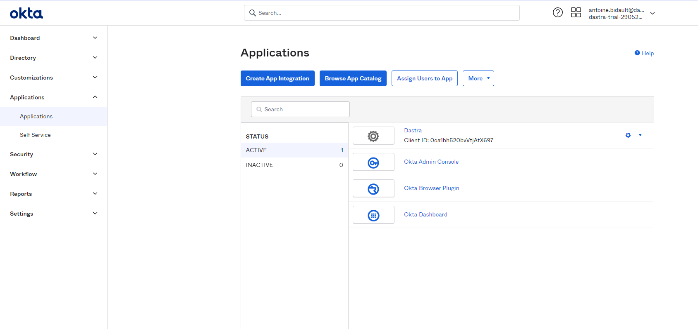
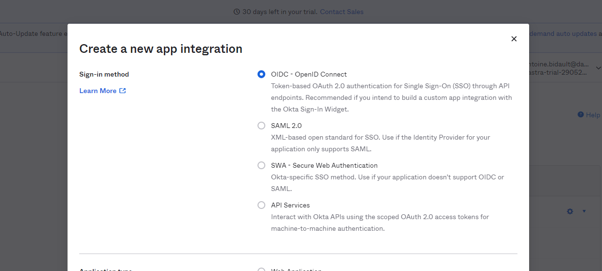
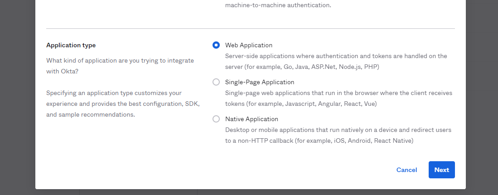
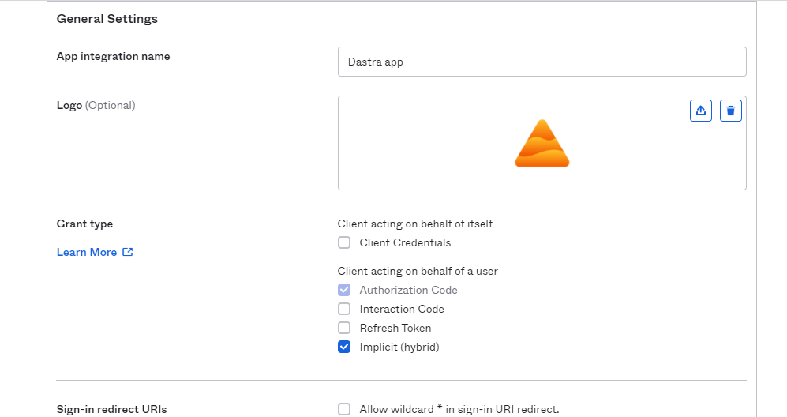
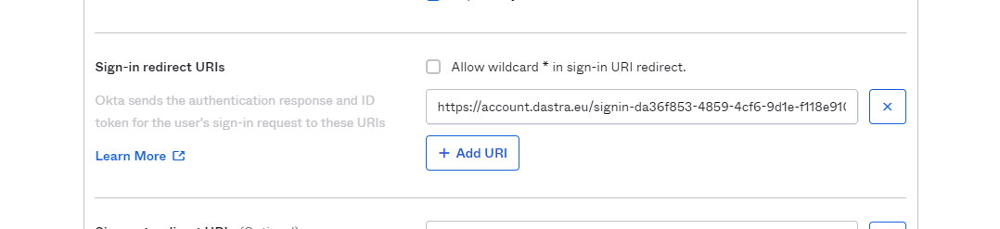
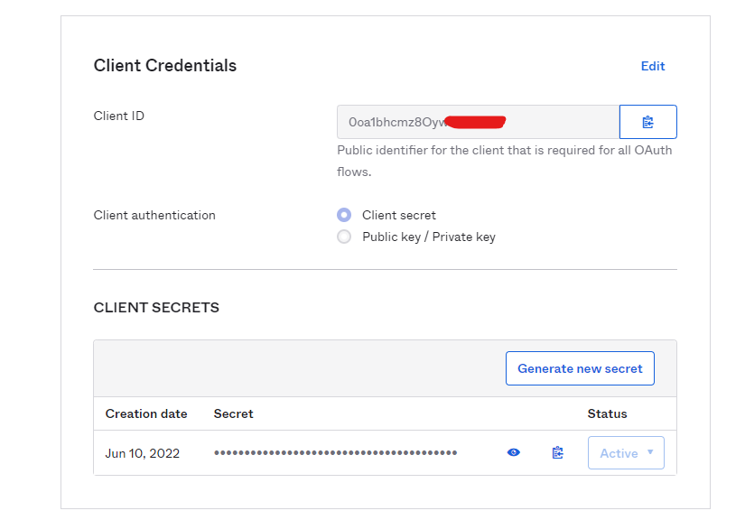
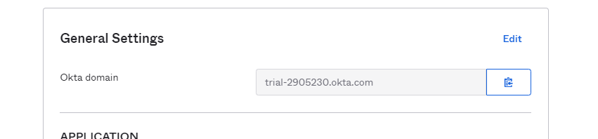
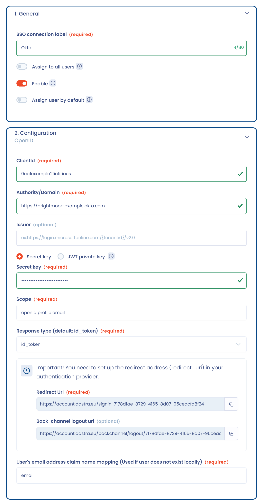

# Okta

Cette page explique comment configurer le login Okta en SSO dans Dastra avec le protocole **OpenID Connect**. Il est également possible de le faire avec SAML : voir [SAML 2](saml.md).

1. Connectez-vous à la console d'administration d'Okta.
2. Ouvrez le menu **Applications** > **Applications**, puis cliquez sur **Create App Integration**.

   
3. Sélectionnez **OIDC - OpenID Connect**.

   
4. Sélectionnez le type d'application **Web application**.

   
5. Configurez l'application et cochez **Implicit (hybrid)** dans **Grant type**. Pour le logo de l'application, vous pouvez [utiliser celui-ci](https://www.dastra.eu/img/press/logodastra.png).

   
6. Dans Dastra, récupérez l'URL de redirection : ouvrez [la page de gestion du SSO](https://app.dastra.eu/general-settings/sso), cliquez sur **Ajouter un login SSO** et choisissez **OpenID**. Dans la section **Configuration**, vers le bas du formulaire, copiez l'URL de redirection.

   <figure><figcaption>
L'URL de redirection affichée par Dastra
</figcaption></figure>
7. Retournez dans Okta et collez l'URL de redirection dans **Sign-in redirect URIs**. Sélectionnez les utilisateurs d'Okta à qui vous souhaitez donner accès à Dastra (par défaut, vous pouvez cocher **Allow everyone**), puis cliquez sur **Save**.

   
8. Okta affiche la page des paramètres de la nouvelle application : l'identifiant du client (Client ID), la clé secrète (Client secret) et le domaine Okta, qui sert d'autorité.

   

   
9. Retournez dans Dastra et renseignez les champs du formulaire :

   * **Id du client (ClientId)** : copiez le Client ID d'Okta.
   * **Authority/Domain** : saisissez le domaine d'Okta avec le protocole (`https://<votre domaine>.okta.com`).
   * **Issuer** : laissez le champ vide.
   * **Clé secrète** : copiez la clé secrète d'Okta.
   * **Scope** : `openid profile email`.
   * **Type de réponse** : `id_token`.

   <figure><figcaption>
Le formulaire OpenID de Dastra
</figcaption></figure>
10. Cliquez sur **Enregistrer**, puis sur **Tester** sur la carte de la connexion. Si Okta vous redirige vers Dastra, la configuration est terminée.
