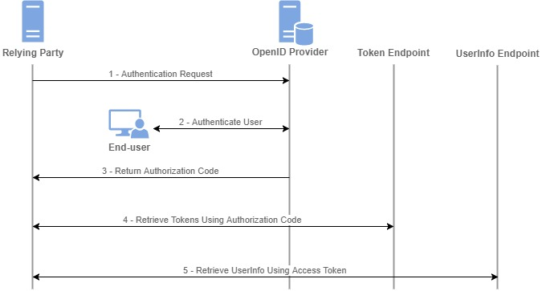
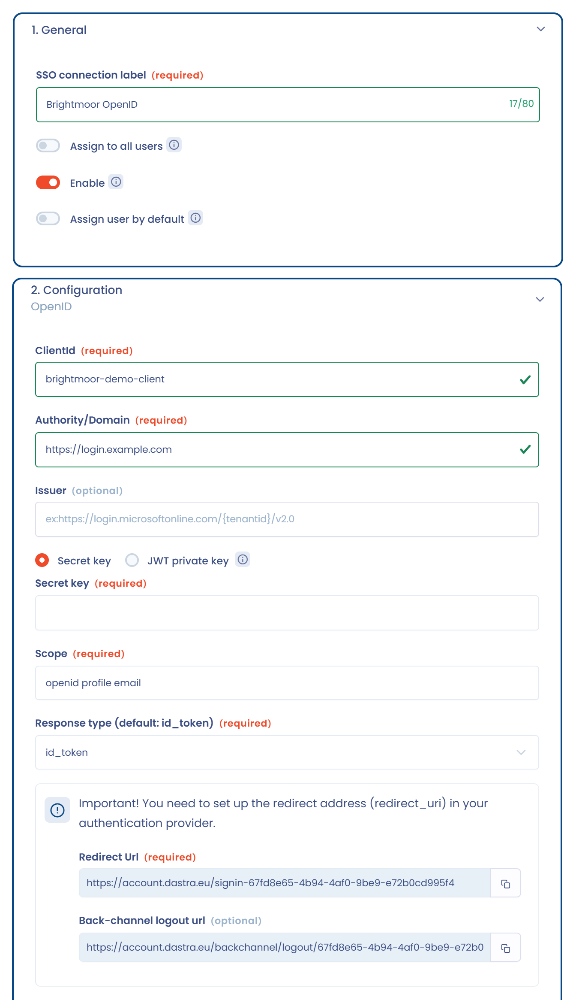
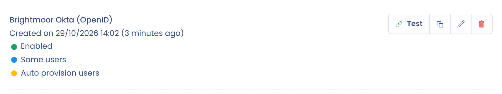

# OpenId

## Principe de fonctionnement

Les spécifications d'OpenId se trouvent [ici](https://openid.net/connect/).

<figure><figcaption></figcaption></figure>

La configuration du SSO avec OpenId se fait en trois étapes :

* configuration du fournisseur d'authentification : Active Directory, Google Workspace, etc. ;
* configuration du fournisseur de service : Dastra ;
* test de l'authentification.

## 1. Configuration du fournisseur d'authentification

Vous devez mettre en place une configuration OpenId dans votre fournisseur d'authentification.

Pour Active Directory : [https://learn.microsoft.com/fr-fr/entra/identity-platform/v2-protocols-oidc](https://learn.microsoft.com/fr-fr/entra/identity-platform/v2-protocols-oidc)

Pour faire le rapprochement entre les comptes locaux (ceux hébergés dans Dastra) et les comptes de votre fournisseur, Dastra a besoin d'une propriété contenant l'e-mail de l'utilisateur. Le champ **Le nom du claim contenant l'adresse email** de l'étape 2 est prérempli avec `email`. Si ce claim est absent, Dastra cherche aussi la propriété nommée [http://schemas.xmlsoap.org/ws/2005/05/identity/claims/emailaddress](http://schemas.xmlsoap.org/ws/2005/05/identity/claims/emailaddress).

Voici les informations dont vous avez besoin pour renseigner le fournisseur de service :

* **Authority/Domain**, par exemple `https://account.oauth.sso.com` ;
* **Id du client (ClientId)** ;
* **Clé secrète**, ou les éléments de la clé privée JWT (voir la méthode d'authentification du client à l'étape 2) ;
* **Type de réponse**, par défaut `id_token` ;
* **Scope**, par défaut `openid profile email`.

Pour configurer votre fournisseur d'authentification, vous avez besoin de l'**URL de redirection** affichée dans le formulaire de Dastra, au format `https://account.dastra.eu/signin-{identifiant de la connexion}`. Cette URL est propre à chaque connexion.

## 2. Configuration du fournisseur de service

Dans Dastra, ouvrez [la page d'administration du SSO](https://app.dastra.eu/general-settings/sso) (**Configuration de l'organisation** > **Single sign on**, réservée aux propriétaires de l'organisation) et cliquez sur **Ajouter un login SSO**. Choisissez le protocole **OpenID**.

<figure><figcaption></figcaption></figure>

Renseignez les champs du formulaire à l'aide des informations de votre fournisseur d'authentification :

<figure><figcaption></figcaption></figure>

Le formulaire affiche aussi les valeurs à déclarer chez votre fournisseur d'authentification :

* **URL de redirection** ;
* **URL de déconnexion (Back-channel logout url)**, facultative ;
* **URI de clé publique JSON**, uniquement avec la clé privée JWT. Enregistrez le formulaire une fois pour que ce point de terminaison fonctionne.

Déclarez l'**URL de déconnexion (Back-channel logout url)** chez votre fournisseur si vous voulez qu'une déconnexion chez le fournisseur mette aussi fin à la session Dastra. Dastra prend en charge OpenID Connect Back-Channel Logout : lorsque votre fournisseur envoie un jeton de déconnexion pour un utilisateur ou une session, Dastra révoque les sessions correspondantes, et l'utilisateur doit se reconnecter.

### Méthode d'authentification du client : clé secrète ou clé privée JWT

Choisissez comment Dastra s'authentifie auprès de votre fournisseur d'identité :

* **Clé secrète** : Dastra et votre fournisseur stockent le même secret client. Saisissez-le dans le champ **Clé secrète**.
* **Clé privée JWT** : Dastra signe son authentification avec la clé privée que vous lui fournissez, et votre fournisseur vérifie la signature avec la clé publique. Aucun secret partagé n'est nécessaire, ce qui réduit le risque de fuite. Vérifiez que votre fournisseur d'identité prend en charge cette méthode.

<figure><figcaption></figcaption></figure>

Avec **Clé privée JWT**, le **Type de réponse** passe à `code` et le formulaire demande :

* **Clé privée dans le texte PEM (RAW)** : après l'enregistrement, la clé n'est plus affichée. Cliquez sur **Replace private key** pour la remplacer ;
* **Contenu du certificat (format RAW), obligatoire pour Entra Id** ;
* **Identifiant de clé (kid)**, facultatif : renseignez l'identifiant assigné par votre fournisseur lors de l'import de la clé publique, ou laissez vide pour que Dastra utilise l'empreinte JWK (RFC 7638) de la clé privée.

Déclarez ensuite l'**URI de clé publique JSON** chez votre fournisseur, pour qu'il puisse récupérer la clé publique de la connexion.

Le champ **Issuer** est facultatif. S'il est renseigné, Dastra vérifie que le jeton reçu a bien été émis par cet émetteur, par exemple `https://login.microsoftonline.com/{tenantid}/v2.0`.


Vous pouvez forcer tous les utilisateurs de l'organisation à utiliser un SSO particulier (option **Forcer pour tous les utilisateurs**). Soyez prudent : si le SSO dysfonctionne, vous ne pourrez plus accéder à votre compte en tant qu'administrateur. Gardez un compte local de secours, ou exemptez des utilisateurs avec le champ **Utilisateurs spécifiques exemptés de SSO (par exemple, les administrateurs de sécurité)** (voir [Single Sign On (SSO)](README.md)). Il est préférable de gérer le SSO par utilisateur.



**Cas particulier des utilisateurs externes**\
Seuls les comptes internes à un abonnement sont soumis au SSO. Les comptes d'utilisateurs externes (qui ont un autre abonnement supplémentaire) ne sont pas soumis au SSO.


## 3. Tester le SSO avec OpenId

Une fois la configuration terminée, testez l'authentification en cliquant sur **Tester**, à droite de la connexion dans la liste. Si vous rencontrez un problème, ouvrez un ticket depuis la [page du support](https://app.dastra.eu/general-settings/support).

<figure><figcaption></figcaption></figure>
