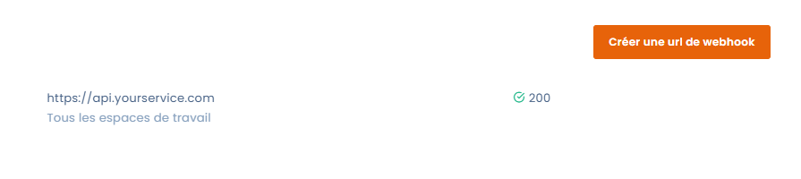
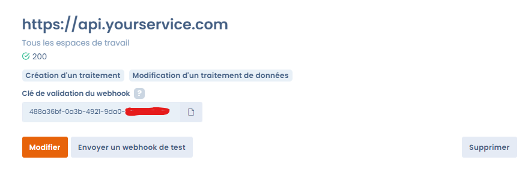

# Webhooks



## Concept

Un webhook déclenche une action à la suite d'un évènement. Les webhooks servent à faire communiquer des systèmes : ils vous alertent dès que quelque chose se produit dans Dastra. L'objectif est de notifier des applications tierces (API, CRM, fonctions serverless...) en temps réel.

## Configuration

Les webhooks se configurent au niveau de l'organisation et sont réservés aux propriétaires. Cliquez sur l'icône d'engrenage de la barre supérieure (**Réglages de l'organisation**), puis sur **Webhooks** dans le menu de gauche. L'adresse directe est [https://app.dastra.eu/general-settings/webhooks](https://app.dastra.eu/general-settings/webhooks).

<figure><figcaption><p>La liste des webhooks</p></figcaption></figure>

1. Cliquez sur **Créer une url de webhook**.
2. Renseignez l'**Url du webhook**. Pour en savoir plus sur ce qu'elle reçoit, consultez la section [Comment réceptionner le webhook](webhooks.md#comment-receptionner-le-webhook).
3. Choisissez l'espace de travail concerné dans **Sélection d'un espace de travail spécifique**. Sans choix, le webhook s'applique à **Tous les espaces de travail**.
4. Facultatif : renseignez l'**Adresse email utilisée pour l'envoi de notification en cas d'échec répété**. Dastra y envoie un e-mail lorsque le webhook passe en erreur.
5. Sélectionnez le ou les évènements auxquels vous souhaitez vous abonner dans **Quel(s) évènement(s) souhaitez-vous recevoir ?** Au moins un évènement est nécessaire. Le type de données renvoyé dépend de l'évènement : par exemple, si vous choisissez la création d'une demande d'exercice des droits, le corps de la requête contient un JSON décrivant cette demande.
6. Cliquez sur **Enregistrer**.

<figure><figcaption><p>Le formulaire d'un webhook</p></figcaption></figure>

Les évènements proposés sont ceux du centre de notifications, regroupés par type d'objet (traitements, demandes d'exercice des droits, violations de données, etc.).


Une organisation peut déclarer 30 webhooks au maximum.


Vous arrivez sur l'écran de détail du webhook. Il présente l'url, l'espace de travail, l'état du webhook (**Actif** ou **Désactivé**), le **Dernier message erreur** le cas échéant, les évènements souscrits et la **Clé de validation du webhook**, que vous pouvez copier. Les boutons **Modifier**, **Envoyer un webhook de test** et **Supprimer** s'y trouvent aussi.

<figure><figcaption><p>Le détail d'un webhook</p></figcaption></figure>

## Réceptionner le webhook <a href="#comment-receptionner-le-webhook" id="comment-receptionner-le-webhook"></a>

Pour réceptionner les requêtes du webhook, vous devez créer un endpoint d'API de captation de l'évènement. La requête effectuée est en POST et est toujours structurée de la même façon. Le body de la requête contient un JSON avec le détail de l'évènement déclenché.

Voici la structure générale de la requête envoyée :

```json
{
 "webhookId": <id of the webhook configured in dastra>,
 "signatureUrl": "https://yourapi.com/webhooks/handle",
 "userId": <The user who triggered the event>,
 "eventType": <The id of the event>,
 "eventName": <The label of the event>,
 "data": <Event dynamic data>,
 "date": <date of the event>
}
```

Un timeout de 10 secondes est appliqué à la requête : au-delà, elle est en erreur. La réponse doit être un code de succès (2xx), par exemple 200.

Il peut y avoir un petit délai entre le moment où l'évènement a lieu dans l'application et l'envoi du webhook. Ce délai est lié à la nature asynchrone de l'exécution des webhooks dans notre infrastructure. Il dépend de la charge de l'infrastructure et peut atteindre 60 à 120 secondes.


Il n'existe pour l'instant aucun système permettant de rejouer les webhooks qui ont échoué, et donc de compenser une indisponibilité du serveur de réception. Dans ce cas, nous vous recommandons d'effectuer une synchronisation manuelle des évènements qui ont échoué.


## Tester votre url de webhook

Pour tester votre webhook en condition réelle, ouvrez son écran de détail et cliquez sur **Envoyer un webhook de test**. Dans la fenêtre **Outil de test de webhook** :

1. Choisissez l'évènement à tester dans **Choisissez l'évènement que vous souhaitez tester**. La liste reprend les évènements auxquels le webhook est abonné.
2. Au besoin, modifiez les données envoyées dans **Modifier les données envoyées (Si nécessaire)**. Dastra les remplit avec un exemple pour l'évènement choisi.
3. Cliquez sur **Envoyer un webhook de test**.

Un message de confirmation indique que votre url a répondu 200. Si le webhook avait été bloqué à la suite d'erreurs, un test réussi le réactive.

<figure><figcaption><p>L'outil de test d'un webhook</p></figcaption></figure>

## Sécuriser le webhook <a href="#comment-securiser-le-webhook" id="comment-securiser-le-webhook"></a>


La validation de la requête entrante n'est pas obligatoire, mais elle est recommandée. Elle empêche une personne qui aurait observé le réseau de poster n'importe quoi sur votre url de webhook, et ainsi de déclencher ou de multiplier la création d'éléments dans votre système.


Chaque fois qu'un évènement auquel vous êtes abonné se produit, Dastra envoie une requête POST à l'url du webhook. Chaque requête contient l'en-tête `Dastra-Signature`, que votre serveur peut lire.

Sa valeur est le HMAC-SHA256 du corps JSON exact de la requête, calculé avec la clé de validation du webhook, puis encodé en Base64.

> Dastra-Signature = **Base64**(**HMAC-SHA256**(\<corps JSON de la requête>, \<clé de validation du webhook>))

Utilisez la clé de validation telle qu'elle est affichée sur l'écran de détail du webhook, sans la modifier. Voici des exemples de validation de la signature :



```php
<?php
$secret = 'YOUR_WEBHOOK_KEY'; // clé de validation affichée sur l'écran de détail du webhook

$payload = file_get_contents('php://input'); // corps brut de la requête
$signature = $_SERVER['HTTP_DASTRA_SIGNATURE'] ?? ''; // valeur de l'en-tête Dastra-Signature

$computed = base64_encode(hash_hmac('sha256', $payload, $secret, true));

if (!hash_equals($computed, $signature)) {
    http_response_code(401);
    exit;
}

// la signature est valide : traitez l'évènement
http_response_code(200);
```



```csharp
[HttpPost("webhooks/handle")]
public async Task<IActionResult> Handle()
{
    string signature = Request.Headers["Dastra-Signature"];
    string key = "YOUR_WEBHOOK_KEY";

    using var reader = new StreamReader(Request.Body, Encoding.UTF8);
    string payload = await reader.ReadToEndAsync();

    if (!ValidateSignature(signature, payload, key))
    {
        return Unauthorized();
    }

    // la signature est valide : traitez l'évènement
    return Ok();
}

private static bool ValidateSignature(string signature, string payload, string secret)
{
    using var hmac = new HMACSHA256(Encoding.UTF8.GetBytes(secret));
    byte[] hash = hmac.ComputeHash(Encoding.UTF8.GetBytes(payload));
    string computed = Convert.ToBase64String(hash);

    return CryptographicOperations.FixedTimeEquals(
        Encoding.UTF8.GetBytes(computed),
        Encoding.UTF8.GetBytes(signature ?? string.Empty));
}
```



## Comportement en cas d'erreur

Le webhook est considéré en erreur lorsque plus de 5 erreurs ont été enregistrées. Dastra n'envoie plus d'évènements à son url tant que la dernière erreur date de moins de 24 heures. Si une adresse e-mail est renseignée dans la configuration, elle reçoit alors un message. Un test réussi remet le compteur d'erreurs à zéro.

## Comment mettre en place des webhooks avec les API

Récupérez les webhooks liés à votre compte (dans tous les espaces de travail). Le paramètre facultatif `workspaceId` limite la liste à un espace de travail.


[dastra-api.json](../../.gitbook/assets/dastra-api.json)


Créez une nouvelle url de webhook en utilisant le endpoint POST. Renseignez les évènements auxquels vous souhaitez abonner votre webhook avec le paramètre `subscribedEvents`.


[dastra-api.json](../../.gitbook/assets/dastra-api.json)


Un identifiant de webhook vous est retourné. Utilisez-le pour consulter, modifier ou supprimer le webhook.


[dastra-api.json](../../.gitbook/assets/dastra-api.json)



[dastra-api.json](../../.gitbook/assets/dastra-api.json)



[dastra-api.json](../../.gitbook/assets/dastra-api.json)

