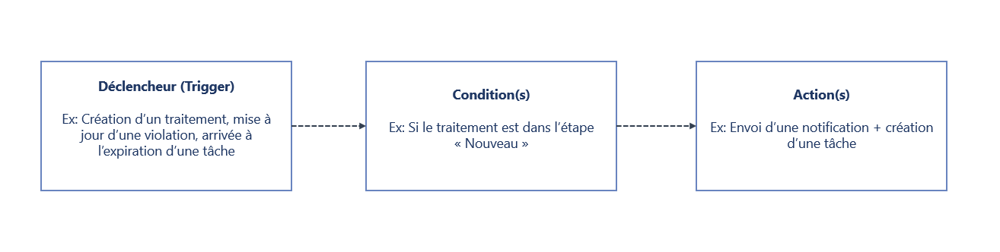
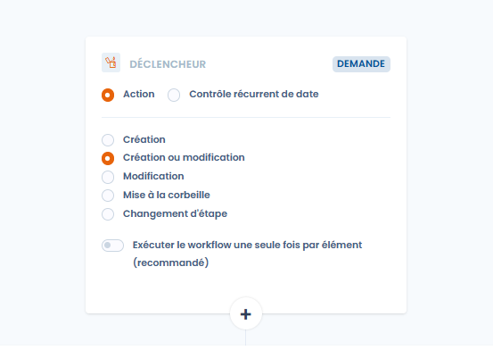
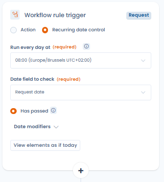
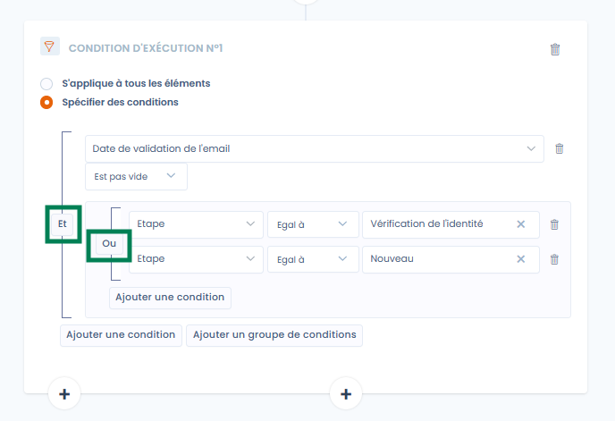
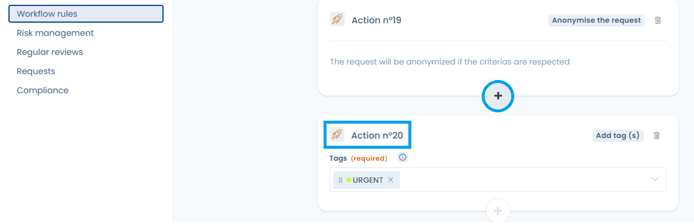
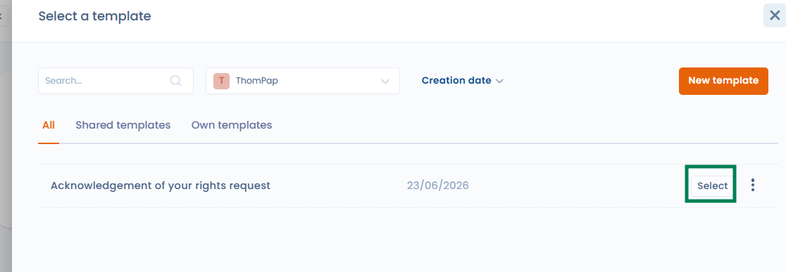
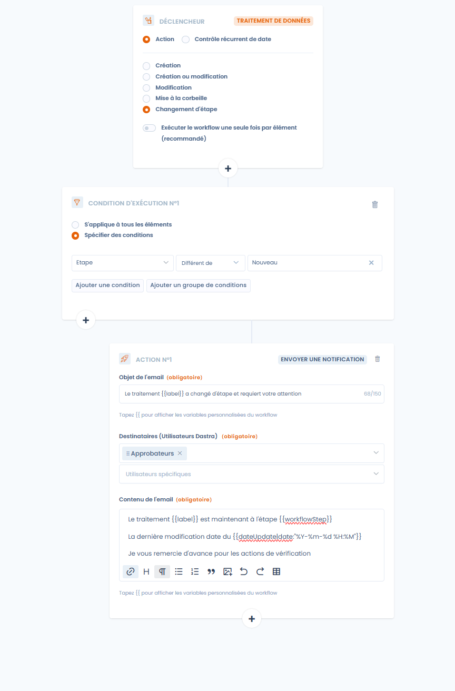
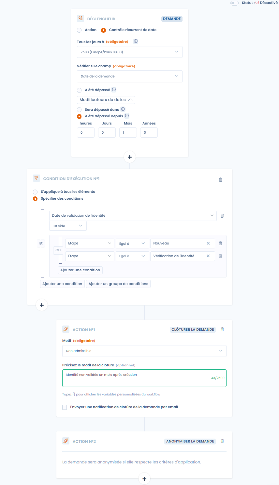
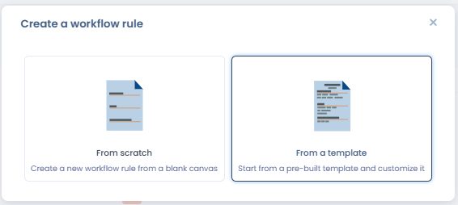

# Règles de workflows


**Étapes de processus vs règles de workflow**

Les [étapes de processus](workflow-stages.md) définissent les statuts que traversent les objets (ex. Nouveau → En cours → Fait). Les **règles de workflow** automatisent des actions lorsque ces étapes ou d'autres événements surviennent. Les deux fonctionnalités sont complémentaires.


## Le principe de fonctionnement

Une règle de workflow est un ensemble d'actions (notifications par e-mail, planification d'une réponse à un questionnaire, tâches, mises à jour de champs…) exécutées lorsque certaines conditions sont réunies. Elle automatise l'envoi de notifications, l'attribution de tâches et la mise à jour de certains champs d'un enregistrement.

Chaque règle suit une logique en trois temps : un déclencheur, des conditions et des actions.

<figure><figcaption><p>Déclencheur, conditions et actions</p></figcaption></figure>

Une règle porte sur un type d'objet. Les types proposés dépendent des modules activés sur votre abonnement :

| Type d'objet                    |
| ------------------------------- |
| Traitement de données           |
| Demande                         |
| Violation de données            |
| Tâche                           |
| Actif                           |
| Acteur                          |
| Données                         |
| Mesure de sécurité              |
| Catégorie de personne concernée |
| Système d'IA                    |
| Contrat                         |
| Soumission de questionnaire     |


Le nombre de règles de workflow disponibles dépend de votre plan, de **25 à 100 règles**. Une capacité supplémentaire peut être achetée si nécessaire. Contactez votre account manager pour plus de détails.


## Créer une règle de workflow

1. Dans le menu latéral, ouvrez **Automatisations** puis **Règles de workflow**.
2. Cliquez sur **Créer une règle de workflow**.
3. Choisissez **De zéro** pour partir d'un canevas vierge, ou **A partir d'un modèle** (voir [Bibliothèque de modèles de règles](#bibliotheque-de-modeles-de-regles)).
4. Saisissez le **Nom de la règle** et le **Type d'élément** concerné (traitement, violation…), puis validez.

Vous arrivez dans le designer de règles. En haut de l'écran, l'interrupteur **Statut** active ou désactive la règle. Les boutons **Historique** et **Exécuter** sont décrits plus bas. Le menu du bouton **Enregistrer** propose aussi **Enregistrer et quitter** et **Enregistrer le modèle**.

### Définition du déclencheur

Le déclencheur se choisit entre deux valeurs :

* **Action** : la règle se déclenche lors d'un événement sur l'objet. Les événements proposés sont **Création**, **Création ou modification**, **Modification**, **Mise à la corbeille** et **Changement d'étape**. La mise à la corbeille n'est pas proposée pour les actifs, les acteurs, les données, les mesures de sécurité et les catégories de personnes concernées.

<figure><figcaption><p>Création d'un déclencheur par action</p></figcaption></figure>

*   **Contrôle récurrent de date** : la règle est évaluée chaque jour à une heure configurée et se déclenche en fonction d'un champ date de l'objet. Configurez les paramètres suivants :

    * **Tous les jours à** : l'heure du contrôle quotidien, affichée avec votre fuseau horaire (ex. 00:00 Europe/Paris).
    * **Vérifier si le champ** : le champ date à évaluer (ex. date de clôture, date de création, date de révision…).
    * Le moment du déclenchement, à choisir parmi :
      * **A été dépassé** : la règle se déclenche le jour où la date est atteinte.
      * **Modificateurs de dates**, qui ajoutent un décalage par rapport à la date :
        * **Sera dépassé dans** : la règle se déclenche N heures, jours, mois ou années _avant_ la date (ex. 30 jours avant l'expiration d'un contrat).
        * **A été dépassé depuis** : la règle se déclenche N heures, jours, mois ou années _après_ la date (ex. 1 jour après la clôture).

    Le bouton **Voir les éléments concernés aujourd'hui** affiche un aperçu des objets qui correspondraient actuellement à la règle, ce qui est utile pour tester avant activation.

<figure><figcaption><p>Création d'un déclencheur par contrôle récurrent de date</p></figcaption></figure>

Un seul déclencheur (ou trigger) peut être défini par règle de workflow.

Pour les événements **Création ou modification**, **Modification**, **Mise à la corbeille** et **Changement d'étape**, l'option **Exécuter le workflow une seule fois par élément (recommandé)** est activée par défaut. Il est fortement recommandé de la conserver, car l'exécution d'un workflow plusieurs fois sur le même élément peut conduire à des créations de tâches répétées ou à des doublons de notifications.

### Définition de conditions

Une règle comporte jusqu'à cinq conditions d'exécution. Chaque condition porte ses propres actions. Les boutons **+** du designer ajoutent une condition.

Pour chaque condition, choisissez :

* **S'applique à tous les éléments** : la règle s'exécute sur tous les éléments qui correspondent au déclencheur, sans filtre supplémentaire.
* **Spécifier des conditions** : filtrez selon la valeur d'un ou plusieurs champs de l'objet (par exemple « Etape est égal à Nouveau »).

Les conditions peuvent s'appliquer à l'ensemble des champs de l'objet et être assemblées au sein de groupes, avec la possibilité de changer l'association **Et** ou **Ou**. Utilisez **Ajouter une condition** pour ajouter une ligne dans un groupe, et **Ajouter un groupe de conditions** pour créer un bloc logique distinct.

<figure><figcaption><p>Ici l'action sera lancée si l'étape est « Vérification de l'identité » ou « Nouveau » ET que la date de validation de l'e-mail est remplie</p></figcaption></figure>

### Définition des actions

Pour ajouter une action, cliquez sur le bouton **+** d'une condition, puis choisissez l'action dans la fenêtre **Choisissez une action à exécuter**. Une condition peut comporter jusqu'à **20 actions**. Au-delà, le bouton d'ajout se désactive et un message indique que le maximum est atteint.

<figure><figcaption><p>Une condition peut comporter jusqu'à 20 actions</p></figcaption></figure>

Voici les actions que vous pouvez déclencher :

| Action                                       | Rôle                                                                                              | Types d'objets exclus                                                                              |
| -------------------------------------------- | ------------------------------------------------------------------------------------------------- | -------------------------------------------------------------------------------------------------- |
| **Modifier un champ**                        | Mettre à jour un champ de l'objet                                                                 |                                                                                                    |
| **Définir utilisateur assigné**              | Assigner l'objet à un utilisateur, à un membre d'une équipe ou à une variable de l'objet          | Acteur, données, mesure de sécurité, catégorie de personne concernée, soumission de questionnaire |
| **Ajouter une tâche**                        | Créer une tâche liée à l'objet                                                                    |                                                                                                    |
| **Envoyer une notification**                 | Envoyer une notification par e-mail                                                               |                                                                                                    |
| **Ajouter tag(s)**                           | Ajouter un ou plusieurs tags à l'objet                                                            | Données, soumission de questionnaire                                                               |
| **Planifier une réponse à un questionnaire** | Planifier automatiquement une réponse à un questionnaire                                          | Soumission de questionnaire                                                                        |
| **Exécuter un agent IA**                     | Lancer un agent IA (voir [Exécuter un agent IA](#executer-un-agent-ia))                           |                                                                                                    |
| **Envoyer une notification Teams**           | Publier une carte dans un canal Microsoft Teams, si l'intégration Microsoft Teams est installée   |                                                                                                    |
| **Envoyer une requête HTTP**                 | Appeler l'API d'une plateforme externe, si l'intégration HTTP / Custom API est activée            |                                                                                                    |

Pour les demandes d'exercice de droits, des actions supplémentaires sont disponibles :

* **Envoyer un message de demande** : envoyer un message au demandeur.
* **Clôturer la demande**
* **Anonymiser la demande** (uniquement possible si la demande est clôturée)

L'action **Déplacer dans la corbeille** est disponible pour les demandes et pour les traitements.


Exemple : envoyer une notification à plusieurs personnes lors de la création d'une tâche. Pour cela, choisissez le type d'objet **Tâche** et, selon les conditions de la tâche (par exemple l'ajout d'un tag), ajoutez une action **Envoyer une notification**.


### Unité organisationnelle d'une tâche créée

L'action **Ajouter une tâche** comporte un champ **Unité organisationnelle** qui détermine l'unité de rattachement de la tâche créée :

* **Par défaut (hérité de l'objet)** : la tâche est rattachée à l'unité organisationnelle de l'objet déclencheur, s'il en a une. C'est la valeur appliquée lorsque le champ reste vide.
* **Une unité précise** : sélectionnez une unité dans l'arborescence ; la tâche est rattachée à cette unité, quelle que soit l'unité de l'objet déclencheur.

Pour les règles portant sur les objets des référentiels (**Actif**, **Données**, **Mesure de sécurité**, **Acteur**, **Catégorie de personne concernée**), qui n'ont pas d'unité organisationnelle, le champ est obligatoire.

<figure><figcaption><p>Choix de l'unité organisationnelle de la tâche créée par la règle</p></figcaption></figure>

### Personne assignée et propriétaire d'une tâche créée

L'action **Ajouter une tâche** comporte les champs **Assignée à** et **Propriétaire**. Chacun accepte une variable de l'objet déclencheur (son créateur, son propriétaire, son responsable, etc.) ou un utilisateur nommé. Si la variable n'est pas renseignée sur l'objet, la tâche est tout de même créée.

La variable **Responsable de l'UO** confie la tâche au responsable de l'unité organisationnelle de l'objet déclencheur. Si cette unité n'a pas de responsable, celui de l'unité parente la plus proche est retenu. Si l'objet n'a pas d'unité organisationnelle, l'action utilise l'**Unité organisationnelle par défaut** sélectionnée dans l'action, avec la même règle. Si aucun responsable n'est trouvé, la tâche est créée sans assigné, sans bloquer la règle.

Pour répartir le travail dans une équipe, choisissez **Sélectionnez un utilisateur dans l'équipe** dans l'action **Définir utilisateur assigné**, puis sélectionnez l'équipe dans **Sélectionnez une équipe**. Dastra choisit un utilisateur de l'équipe selon le modèle du tourniquet : à chaque déclenchement de la règle, le membre suivant de l'équipe est choisi.

### Lier un modèle de message à une action

Pour les règles liées aux **demandes d'exercice de droits**, l'action **Envoyer un message de demande** peut s'appuyer sur un **modèle de message** existant plutôt que sur un contenu saisi manuellement.

<figure><figcaption><p>L'action Envoyer un message de demande propose Sélectionner un modèle</p></figcaption></figure>

Dans l'action, cliquez sur **Sélectionner un modèle**, puis choisissez un modèle de type **Message de demande d'ex. de droits** de votre espace de travail. Au déclenchement de la règle, le contenu du modèle est récupéré et les variables personnalisées (par exemple `{{ givenName }}`, `{{ refId }}`) sont substituées automatiquement.

<figure><figcaption><p>Choix d'un modèle de type message de demande de l'espace de travail</p></figcaption></figure>

* Le message envoyé utilise toujours la version à jour du modèle, même si celui-ci est modifié après la création de la règle.
* Si le modèle lié est supprimé, l'exécution échoue explicitement : le message n'est pas envoyé silencieusement.
* Les règles utilisant un contenu manuel ne sont pas affectées. Vous pouvez repasser d'un modèle lié à un contenu manuel à tout moment en cliquant sur **Retirer**.

<figure><figcaption><p>Une fois lié, le modèle peut être changé ou retiré ; les variables sont substituées à l'exécution</p></figcaption></figure>

### Envoyer une notification Teams

Lorsque l'[intégration Microsoft Teams](../integrations/microsoft-teams.md) est installée et activée sur l'espace de travail, l'action **Envoyer une notification Teams** publie une carte dans le canal Teams relié au webhook. Il n'y a pas de destinataire à choisir.

Renseignez les champs suivants :

* **Titre de la carte** (obligatoire, 150 caractères au maximum).
* **Message** : texte riche affiché dans la carte.
* **Inclure un lien vers l'objet dans la carte** : ajoute à la carte un lien direct vers l'objet déclencheur dans Dastra. L'option est activée par défaut.

Le titre et le message acceptent les variables personnalisées de l'objet déclencheur : tapez `{{` pour afficher la liste des variables disponibles (voir [Variables personnalisées](#variables-personnalisees)).


L'action n'apparaît dans la liste des actions que si l'intégration Microsoft Teams est installée et activée. Si l'intégration est désinstallée ou désactivée, le formulaire de l'action affiche un avertissement : l'action échoue tant que l'intégration n'est pas configurée.


### Envoyer une requête HTTP

L'action **Envoyer une requête HTTP** appelle l'API d'une plateforme externe au déclenchement de la règle : outil de ticketing, ITSM, service interne, hub d'automatisation. Elle sert lorsqu'aucun connecteur natif n'existe pour votre outil.

**Prérequis** : l'intégration [HTTP / Custom API](../integrations/custom-http.md) est activée dans **Réglages espace de travail** > **Intégrations**, avec une connexion pour la plateforme cible (clé d'API, identifiants Basic ou OAuth 2.0). Ajouter ou modifier cette action demande la permission **Intégrations** sur l'espace de travail.

Renseignez les champs suivants :

* **Méthode** (GET, POST, PUT, PATCH ou DELETE) et **URL** absolue (`https://…`). L'hôte est fixe ; le chemin et les paramètres peuvent contenir des variables.
* Onglet **Authentification** : la connexion à utiliser, ou **Sans authentification** pour un point d'accès public. Les identifiants restent sur la connexion, jamais dans la règle.
* Onglet **En-têtes** : jusqu'à 20 en-têtes, dont les valeurs acceptent des variables.
* Onglet **Corps** (POST, PUT et PATCH) : un corps **JSON** ou **XML** rédigé comme un modèle.

Tapez `{{` dans l'URL, un en-tête ou le corps pour insérer les champs de l'objet déclencheur (voir [Variables personnalisées](#variables-personnalisees)). Le corps rendu doit être un JSON ou un XML bien formé, sinon rien n'est envoyé et l'exécution est journalisée en erreur.

* **Tester la requête** rend la requête avec un objet réel de l'espace de travail. **Aperçu** n'envoie rien ; **Envoyer la requête** fait l'appel réel et affiche la réponse de la cible.
* **Générer avec l'IA** rédige la requête à partir d'une consigne et du payload attendu par la cible. Seuls les noms et types des champs sont transmis à l'assistant, jamais vos données ni vos identifiants.

<figure><figcaption><p>L'action Envoyer une requête HTTP</p></figcaption></figure>


Désactiver ou désinstaller l'intégration HTTP / Custom API, ou supprimer une connexion, désactive automatiquement les règles qui en dépendent. Réactivez-les une fois la dépendance rétablie. Chaque envoi est tracé dans les journaux de l'intégration.


### Exécuter un agent IA

L'action **Exécuter un agent IA** lance un [agent IA](../general/ai-assistant/agents/README.md) de votre espace de travail lorsque la règle se déclenche. Elle est réservée aux plans qui incluent les agents IA personnalisés et aux utilisateurs autorisés à les gérer.

Renseignez les champs suivants :

* **Agent IA à exécuter** : seuls les agents publiés en mode Agent sont proposés. Si la liste est vide, créez d'abord un agent dans le module Agents IA.
* **Message d'instruction** : message facultatif transmis à l'agent à chaque exécution. Il accepte les variables personnalisées de l'objet déclencheur (tapez `{{`).
* **Champs d'entrée de l'agent** : les champs définis par l'agent apparaissent après sa sélection. Renseignez au moins ceux qui sont obligatoires.

### Variables personnalisées

Dans les notifications personnalisées par exemple, il est souvent utile d'injecter des informations provenant de l'objet entré dans le workflow : le nom du traitement ou sa date de publication sont autant de variables que vous pouvez insérer dans le texte grâce au système d'injection de variables. Dastra utilise un moteur de templating basé sur [LiquidJS](https://shopify.github.io/liquid/basics/introduction/).

Pour accéder aux variables de l'objet du déclencheur, tapez `{{` : la liste des variables disponibles s'affiche. Les champs personnalisés de l'espace de travail sont disponibles sous la forme `customFields.<clé>`.

Pour afficher une variable de type chaîne de caractères (la référence d'un traitement) :

```
{{ref}}
```

Pour afficher toutes les valeurs d'une variable de type tableau (les tags) :

```


 {{ tag.label }}


```

Pour afficher uniquement la première valeur d'une variable de type tableau (le premier approbateur d'un traitement) :

```


{{accountable.displayName}}
```

### Exemples

**Exemple de workflow basé sur une action**

Cet exemple notifie les approbateurs d'un traitement lors d'un changement d'étape, si l'étape courante est différente de « Nouveau ».

<figure><figcaption></figcaption></figure>

**Exemple de workflow basé sur une date**

Cet exemple nettoie automatiquement les demandes d'exercice de droits dont l'identité du demandeur n'a pas été validée un mois après la création.

<figure><figcaption><p>Tous les jours, fermer et anonymiser les demandes de droit dont l'identité du demandeur n'a pas été validée un mois après la création</p></figcaption></figure>

Quatre règles complètes, avec leur déclencheur, leurs conditions et leurs actions, sont décrites dans [Recettes de workflow](../../examples/workflow-recipes.md).

## Historique d'exécution

Chaque règle conserve l'historique de ses exécutions. Cliquez sur **Historique** dans le designer pour afficher, pour chaque objet traité :

* **Date dernière exécution**
* **Statut**
* **Nombre d'exécut.**
* Le résultat : **Réussite**, **Dern. exécution en erreur** ou **En erreur**, avec le nombre d'erreurs

Le menu de chaque ligne propose :

* **Voir l'objet lié** : ouvrir l'objet qui a déclenché la règle.
* **Relancer l'éxecution de la règle** : exécuter de nouveau la règle sur le même objet.
* **Réinitialiser** : supprimer l'entrée d'historique de cet objet.

## Exécution manuelle

Vous pouvez exécuter une règle à tout moment avec le bouton **Exécuter** du designer, ou avec **Executer le workflow** dans le menu du bouton **Enregistrer**. Une fenêtre vous invite à sélectionner l'objet sur lequel exécuter la règle. Le déclencheur est ignoré : seules les conditions et les actions sont appliquées.

L'exécution manuelle sert à tester une règle, ou à l'appliquer à un objet créé avant la règle. Elle n'est disponible qu'une fois la règle enregistrée.

## Bibliothèque de modèles de règles

La bibliothèque de modèles de règles de workflow regroupe deux sources :

* **La bibliothèque par défaut de Dastra** : des règles prêtes à l'emploi couvrant les scénarios d'automatisation les plus courants (gestion des violations de données, expiration de contrats, révision des fournisseurs, cycle de vie des demandes d'exercice de droits…). Elle est maintenue et enrichie par Dastra.
* **Les modèles personnalisés de votre organisation** : toute règle que votre équipe a enregistrée comme modèle. Ces modèles sont accessibles dans la même bibliothèque et réutilisables par tous les utilisateurs de l'espace de travail.

Les modèles peuvent être filtrés par type d'objet et par langue.

**Créer une règle depuis un modèle**

Lors de la création d'une règle, choisissez **A partir d'un modèle** pour démarrer depuis une configuration préétablie plutôt que depuis une page blanche.

<figure><figcaption><p>Choisir de créer une règle depuis un modèle existant</p></figcaption></figure>

<figure><figcaption><p>Sélection du modèle souhaité dans la bibliothèque</p></figcaption></figure>

**Enregistrer une règle comme modèle**

Ouvrez une règle de workflow existante, puis ouvrez le menu du bouton **Enregistrer** et cliquez sur **Enregistrer le modèle**. Donnez-lui un nom et une description, puis confirmez. Le modèle est immédiatement disponible dans la bibliothèque, réutilisable par tous les utilisateurs de l'espace de travail.

<figure><figcaption><p>Enregistrement d'une règle de workflow comme modèle réutilisable</p></figcaption></figure>

Cette fonctionnalité permet d'harmoniser les règles d'automatisation à l'échelle de l'organisation et d'éviter de reconstruire des workflows identiques sur chaque objet ou entité.

***

## Tutoriel vidéo : les règles de workflow


