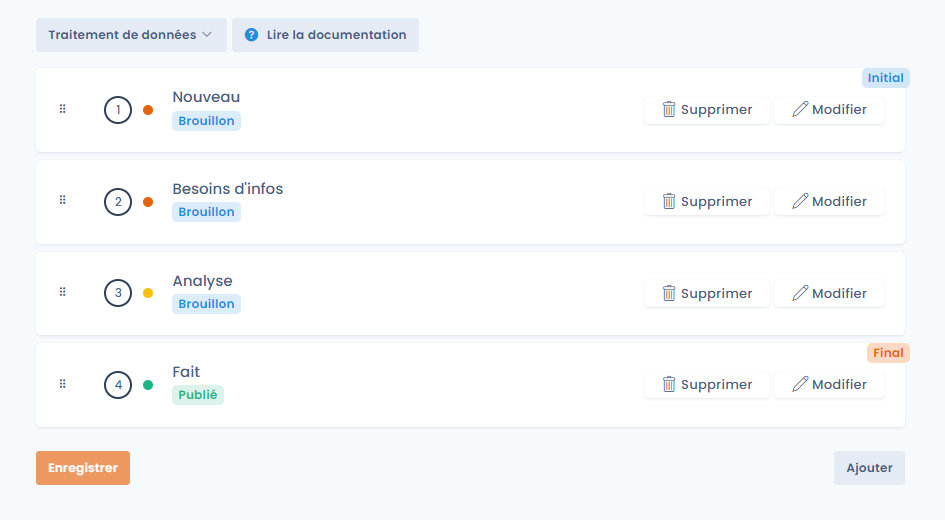
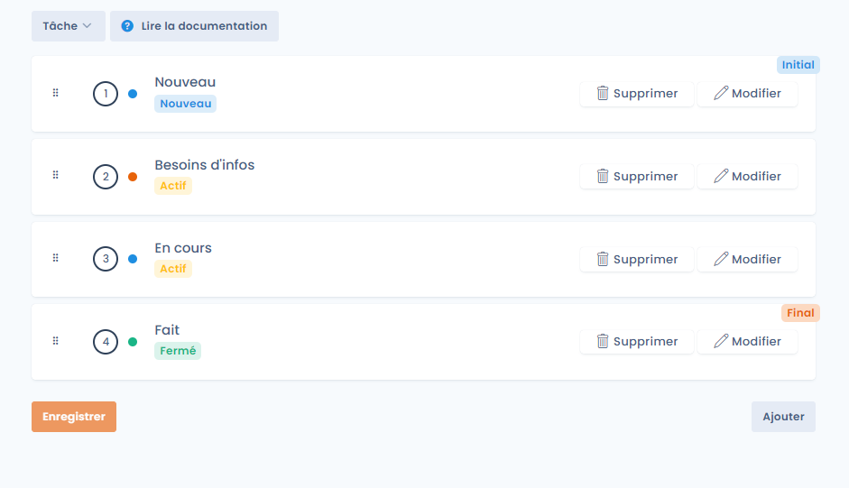
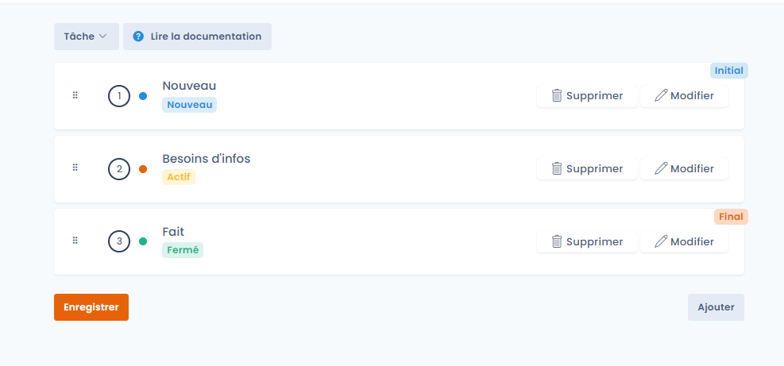

# Etapes de processus


**Étapes de processus vs règles de workflow**

Les étapes de processus définissent les statuts que traversent les objets. Pour automatiser des actions lors des changements d'étape (envoyer une notification, créer une tâche…), consultez les [Règles de workflows](workflow-rules.md).


## Rôle des étapes de processus

Les étapes de workflow (flux de travail en français) matérialisent un processus de réalisation : les objets passent d'une étape à l'autre.

Ainsi, vous pouvez décliner votre procédure de manière très opérationnelle en indiquant quelles sont les étapes à suivre directement dans Dastra.

Chaque type d'objet dispose de son propre jeu d'étapes configurables :

* Demandes d'exercice de droits
* Violations de données
* Tâches
* Traitements de données
* Actifs
* Acteurs
* Données
* Mesures de sécurité
* Catégories de personnes concernées
* Systèmes d'IA
* Contrats

Chaque étape est rattachée à un **statut interne** (champ **Etape de processus interne**), qui dépend du type d'objet. Pour un traitement, par exemple, les statuts sont « brouillon » et « publié ».

## Personnaliser les étapes de workflow



Dans le menu latéral, cliquez sur **Réglages espace de travail**, puis, dans la section **Processus**, sur **Etapes de processus**. Cette page est réservée aux utilisateurs qui ont le droit de gérer les paramètres avancés.

<figure><figcaption>
L'entrée Etapes de processus dans les réglages de l'espace de travail
</figcaption></figure>

Choisissez le type d'objet dans la liste en haut de la page : vous accédez aux étapes disponibles pour ce processus, avec leur statut interne. Personnalisez-les à votre convenance puis cliquez sur **Enregistrer**.

* **Modifier** une étape pour changer son libellé, sa description ou son statut interne, et pour réserver la modification de l'objet dans cette étape aux utilisateurs d'un rôle précis.
* **Ajouter une étape** pour en créer une nouvelle.
* Glissez-déposez une étape pour changer l'ordre. La première étape est marquée **Initial**, la dernière **Final**.

<figure><figcaption>
Les étapes du workflow des traitements
</figcaption></figure>

## Supprimer une étape de workflow

Pour supprimer une étape, cliquez sur **Supprimer** puis confirmez.

Les éléments attachés à l'étape supprimée seront automatiquement rattachés à l'étape de premier niveau dans le même statut.

Par exemple, si vous supprimez l'étape « En cours » dans les workflows de tâches :

<figure><figcaption>
Workflow des tâches avant la suppression de l'étape « En cours »
</figcaption></figure>

Les objets attachés passeront à l'étape « Besoins d'infos » :

<figure><figcaption>
Workflow des tâches après la suppression
</figcaption></figure>
