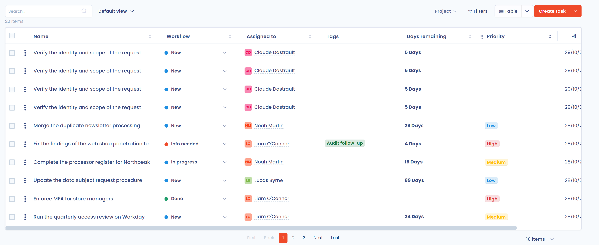
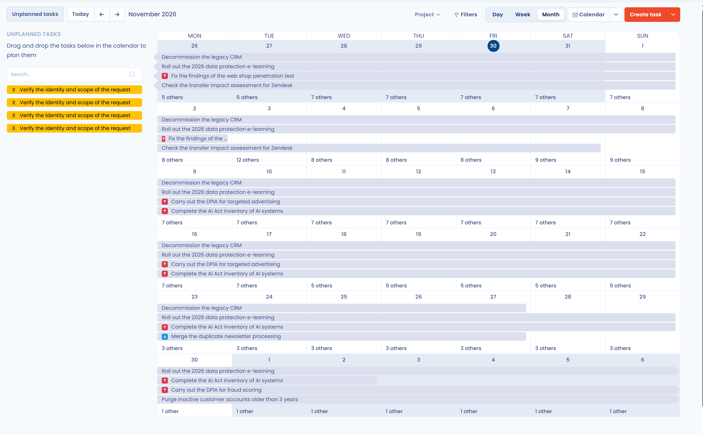
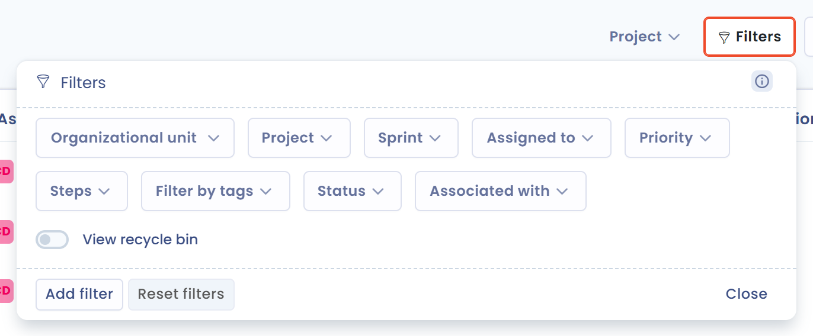
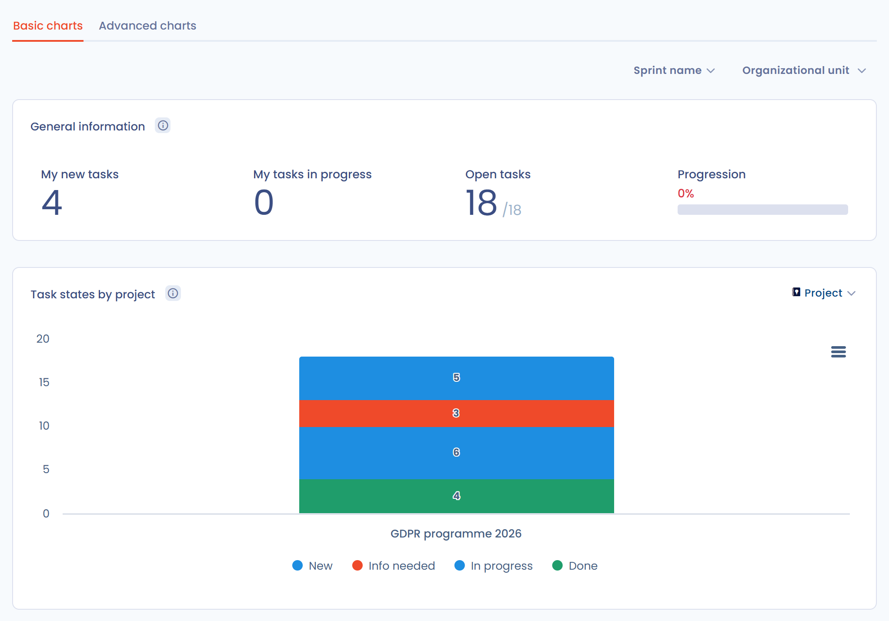
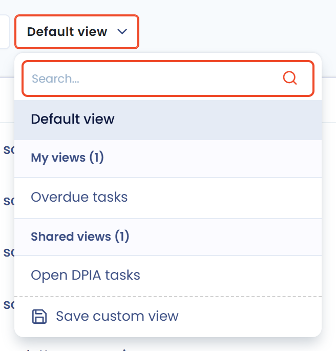

# Suivre, filtrer ou exporter les tâches

Toutes les tâches du plan d'action peuvent être suivies depuis la page **Tâches** du module Planification et depuis la page **Statistiques**, puis exportées. Vous pilotez ainsi vos processus à l'aide d'indicateurs, pour démontrer la responsabilisation (« accountability ») de votre organisation vis-à-vis du RGPD.

## Choisir une vue

Le sélecteur de vue de la barre d'outils de la page **Tâches** propose quatre vues : **Colonnes**, **Tableau**, **Arborescence** et **Calendrier**.

### Vue Colonnes

La vue **Colonnes** répartit les tâches par étape du workflow, une colonne par étape. Glissez-déposez une tâche d'une colonne à l'autre pour changer son étape.

<figure><figcaption>
La vue Colonnes
</figcaption></figure>

Dans l'en-tête d'une colonne, cliquez sur le nom de l'étape pour la renommer, ou sur **+** pour créer une tâche à cette étape. Le bouton **Ajouter une colonne** ajoute une étape. Pour réorganiser les étapes ou régler leur statut interne, voir [Personnaliser le workflow des tâches](workflow.md).

### Vue Tableau

La vue **Tableau** affiche la liste de toutes les tâches. Cliquez sur une ligne pour ouvrir la tâche. Cochez des lignes pour appliquer une action groupée : **Modifier les champs**, **Fusionner**, **Exporter**, **Rattacher des tâches à des objets**, **Déplacer dans la corbeille** ou **Supprimer**.

Cliquez sur **Personnaliser les colonnes** pour choisir les colonnes affichées, et sur **Filtres** pour filtrer la liste.

<figure><figcaption>
La vue Tableau
</figcaption></figure>

### Vue Arborescence

La vue **Arborescence** regroupe les tâches selon le critère choisi dans la liste **Regrouper par**. Le regroupement par défaut est **Projet**. Les autres critères sont : **Itération**, **Unité organisationnelle**, **Assignée à**, **Traitement de données**, **Demande**, **Acteur**, **Actif**, **Violation de données**, **Jeu de données**, **Point de contrôle** et **Mesure de sécurité**.

Cliquez sur **Tout replier** ou **Tout déployer** pour réduire ou ouvrir tous les groupes.

<figure><figcaption>
La vue Arborescence regroupée par projet
</figcaption></figure>

### Vue Calendrier

La vue **Calendrier** place chaque tâche entre sa date de début et sa date d'échéance. Choisissez l'affichage par **Jour**, **Semaine** ou **Mois**, et utilisez **Aujourd'hui** et les flèches pour naviguer.

Le bouton **Tâches non planifiées** ouvre la liste des tâches qui n'ont pas de date de début ou pas de date d'échéance. Glissez une tâche sur un jour du calendrier pour la planifier : sa date de début et sa date d'échéance sont alors renseignées. Une tâche déjà planifiée garde sa durée quand vous la déplacez. Pour supprimer les dates d'une tâche, glissez-la dans la zone **Déposez une tâche ici pour la déplanifier**.

<figure><figcaption>
La vue Calendrier et ses tâches non planifiées
</figcaption></figure>

## Filtrer les tâches

Dans chaque vue, la zone de recherche et le bouton **Filtres** restreignent les tâches affichées. Les filtres couvrent notamment l'unité organisationnelle, le projet, l'itération, la personne assignée, la priorité, l'étape, les tags, le statut, le type d'élément associé et la corbeille.

<figure><figcaption>
Les filtres de la page Tâches
</figcaption></figure>

## Suivre l'avancement avec les statistiques

Dans le menu latéral, cliquez sur **Planification**, puis sur **Statistiques**. La page compte deux onglets.

L'onglet **Graphiques de base** présente les indicateurs généraux du plan d'action et le graphique **Répartition du statut des tâches**. Ce graphique montre le nombre de tâches par étape. Choisissez le critère dans la liste **Regrouper par** : les tâches sont regroupées par projet par défaut, et vous pouvez les regrouper par unité organisationnelle, par itération, par personne assignée ou par élément associé.

<figure><figcaption>
L'onglet Graphiques de base
</figcaption></figure>

L'onglet **Graphiques avancés** réunit trois graphiques. Par défaut, ils couvrent les 30 derniers jours. Vous pouvez les limiter à une itération, à une période ou à une unité organisationnelle.

### Graphique d'avancement

Le graphique d'avancement représente l'évolution de la quantité de travail restante sur une période donnée, par exemple une itération.

<figure><figcaption>
Le graphique d'avancement
</figcaption></figure>

### Diagramme de flux cumulatif

Ce graphique montre dans le temps la répartition des tâches entre les différentes étapes de leur cycle de vie.

<figure><figcaption>
Le diagramme de flux cumulatif
</figcaption></figure>

### Diagramme de vélocité

Ce graphique, intitulé **Evolution de la vélocité** dans l'application, montre l'évolution du nombre de tâches fermées par itération.

<figure><figcaption>
L'évolution de la vélocité
</figcaption></figure>

## Exporter les tâches

1. Dans la page **Tâches**, cliquez sur la flèche du bouton **Créer tâche**, puis sur **Exporter**. Pour n'exporter que certaines tâches, cochez-les dans la vue **Tableau** et choisissez l'action groupée **Exporter**.
2. Dans la fenêtre, choisissez le format d'export. L'export reprend les filtres appliqués à la page.
3. Cliquez sur **Télécharger le fichier**.

<figure><figcaption>
La fenêtre d'export des tâches
</figcaption></figure>



## Vues personnalisées

Une vue personnalisée enregistre sous un nom la combinaison de filtres et de colonnes d'une vue. Vous passez ensuite d'une vue enregistrée à l'autre depuis le sélecteur de la barre d'outils, à côté de la zone de recherche.

<figure><figcaption>
Le sélecteur de vues personnalisées
</figcaption></figure>

### Créer une vue

1. Appliquez les filtres et la sélection de colonnes souhaités dans la vue **Colonnes**, **Tableau** ou **Arborescence**.
2. Ouvrez le sélecteur de vues (il affiche **Vue par défaut**), puis cliquez sur **Enregistrer la vue personnalisée**.
3. Saisissez le **Nom de votre vue personnalisée**, puis cliquez sur **Enregistrer**.

La vue apparaît dans le sélecteur, sous **Mes vues personnalisées**. Quand vous modifiez les filtres d'une vue active, l'entrée **Mettre à jour** de cette vue enregistre les changements.

<figure><figcaption>
L'enregistrement d'une vue personnalisée
</figcaption></figure>

### Partager une vue

Dans la fenêtre d'enregistrement, activez **Partager cette vue personnalisée avec les autres utilisateurs**. Cette option est réservée aux utilisateurs qui gèrent les paramètres avancés. Les autres utilisateurs de l'espace de travail retrouvent la vue sous **Vues partagées**. Vous uniformisez ainsi le suivi du plan d'action au sein d'une équipe.

### Exemples de vues

* « Tâches en retard » : les tâches dont la date d'échéance est dépassée et dont l'étape n'est pas **Fait**.
* « Mon backlog » : les tâches qui vous sont assignées, à l'étape **Nouveau**.
* « Itération en cours » : les tâches de l'itération en cours.

## Aller plus loin


[Synchroniser avec d'autres calendriers](calendar-sync.md)

