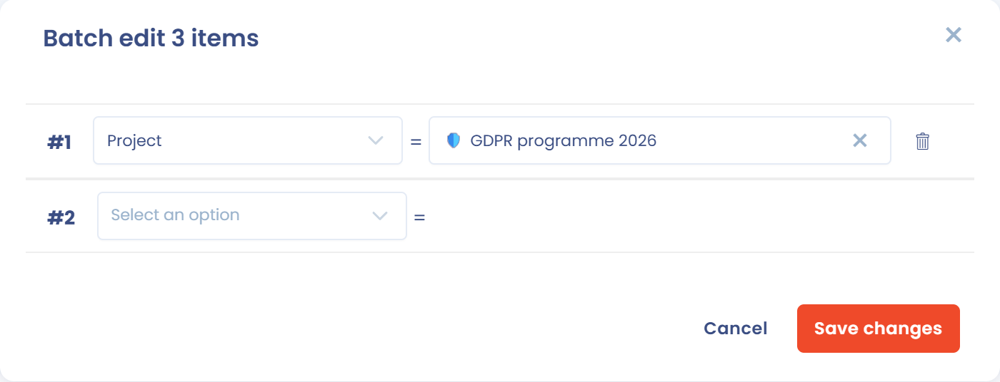
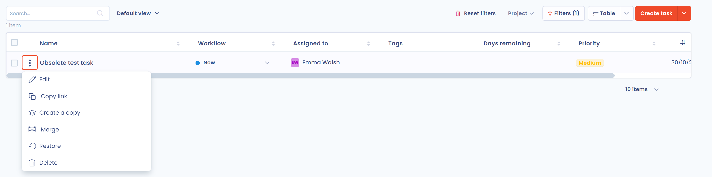

# Questions fréquentes

## Comment attacher plusieurs tâches à un projet ?

Passez par les actions groupées et la modification des champs.

1. Dans la vue **Tableau** de la page **Tâches**, cochez les tâches à rattacher au projet.

<figure><figcaption>
Le menu des actions groupées
</figcaption></figure>

2. Cliquez sur **Choisir une action groupée**, puis sur **Modifier les champs**.
3. Dans la fenêtre, sélectionnez le champ **Projet**, puis le projet souhaité.

<figure><figcaption>
La modification groupée du champ Projet
</figcaption></figure>

4. Cliquez sur **Enregistrer**.

## Comment supprimer une tâche ?

Deux chemins sont possibles.

### Par la corbeille

Cette voie laisse la possibilité de revenir en arrière tant que la tâche n'est pas supprimée.

1. Cliquez sur les trois points de la tâche, puis sur **Déplacer dans la corbeille**.
2. Ouvrez **Filtres** et cochez **Voir la corbeille**.
3. Cliquez sur les trois points de la tâche, puis sur **Supprimer**, et confirmez.

<figure><figcaption>
Le filtre Voir la corbeille
</figcaption></figure>

<figure><figcaption>
Les actions d'une tâche de la corbeille
</figcaption></figure>

### Directement depuis la vue Tableau

Cochez la ou les tâches, cliquez sur **Choisir une action groupée**, puis sur **Supprimer**, et confirmez.


La suppression est définitive. Pour conserver une trace de la tâche, mettez-la à la corbeille sans la supprimer.


## Comment indiquer la charge de travail d'une tâche ?

Vous pouvez saisir la charge de travail estimée et réalisée sur chaque tâche. Vous mesurez ainsi dans votre bilan le temps passé à réaliser les tâches.

Pour cela, ajoutez des champs personnalisés aux tâches : dans le menu latéral, cliquez sur **Réglages espace de travail**, puis sur **Champs personnalisés**, et choisissez **Tâche** dans la liste de gauche. Voir [Champs personnalisés](../general/custom-fields.md).

<figure><figcaption>
Un groupe de champs de charge de travail
</figcaption></figure>

Les champs apparaissent dans le panneau de la tâche. Vous pouvez ensuite exporter leurs valeurs dans un classeur ou les utiliser dans les filtres des tâches.

<figure><figcaption>
Exemple de champs de charge de travail
</figcaption></figure>

## Comment relancer une personne sur une tâche ?

Mentionnez-la dans la discussion de la tâche : ouvrez la tâche, cliquez sur le bouton **Discussions internes**, puis saisissez **@** suivi de son nom. La personne mentionnée reçoit une notification. Voir [Discussions internes](../general/discussions.md).
