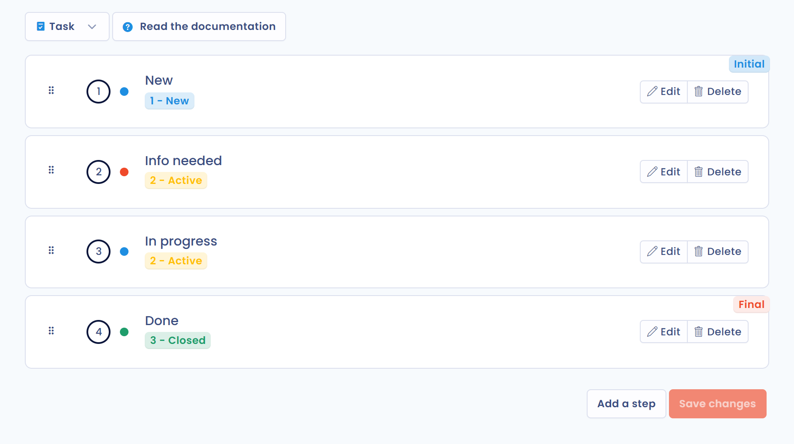

# Personnaliser le workflow des tâches

Chaque tâche suit un workflow : elle passe d'une étape à la suivante jusqu'à sa fermeture. Les étapes sont les colonnes de la vue **Colonnes**. Vous pouvez les adapter aux règles de suivi de votre organisation.

## Les étapes par défaut

Un nouvel espace de travail propose quatre étapes. Chacune est rattachée à un statut interne, **Nouveau**, **Actif** ou **Fermé**, qui ne dépend pas du nom de l'étape :

| Étape | Statut interne |
| --- | --- |
| **Nouveau** | **Nouveau** |
| **Besoins d'infos** | **Actif** |
| **En cours** | **Actif** |
| **Fait** | **Fermé** |

La dernière étape, **Fait**, est l'étape finale : une tâche qui l'atteint est considérée comme terminée.

## Modifier les étapes

1. Dans le menu latéral, cliquez sur **Réglages espace de travail**, puis, dans la section **Processus**, sur **Etapes de processus**. Vous pouvez aussi cliquer, dans la page **Tâches**, sur la flèche du bouton **Créer tâche**, puis sur **Configurer les colonnes**.
2. Dans la liste en haut de la page **Gestion des processus**, choisissez le type d'objet **Tâches**.
3. Ajoutez, renommez ou réordonnez les étapes, choisissez leur statut interne, puis cliquez sur **Enregistrer**.

<figure><figcaption>
Les étapes du workflow des tâches
</figcaption></figure>

Cette page est réservée aux utilisateurs qui ont le droit de gérer les paramètres avancés. Le fonctionnement détaillé (ajout, ordre, suppression d'une étape) est décrit dans [Etapes de processus](../settings/workflow-stages.md). Vous pouvez aussi renommer une étape directement dans l'en-tête de sa colonne, dans la vue **Colonnes**.

## Classer les tâches avec des tags

Le champ **Tags** du panneau d'une tâche sert à classer les tâches pour les retrouver plus vite : le filtre **Filtrer par tags** les utilise dans chaque vue. Les tags se gèrent dans **Réglages espace de travail**, section **Processus**, entrée **Tags**.

## Aller plus loin


[Créer ou modifier une tâche](create.md)

