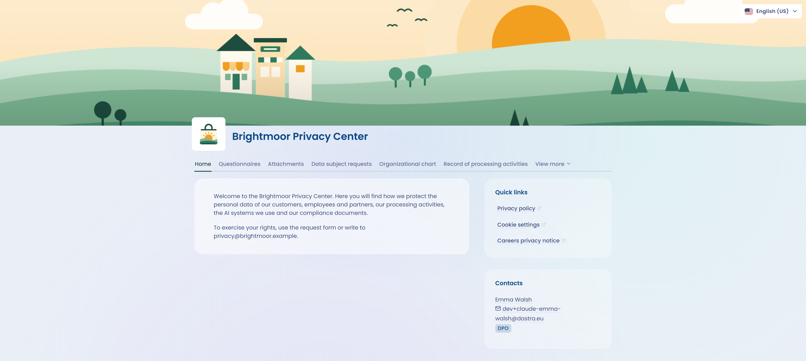

# Trust Center

Le Trust Center est un portail web public que vous configurez pour présenter la conformité de votre organisation en matière de protection des données personnelles. Il s'adresse à vos clients, à vos sous-traitants et à vos collaborateurs.

Vous choisissez les fonctionnalités à afficher parmi les suivantes :

* [Page d'accueil](configuration/home.md) (optionnelle)
* [Questionnaires](configuration/questionnaires.md) (optionnel, nécessite la fonctionnalité [Questionnaires](../questionnaires/README.md))
* [Documents](configuration/attachments.md) (optionnel)
* [Exercice des droits](configuration/data-subject-requests.md) (optionnel, nécessite la fonctionnalité [Exercice des droits](../requests/README.md))
* [Organigramme](configuration/org-chart.md) (optionnel)
* [Contacts](configuration/contacts.md) (optionnel)
* [Registre des traitements](configuration/ropa.md) (optionnel, nécessite la fonctionnalité [Registre des traitements](../ropa/README.md))
* [Systèmes d'IA](configuration/ai-systems.md) (optionnel, nécessite le module Systèmes d'IA dans votre abonnement)
* [Affichage du projet de conformité](configuration/README.md#affichage-du-projet-de-conformite) (optionnel, nécessite la fonctionnalité [Conformité](../compliance/README.md))

La page d'accueil est facultative. Les liens rapides, le message d'accueil et la section Contacts s'affichent sur cette page : sans elle, ils n'apparaissent pas dans le portail.

## Comment accéder à la fonctionnalité

Votre abonnement doit inclure la fonctionnalité Trust Center.

Vous accédez aux Trust Centers depuis l'entrée **Trust Center** de la barre de navigation latérale de l'application.

<figure><figcaption>
Aperçu d'un Trust Center dont toutes les fonctionnalités sont activées
</figcaption></figure>
