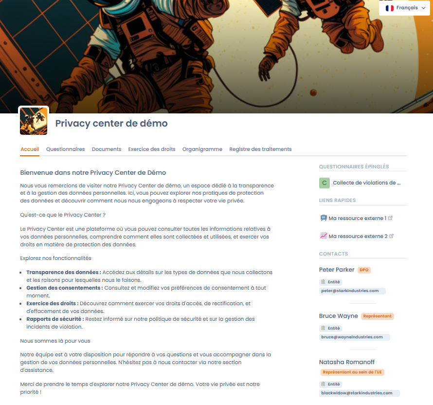

# Trust center

Le **Trust center** permet aux organisations de créer et de personnaliser un **portail web public** entièrement configurable, conçu pour la gestion de la conformité en matière de protection des données personnelles. le Trust center offre une solution simple et intuitive pour mettre en place un espace de transparence et d'interaction avec les parties prenantes de l'organisation, qu'il s'agisse de clients, de sous-traitants ou de collaborateurs.

Le Trust center offre une configuration modulaire et flexible, vous permettant de sélectionner et d'activer les fonctionnalités de votre choix parmi les options suivantes :

* [Page d'accueil personnalisable](configuration/home.md) (obligatoire)
* [Questionnaires](configuration/questionnaires.md) (optionnel - nécessite la fonctionnalité [Questionnaires](../questionnaires/README.md))
* [Documents ](configuration/attachments.md)(optionnel)
* [Exercice des droits](configuration/data-subject-requests.md) (optionnel - nécessite la fonctionnalité [Exercice des droits](../requests/README.md))
* [Organigramme](configuration/org-chart.md) (optionnel)
* [Registre des traitements](configuration/ropa.md) (optionnel - nécessite la fonctionnalité [registre des traitements](../ropa/README.md))
* [Systèmes d'IA](configuration/ai-systems.md) (optionnel - nécessite le module Systèmes d'IA dans votre abonnement)

### Comment accéder à la fonctionnalité

Il est nécessaire pour accéder à la fonctionnalité de disposer dans votre abonnement de notre fonctionnalité [.](README.md "mention").

Vous accédez aux Trust center depuis la barre de navigation latérale de l'application

<figure><figcaption>
Aperçu d'unTrust center de démonstration avec tous les modules activés
</figcaption></figure>
