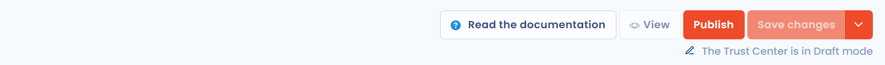

# Paramétrer votre Trust Center

Cette page présente la page d'édition d'un Trust Center, explique comment le publier et décrit l'affichage d'un projet de conformité. Elle s'adresse aux personnes chargées de configurer le portail.

## La page d'édition

La page d'édition se compose de sections, ouvertes ou fermées d'un clic. Les trois premières sont toujours disponibles :

* **Configuration** : le nom, l'unité organisationnelle, les propriétaires, le message d'accueil, les fonctionnalités à afficher et les liens rapides. Voir [Page d'accueil et configuration générale](home.md).
* **Sécurité** : l'authentification obligatoire, l'approbation des téléchargements et le filtrage par adresse IP. Voir [Sécurité](security.md).
* **Apparence & design** : le logo, l'image de couverture et la couleur d'accentuation. Voir [Apparence et design](design.md).

Les sections suivantes se débloquent lorsque la fonctionnalité correspondante est cochée dans **Configuration** :

* **Questionnaires** : voir [Questionnaires](questionnaires.md).
* **Demandes d'exercice des droits** : voir [Exercice des droits](data-subject-requests.md).
* **Documents** : voir [Documents](attachments.md).
* **Conformité** : voir [Affichage du projet de conformité](#affichage-du-projet-de-conformite) sur cette page.

Les autres fonctionnalités s'activent d'une simple case à cocher, sans section dédiée : [Registre des traitements](ropa.md), [Organigramme](org-chart.md), [Contacts](contacts.md) et [Systèmes d'IA](ai-systems.md).

<figure><figcaption>
Les boutons de la page d'édition d'un Trust Center en brouillon
</figcaption></figure>

## Publier et annuler la publication

Un Trust Center nouvellement créé est en brouillon : l'indicateur en haut à droite de la page affiche **Le Trust Center est en mode brouillon** et le portail n'est pas accessible en ligne.

Pour le publier :

1. Cliquez sur **Publier**, en haut à droite de la page d'édition. Le bouton est grisé tant qu'un champ obligatoire est vide.
2. Confirmez la question « Souhaitez-vous enregistrer et publier le Trust Center ? ». Toutes les modifications sont enregistrées.

L'indicateur affiche alors **Le Trust Center a été publié** et le portail devient accessible à toute personne qui dispose du lien, dans le respect des règles de la section **Sécurité**.

Pour rendre le portail inaccessible, cliquez sur **Annuler publication**. Cette action s'applique immédiatement, sans confirmation. Depuis la liste des Trust Centers, le menu de chaque ligne propose aussi **Activer** et **Désactiver**.

## Affichage du projet de conformité

Cette fonctionnalité ajoute au portail un onglet **Conformité**. Il présente une synthèse d'un projet de conformité : pour chaque référentiel du projet, l'audit actif avec ses pièces jointes et les contrôles appliqués. Elle nécessite la fonctionnalité [Conformité](../../compliance/README.md) dans votre abonnement.

### Choisir le projet à afficher

1. Dans la section **Configuration**, cochez **Affichage du projet de conformité**.
2. Ouvrez la section **Conformité**.
3. Dans **Sélectionnez le projet de conformité que vous souhaitez afficher**, choisissez le projet. Un Trust Center affiche un seul projet.
4. Enregistrez, puis publiez le Trust Center s'il ne l'est pas encore.

La section **Conformité** est signalée en erreur tant qu'aucun projet n'est sélectionné.

<figure><figcaption>
Le choix du projet de conformité à afficher
</figcaption></figure>

### Ce que voient les visiteurs

L'onglet **Conformité** du portail affiche, à gauche, un référentiel par carte. Seuls les référentiels du projet qui ont un [audit actif](../../compliance/projects/audits.md) sont listés. Quand un visiteur clique sur un référentiel, la page présente :

* **Détails de l'audit** : le type, le statut, le nom et les dates de début et de fin de l'audit actif, puis ses pièces jointes ;
* **Contrôles** : les contrôles appliqués du référentiel qui sont actifs et dont tous les tests sont réussis. Chaque contrôle affiche sa référence, son titre, sa description et les références des exigences auxquelles il répond.

<figure><figcaption>
L'onglet Conformité du portail public
</figcaption></figure>

Pour que le portail reste à jour, définissez l'audit actif de chaque référentiel dans le projet de conformité et gardez les tests de vos contrôles à jour. Voir [Audits](../../compliance/projects/audits.md).
