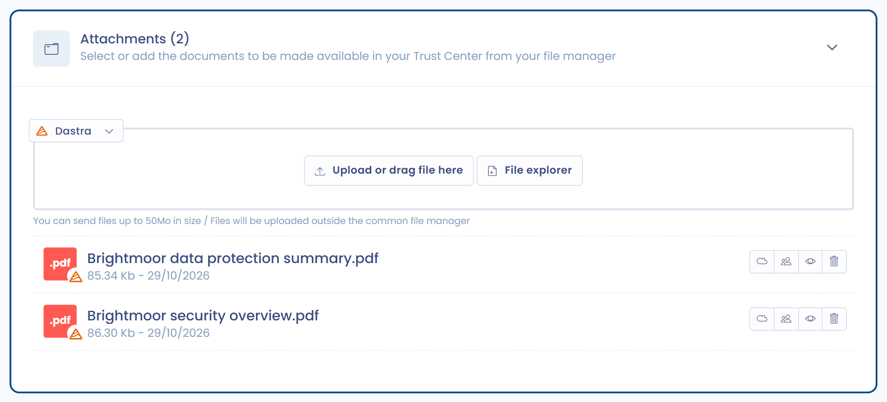
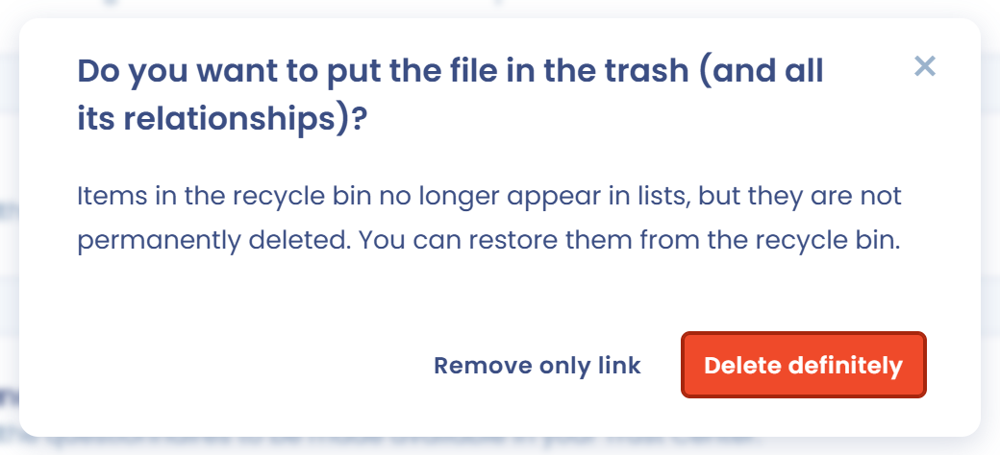

# Documents

Cette page explique comment mettre des documents à disposition des visiteurs de votre Trust Center.

## Activer la fonctionnalité

Cochez **Documents** dans la section **Configuration**, comme l'explique [Page d'accueil et configuration générale](home.md). Une page publique **Documents** est alors ajoutée à votre Trust Center, et la section **Documents** se débloque dans la page d'édition.

<figure><figcaption>
La section de configuration des documents
</figcaption></figure>

## Ajouter des documents à votre Trust Center

Dans la section **Documents**, ajoutez des fichiers en les important ou en les sélectionnant parmi les fichiers existants de la gestion documentaire. Ils sont alors listés sur la page publique **Documents** de votre Trust Center. Les fichiers importés depuis cette section sont enregistrés dans le dossier **Trust Centers** de la gestion documentaire.

Par défaut, un visiteur doit demander l'accès à un document avant de pouvoir le télécharger. Pour modifier ce comportement, lisez [Sécurité](security.md).

## Retirer un document

Dans la section **Documents**, cliquez sur l'icône de corbeille d'un fichier. Dastra demande s'il faut placer le fichier dans la corbeille avec toutes ses relations, et propose deux choix :

* **Supprimer uniquement le lien** : le fichier n'est plus mis à disposition dans ce Trust Center, mais il reste dans la gestion documentaire et dans ses autres usages ;
* **Placer dans la corbeille** : le fichier est placé dans la corbeille, partout où il est utilisé.

<figure><figcaption>
La fenêtre de retrait d'un document
</figcaption></figure>

[Plus d'informations sur la gestion des documents dans Dastra.](../../files/README.md)
