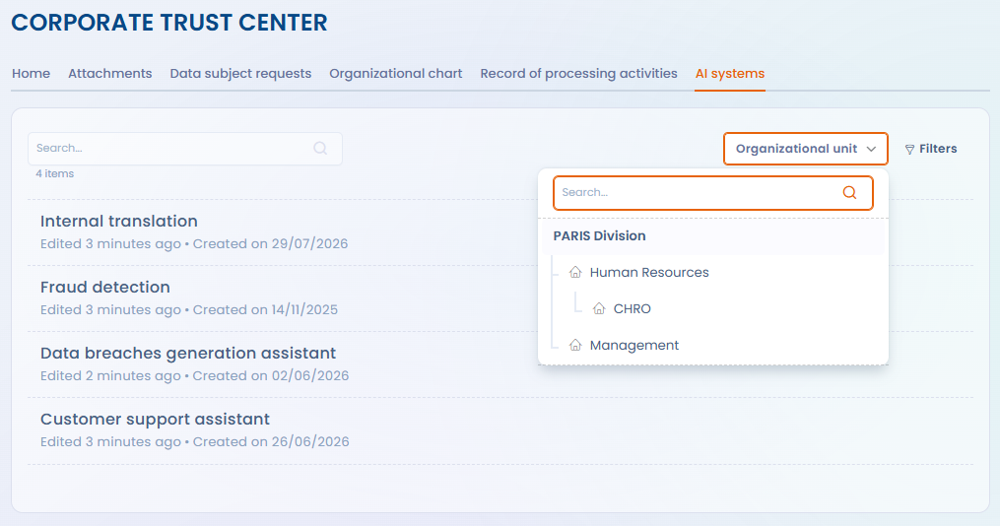

# Page d'accueil et configuration générale

L'onglet 'Configuration' de la page d'édition d'un Trust center vous permet de configurer les options essentielles de votre Trust center.

<figure><figcaption></figcaption></figure>

#### Nom du Trust center

Le nom du Trust center s'affichera dans l'en-tête et sur chaque page de votre portail.

#### Unité organisationnelle

Il est essentiel de lier votre Trust center à une unité organisationnelle. Ce choix influencera directement l'ensemble des fonctionnalités activées dans le hub. Pour plus de détails sur l'impact de cette sélection, consultez la page de configuration de chaque fonctionnalité.

Les visiteurs du Trust center peuvent restreindre l'affichage à une partie de ce périmètre grâce au sélecteur **Unité organisationnelle**. Il présente l'arborescence des unités publiées, c'est-à-dire l'unité du Trust center et ses unités enfants, et propose une recherche par nom. Une fois une unité choisie :

* le registre des traitements et la page des systèmes d'IA ne listent que les éléments de cette unité et de ses unités enfants, en combinaison avec les autres filtres ;
* les contacts se limitent aux entités de ce périmètre.

Le choix est conservé d'une page à l'autre et figure dans l'adresse de la page : un lien copié rouvre le même périmètre. Le sélecteur ne fait que restreindre l'affichage : le périmètre publié reste celui de l'unité organisationnelle configurée ici.

<figure><figcaption>
Restreindre l'affichage du Trust center à une unité organisationnelle
</figcaption></figure>

#### Message d'accueil de votre Trust center

Ce champ de texte enrichi (HTML) vous permet de personnaliser le message d'accueil avec des options de mise en forme, et d'y intégrer des images ou des vidéos. Ce message sera affiché sur la page d'accueil publique de votre Trust center.

#### Fonctionnalités du Trust center

Dans cette section, sélectionnez les fonctionnalités à activer dans votre Trust center (selon les options incluses dans votre abonnement). En cochant la case d'une fonctionnalité, celle-ci devient disponible dans votre hub. Si une configuration spécifique est requise, la case cochée déverrouillera un accordéon de paramètres, vous permettant de la configurer directement depuis la page d'édition du Privacy hub. Consultez les pages de documentation ci-dessous pour le détail de la configuration de chaque fonctionnalité.

#### Liens rapides

Vous pouvez ajouter des liens de redirection dans votre Trust center en cliquant sur le bouton "Ajouter un lien". Chaque lien se compose d’un émoji (optionnel), d’un nom, et d’une URL de destination. Cette fonctionnalité vous permet de créer des raccourcis vers des ressources externes à votre hub. Les liens apparaîtront dans un menu latéral sur la page d’accueil de votre Trust center et s’ouvriront dans une nouvelle fenêtre lorsque vos utilisateurs cliqueront dessus.
