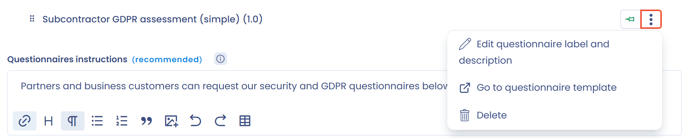

# Questionnaires

Cette page explique comment mettre des questionnaires à disposition des visiteurs de votre Trust Center.

## Activer la fonctionnalité

Cochez **Questionnaires** dans la section **Configuration**, comme l'explique [Page d'accueil et configuration générale](home.md). Une page publique **Questionnaires** est alors ajoutée à votre Trust Center, et la section **Questionnaires** se débloque dans la page d'édition.

<figure><figcaption>
La section de configuration des questionnaires de votre Trust Center
</figcaption></figure>

## Ajouter un questionnaire

1. Dans la section **Questionnaires**, cliquez sur **Ajouter des questionnaires**.
2. Dans la fenêtre de sélection, choisissez un ou plusieurs questionnaires. Ils correspondent à ceux que vous avez installés dans le module Questionnaires de cet espace de travail.
3. Cliquez sur **Ajouter** pour valider.

<figure><figcaption>
La fenêtre de sélection des questionnaires
</figcaption></figure>

Vous pouvez retirer ou ajouter d'autres questionnaires à tout moment. Les questionnaires ajoutés sont visibles sur la page publique **Questionnaires**.

## Instructions pour les questionnaires

Le champ **Instructions pour les questionnaires** est un éditeur de texte enrichi. Vous pouvez y mettre le texte en forme et y intégrer des images ou des vidéos. Le message s'affiche sur la page publique **Questionnaires**, au-dessus de la liste des questionnaires.

## Renommer les questionnaires

Par défaut, un questionnaire porte dans le Trust Center le nom du modèle installé. Pour changer le nom et la description affichés dans le portail, sans modifier le modèle d'origine, ouvrez le menu du questionnaire et cliquez sur **Modifier le nom et la description**.

<figure><figcaption>
Modifier le nom et la description à afficher dans le Trust Center
</figcaption></figure>

## Modifier l'ordre d'affichage

Réorganisez les questionnaires par glisser-déposer. L'ordre du portail public suit celui de cette page de configuration.

## Épingler des questionnaires

Pour mettre un questionnaire en avant, cliquez sur son icône d'épingle. Les questionnaires épinglés s'affichent toujours en haut de la liste, quel que soit leur ordre de configuration. Ils apparaissent aussi dans la barre latérale de la page d'accueil, lorsque la page d'accueil est activée.

<figure><figcaption>
Épingler un questionnaire
</figcaption></figure>

## Impact du choix de l'unité organisationnelle sur les réponses

Les visiteurs de votre Trust Center peuvent répondre à tous les questionnaires mis à leur disposition. Les réponses sont enregistrées dans le module Questionnaires et associées à l'unité organisationnelle du Trust Center (voir [Page d'accueil et configuration générale](home.md)).


Pour fonctionner dans un Trust Center, un questionnaire doit avoir le partage par lien activé. Si ce n'est pas le cas, le partage par lien est activé automatiquement lorsque vous ajoutez le questionnaire. Il ne peut plus être désactivé tant que le questionnaire figure dans un Trust Center.

