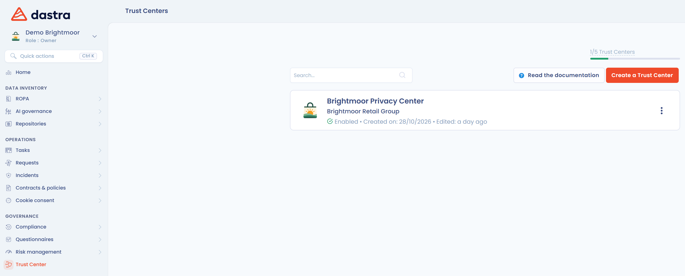

# Créer un Trust Center

Cette page explique comment créer un Trust Center. La création demande un nom et une unité organisationnelle ; la configuration se fait ensuite sur la page d'édition.

## Créer le Trust Center

1. Dans la barre de navigation latérale, cliquez sur **Trust Center**.
2. Cliquez sur **Créer un Trust Center**.
3. Dans la fenêtre qui s'ouvre, renseignez le **Nom du Trust Center** et l'**Unité organisationnelle**. Les deux champs sont obligatoires.
4. Cliquez sur **Créer un Trust Center** pour valider.

Le bouton **Créer un Trust Center** est grisé lorsque vous avez atteint le quota de Trust Centers de votre plan. Le quota utilisé est affiché en haut de la liste.

<figure><figcaption>
Créer un Trust Center depuis la liste des Trust Centers
</figcaption></figure>

<figure><figcaption>
La fenêtre de création d'un Trust Center
</figcaption></figure>

L'unité organisationnelle détermine les données publiées par le Trust Center. Pour le détail de son effet, lisez [Page d'accueil et configuration générale](configuration/home.md).

## Après la création

Une fois le Trust Center créé, vous êtes redirigé vers sa page d'édition. Il est en brouillon : personne ne peut y accéder tant que vous ne l'avez pas publié.

La page d'accueil, les questionnaires, l'exercice des droits, le registre des traitements, les documents, l'organigramme et les contacts sont cochés par défaut. Les systèmes d'IA et le projet de conformité ne le sont pas.

<figure><figcaption>
La page d'édition d'un Trust Center
</figcaption></figure>

Pour configurer et publier votre Trust Center, lisez [Paramétrer votre Trust Center](configuration/README.md).
