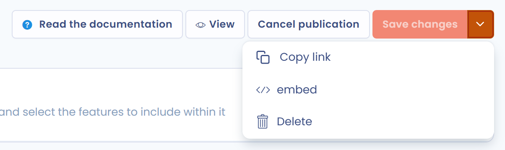

# Prévisualiser et partager votre Trust Center

Cette page explique comment afficher votre Trust Center tel que vos visiteurs le voient, puis comment le partager par lien ou l'intégrer dans votre site.

## Prévisualiser votre Trust Center

Cliquez sur **Afficher**, en haut à droite de la page d'édition. Le portail public s'ouvre dans un nouvel onglet.

Le bouton est grisé tant que le Trust Center n'est pas publié. Pour le publier, lisez [Paramétrer votre Trust Center](configuration/README.md#publier-et-annuler-la-publication).

Si vous modifiez la configuration, enregistrez vos changements puis actualisez l'onglet du portail pour les voir.

## Partager votre Trust Center

Une fois la configuration terminée, vous pouvez partager l'URL de votre Trust Center :

* copiez l'URL de l'onglet du portail ;
* ou cliquez sur la flèche du bouton **Enregistrer**, en haut à droite de la page d'édition, puis sur **Copier lien**.

Dans la liste des Trust Centers, **Copier lien** se trouve dans le menu de la ligne du Trust Center.

<figure><figcaption>
Les options de partage dans le menu du bouton Enregistrer
</figcaption></figure>

**Copier lien** et **intégrer** ne sont actifs que lorsque le Trust Center est publié.

Les règles de la page [Sécurité](configuration/security.md), comme l'authentification obligatoire ou le filtrage par adresse IP, s'appliquent aussi aux visiteurs qui utilisent le lien.

## Intégrer votre Trust Center dans votre site

Cliquez sur la flèche du bouton **Enregistrer**, puis sur **intégrer**. La fenêtre **Intégrer le Trust Center** propose deux types d'affichage, à choisir dans **Type d'affichage** :

* **Page (url fournie)** : la fenêtre affiche l'URL du Trust Center. Copiez-la et partagez-la, ou faites-y pointer un lien de votre site.
* **Intégré dans une Iframe** : la fenêtre affiche un extrait de code. Cliquez sur **Copier**, puis collez la partie HTML à l'endroit de votre page où le Trust Center doit apparaître. Le script fourni ajuste automatiquement la taille de l'iframe à celle du Trust Center.

<figure><figcaption>
Le type d'affichage Page (url fournie)
</figcaption></figure>

<figure><figcaption>
Le type d'affichage Intégré dans une Iframe
</figcaption></figure>
