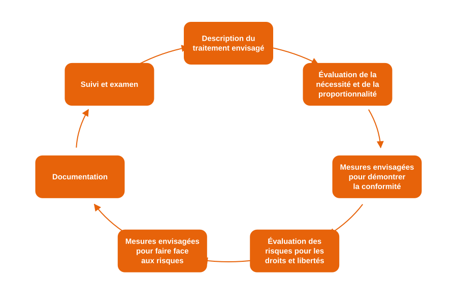

# Analyse d'impact (PIA / DPIA)

## Définition

L’**analyse d’impact relative à la protection des données (AIPD)**, appelée **PIA** dans Dastra, est prévue par l’[article 35 du RGPD](https://www.cnil.fr/fr/reglement-europeen-protection-donnees/chapitre4#Article35), est un **mécanisme de conformité** qui vise à :

* **Identifier et minimiser les risques** d’atteinte aux droits et libertés des personnes,
* **Prouver la conformité** au RGPD,
* Et **intégrer la privacy dès la conception** (_Privacy by design_).

> Le PIA porte sur les **risques pour les personnes**, et non sur les risques pour l’organisation.

Selon le contexte, la même démarche s’appelle aussi AIPD, DPIA (_Data Protection Impact Assessment_) ou EIVP (étude d’impact sur la vie privée).

***

## Les trois composantes d’un PIA

Un PIA est structuré en trois grandes étapes :

1. **Description du traitement**\
   → Objectifs, contexte, acteurs, technologies, données concernées.
2. **Évaluation de la nécessité et de la proportionnalité**\
   → Analyse de la conformité juridique : finalités, bases légales, droits des personnes, durées, etc.
3. **Étude des risques et des mesures de sécurité**\
   → Identification des risques pour la vie privée et détermination des mesures de maîtrise (techniques et organisationnelles).

> Le PIA est à la fois **juridique**, **technique** et **organisationnel** : il engage toute l’équipe projet.

***

## Objectif du PIA

Le PIA permet à une organisation de :

* **Démontrer sa conformité** (principe d’accountability),
* **Anticiper les risques** et les coûts de mise en conformité,
* **Documenter les choix** et arbitrages de conception,
* **Garantir la confiance** des usagers, clients ou salariés.

***

## Cas où un PIA est obligatoire

Un PIA est **obligatoire** lorsqu’un traitement **est susceptible d’engendrer un risque élevé** pour les droits et libertés des personnes.

### Exemples de traitements concernés

* Surveillance vidéo intelligente,
* Notation automatique de profils (scoring),
* Collecte massive de données de santé,
* Utilisation de biométrie ou d’IA sur données personnelles.


En général, un traitement qui remplit au moins **2 des critères suivants** (Comité européen de la protection des données, CEPD) justifie un PIA :

* Évaluation ou scoring,
* Décision automatisée avec effet juridique,
* Surveillance systématique,
* Données sensibles,
* Large échelle,
* Croisement de données,
* Personnes vulnérables,
* Usage innovant (IA, IoT, big data),
* Blocage d’un droit ou d’un service.

Un seul critère peut suffire pour un traitement particulièrement sensible. Les autorités de contrôle publient aussi des listes de traitements pour lesquels un PIA est requis : voir le [guide AIPD par pays](../../other/dpia-by-country.md).


***

## Moment de réalisation et mise à jour

Le PIA doit être mené **avant la mise en œuvre du traitement**, idéalement dès la phase de conception.\
Il constitue une application concrète du principe de **Privacy by Design**.

Il doit aussi être :

* **Réexaminé régulièrement**,
* **Révisé en cas de modification** importante du traitement ou de son niveau de risque (article 35, paragraphe 11),
* **Rattaché à votre registre** dans Dastra pour un suivi continu.

<figure><figcaption>
Un processus itératif
</figcaption></figure>

> Le PIA est un **processus itératif** : il accompagne tout le cycle de vie du traitement.

***

## Réaliser un PIA

### 1. Évaluer la nécessité et la proportionnalité du traitement

Posez-vous les bonnes questions :

* Les **finalités** sont-elles déterminées et légitimes ?
* Le **fondement juridique** est-il clair ?
* Les données sont-elles **minimisées**, exactes et à jour ?
* Les **durées de conservation** sont-elles limitées ?
* Les **personnes concernées** sont-elles correctement informées ?

### 2. Examiner la protection des droits des personnes

* Information transparente, consentement clair, droit d’accès, d’effacement, d’opposition.
* Contrats avec les sous-traitants.
* Garanties sur les transferts internationaux.
* Mesures correctives prévues en cas de violation.

### 3. Analyser les risques sur la vie privée

Pour chaque **événement redouté** :

* Identifier les **impacts possibles** sur les personnes (atteinte à la vie privée, réputation, discrimination…).
* Estimer la **gravité** et la **vraisemblance** du risque.
* Déterminer les **mesures de protection existantes ou prévues**.
* Évaluer le **risque résiduel** et, le cas échéant, proposer des **mesures complémentaires**.


Objectif final : atteindre un **niveau de risque résiduel acceptable**, documenté et justifié.


***

## Acteurs à impliquer

| Acteur                        | Rôle dans le PIA                                                  |
| ----------------------------- | ----------------------------------------------------------------- |
| **Responsable du traitement** | Porte la responsabilité du PIA et pilote sa réalisation           |
| **DPO**                       | Conseille sur la réalisation du PIA et en vérifie l’exécution     |
| **RSSI / Direction IT**       | Apporte l’expertise technique et les mesures de sécurité          |
| **Équipes métiers**           | Fournissent les détails opérationnels du traitement               |
| **Sous-traitants**            | Communiquent les informations nécessaires à l’évaluation          |
| **Personnes concernées**      | Peuvent être consultées ou représentées dans certains cas         |

> Le PIA est une démarche collaborative : il engage autant les juristes que les opérationnels.

***

## PIA et intelligence artificielle

L’**AI Act** introduit une obligation spécifique de **documentation et d’évaluation des systèmes d’IA** à risque.\
Les organisations doivent y inclure :

* L’origine des données d’entraînement,
* Les tests de robustesse et biais,
* Les contrôles humains prévus,
* Les mesures de transparence.

Pour les systèmes d’IA, Dastra propose une analyse d’impact dédiée dans le module **Systèmes d’IA**, sous **Analyses d’impact**, pour couvrir à la fois le RGPD et l’AI Act.

***

## Bonnes pratiques Dastra

* Déterminez si un PIA est nécessaire dans la section **Analyse d’impact** du traitement, qui évalue les 9 critères du CEPD,
* Lancez le PIA depuis un **modèle de questionnaire** de la bibliothèque,
* Exportez le rapport du PIA en **PDF** pour les audits,
* Planifiez le prochain réexamen avec les **revues régulières** du traitement.


Dastra vous guide pas à pas dans la réalisation du PIA grâce à un modèle de questionnaire interactif.


***

## Pour aller plus loin


Webinar « Comment aborder l’étape PIA avec un outil ? »



[Analyse d'impact](../../features/ropa/activity/impact-analysis.md)



[AIPD / PIA](../../features/questionnaires/types/dpia.md)

