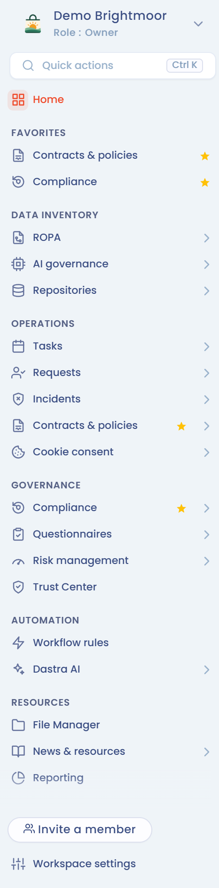
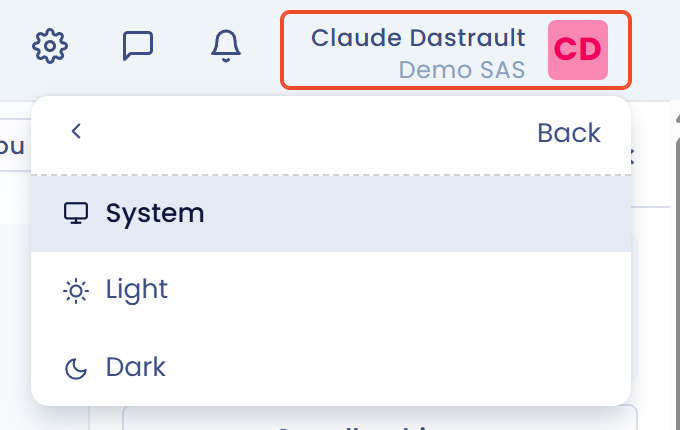
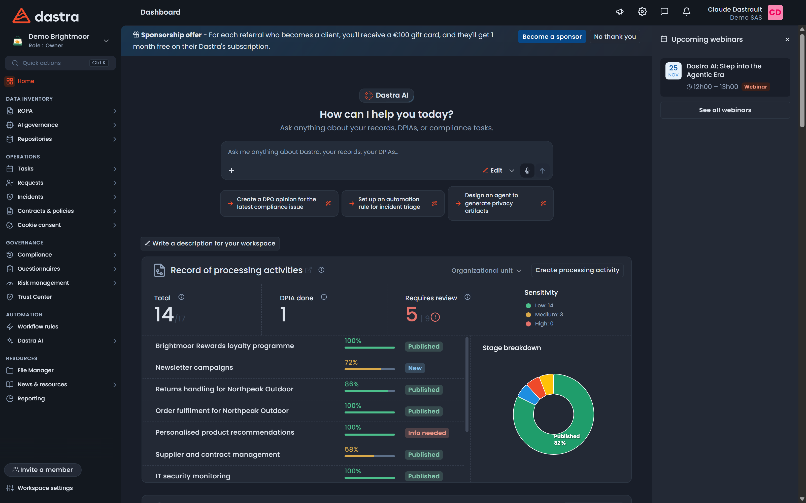
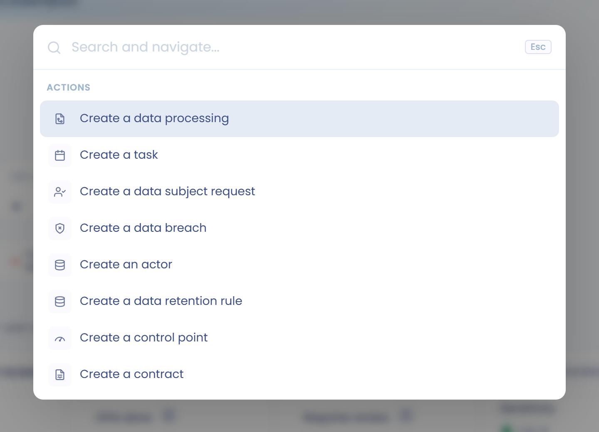

# Naviguer dans Dastra

Cette page présente les éléments qui vous permettent de vous déplacer dans Dastra : le menu latéral, la barre du haut, le thème et la palette de commandes. Elle s'adresse à toute personne qui découvre l'application.

Les modules affichés dépendent de l'offre de votre organisation et de vos droits. Un module que vous ne voyez pas n'est pas inclus dans votre offre ou demande un droit que votre rôle n'a pas.

***

## Le menu latéral

Le menu latéral est à gauche de l'écran. De haut en bas, il contient :

* le sélecteur d'espace de travail, qui rappelle votre rôle dans l'espace en cours ;
* le bouton **Actions rapides**, qui ouvre la [palette de commandes](navigation.md#la-palette-de-commandes) ;
* l'entrée **Tableau de bord**, pour revenir à la page d'accueil de l'espace de travail ;
* la section **Favoris**, quand vous avez épinglé au moins un module ;
* les cinq sections de modules ;
* le bouton **Inviter un membre**, si vous avez le droit de gérer les utilisateurs, et l'entrée **Réglages espace de travail**.

<figure><figcaption>
Le menu latéral
</figcaption></figure>

Cliquez sur un module pour déployer ses pages, ou sur la flèche à droite de son nom. Sur un petit écran, le menu s'ouvre depuis le bouton en haut à gauche de la barre du haut.

### Les cinq sections

| Section | Modules |
| --- | --- |
| **Inventaire** | **Traitements de données**, **Systèmes d'IA**, **Référentiels** |
| **Opérations** | **Planification**, **Demandes**, **Incidents**, **Contrats et politiques**, **Consentement cookies** |
| **Gouvernance** | **Conformité**, **Questionnaires**, **Gestion des risques**, **Trust Center** |
| **Automatisation** | **Règles de workflow**, **Dastra AI** |
| **Ressources** | **Gestionnaire de fichiers**, **Veille et ressources**, **Rapports personnalisés** |

Le module **Dastra AI** regroupe les conversations en plein écran, les artefacts, et, selon votre offre et vos droits, les agents, la boîte de réception et les compétences. Voir [Dastra AI](../features/general/ai-assistant/README.md).

Une section dont aucun module n'est disponible pour vous est masquée.

### Les favoris

Pour épingler un module, survolez son nom dans le menu et cliquez sur l'étoile qui apparaît à droite. Le module rejoint la section **Favoris**, en haut du menu, et reste aussi dans sa section d'origine. Cliquez de nouveau sur l'étoile pour le retirer.

Les favoris sont personnels et propres à chaque organisation : ils ne changent pas le menu des autres utilisateurs.

### Le sélecteur d'espace de travail

En tête du menu, le sélecteur affiche le nom de l'espace de travail en cours et votre rôle dans cet espace (**Propriétaire** si vous êtes propriétaire de l'organisation). Si vous avez plusieurs rôles, ils sont tous listés ; survolez la ligne pour les voir en entier.

Cliquez sur le sélecteur pour changer d'espace de travail, et utilisez le champ de recherche pour retrouver un espace par son nom. Vos espaces de travail favoris, marqués d'une étoile dans la liste, sont proposés en premier. Pour la notion d'espace de travail, voir [Les notions importantes](setup/key-concepts.md).

***

## La barre du haut

La barre du haut affiche le fil d'Ariane de la page en cours. À droite, elle donne accès à :

* l'envoi d'un retour à l'équipe Dastra ;
* les **Réglages de l'organisation**, avec l'icône d'engrenage ;
* les commentaires et le centre de notifications ;
* le menu de votre profil, où vous changez d'organisation et de thème, et où vous trouvez votre profil utilisateur, le centre de notifications et l'aide.

***

## Le thème clair ou sombre

Dastra existe en thème clair et en thème sombre. Pour choisir :

1. Ouvrez le menu de votre profil, en haut à droite.
2. Cliquez sur **Thème**.
3. Choisissez **Clair**, **Sombre** ou **Système**.

Avec **Système**, Dastra suit les réglages de votre ordinateur et change de thème avec eux. Votre choix est enregistré dans votre compte : vous le retrouvez sur vos autres navigateurs.

Lorsque vous n'avez encore rien choisi et que votre ordinateur est en mode sombre, Dastra passe au thème sombre et ouvre la fenêtre **Thème sombre activé**. Cliquez sur **Garder le thème sombre** ou sur **Revenir au thème clair**. Si vous fermez la fenêtre sans choisir, le thème **Système** est conservé et la question n'est plus posée sur ce navigateur.

<figure><figcaption>
Le choix du thème dans le menu du profil
</figcaption></figure>

<figure><figcaption>
Le tableau de bord en thème sombre
</figcaption></figure>

Les répondants externes à un questionnaire et les demandeurs ont aussi un choix de thème, dans leur espace : deux boutons, l'un pour le thème clair, l'autre pour le thème sombre. Les pages publiques d'un Trust Center restent toujours en thème clair.

***

## La palette de commandes

La palette de commandes retrouve une fiche, une page ou une page de la documentation en une seule saisie. Ouvrez-la avec le raccourci **Ctrl+K** (**Cmd+K** sur Mac), ou avec le bouton **Actions rapides** du menu latéral. Appuyez de nouveau sur le raccourci pour la fermer.

<figure><figcaption>
La palette de commandes
</figcaption></figure>

### Rechercher

Saisissez votre recherche dans le champ **Rechercher et naviguer...**. La palette cherche :

* parmi les pages de l'application ;
* parmi les fiches de votre espace de travail ;
* parmi les pages de la documentation Dastra, qui s'ouvrent dans un nouvel onglet.

Appuyez sur **Entrée** pour ouvrir la page sélectionnée, ou pour afficher la page complète des résultats de recherche quand rien n'est sélectionné.

Si Dastra AI est disponible pour vous, la ligne **Demander à l'IA** envoie votre saisie à l'assistant dans une nouvelle conversation. Utilisez **Ctrl+Entrée** (**Cmd+Entrée** sur Mac) pour y accéder directement.

### Les actions rapides

Quand le champ est vide, la palette propose des actions de création. Elles apparaissent selon vos droits et selon les modules de votre offre :

* **Créer un traitement de données** ;
* **Créer une tâche** ;
* **Créer une demande d'exercice de droits** ;
* **Déclarer une violation de données** ;
* **Ajouter un acteur** ;
* **Créer une règle de conservation** ;
* **Créer un point de contrôle** ;
* **Créer un contrat**.

Naviguez dans la liste avec les flèches, puis appuyez sur **Entrée**.

***

## Poser une question à Dastra AI

Si Dastra AI est disponible pour vous, le tableau de bord affiche un champ de saisie. Écrivez votre question et envoyez-la : le panneau Dastra AI s'ouvre et la réponse commence. Voir [Dastra AI](../features/general/ai-assistant/README.md).


[quickstart.md](quickstart.md)



[key-concepts.md](setup/key-concepts.md)

