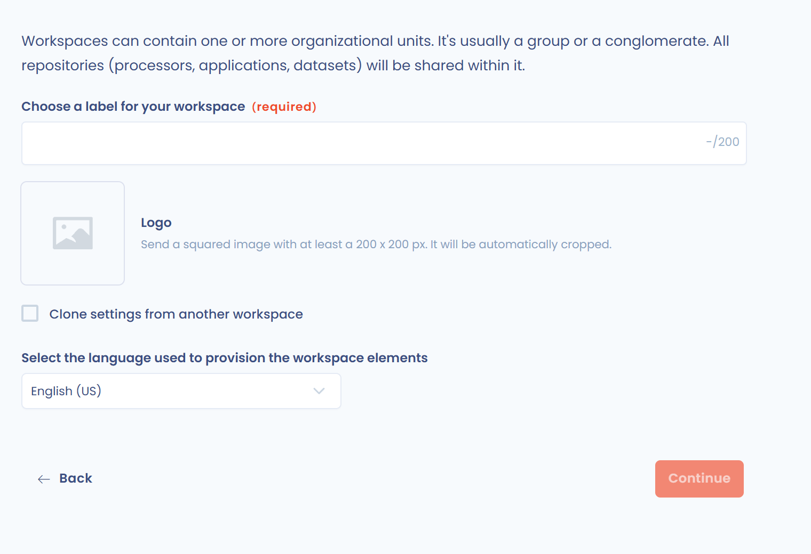

# Mise en place

Cette section vous guide pas à pas pour créer votre premier espace de travail, inviter des utilisateurs et configurer les rôles, permissions et équipes.

## Premiers pas

<table data-view="cards"><thead><tr><th></th><th></th><th data-hidden data-card-target data-type="content-ref"></th></tr></thead><tbody><tr><td><strong>Les notions importantes</strong></td><td>Définitions des notions qui structurent Dastra : organisation, espace de travail, unité organisationnelle, entité, département et propriétaire.</td><td><a href="key-concepts.md">key-concepts.md</a></td></tr><tr><td><strong>Se connecter et gérer l'authentification</strong></td><td>Connectez-vous à Dastra avec votre mot de passe, une passkey, un lien d'accès ou le SSO, et sécurisez votre compte.</td><td><a href="login.md">login.md</a></td></tr><tr><td><strong>Paramétrer votre profil utilisateur</strong></td><td>Modifiez vos informations personnelles, votre langue, votre fuseau horaire et supprimez votre compte utilisateur.</td><td><a href="profile.md">profile.md</a></td></tr></tbody></table>

## Structurer votre espace de travail

Commencez par créer votre espace de travail :

<figure><figcaption>
Le formulaire de création d'un espace de travail
</figcaption></figure>

<table data-view="cards"><thead><tr><th></th><th></th><th data-hidden data-card-target data-type="content-ref"></th></tr></thead><tbody><tr><td><strong>Créer et paramétrer un espace de travail</strong></td><td>Apprenez à créer votre premier espace de travail dans Dastra.</td><td><a href="workspace.md">workspace.md</a></td></tr><tr><td><strong>Créer et paramétrer les unités organisationnelles</strong></td><td>Apprenez à créer et paramétrer des entités et des départements dans Dastra.</td><td><a href="organizational-units.md">organizational-units.md</a></td></tr><tr><td><strong>Désigner un DPO</strong></td><td>Désignez un DPO et ajoutez-le à l'entité concernée dans Dastra.</td><td><a href="dpo.md">dpo.md</a></td></tr><tr><td><strong>Ajouter une autorité chef de file</strong></td><td>Renseignez l'autorité de contrôle chef de file d'une entité dans Dastra.</td><td><a href="lead-authority.md">lead-authority.md</a></td></tr></tbody></table>

## Gérer les utilisateurs

<table data-view="cards"><thead><tr><th></th><th></th><th data-hidden data-card-target data-type="content-ref"></th></tr></thead><tbody><tr><td><strong>Inviter des utilisateurs</strong></td><td>Découvrez comment le système d'invitation de Dastra fonctionne.</td><td><a href="users.md">users.md</a></td></tr><tr><td><strong>Gérer les rôles et permissions</strong></td><td>Découvrez comment gérer les rôles et permissions dans Dastra.</td><td><a href="roles.md">roles.md</a></td></tr><tr><td><strong>Pourquoi un utilisateur ne voit-il pas un traitement ?</strong></td><td>Un utilisateur ne voit pas un traitement, un onglet ou obtient une erreur 403 ? Comprenez comment les rôles, les équipes et les unités organisationnelles déterminent ce qu'il peut voir.</td><td><a href="visibility.md">visibility.md</a></td></tr><tr><td><strong>Créer puis affecter des équipes</strong></td><td>Découvrez comment le système d'équipes de Dastra fonctionne.</td><td><a href="teams.md">teams.md</a></td></tr></tbody></table>

## Aller plus loin

Vous êtes prêt à commencer à utiliser Dastra.\
Vous pouvez explorer librement les fonctionnalités de la plateforme, ou suivre un cas concret à travers le tutoriel suivant :


[README.md](../tutorial/README.md)



[faq.md](faq.md)


Des questions sur la mise en place ? Consultez la [FAQ](../../other/faq.md), qui liste les questions de chaque module.


Vous pouvez à tout moment modifier les rôles, les équipes et les unités organisationnelles de votre espace de travail. Ces paramètres restent entièrement personnalisables selon votre organisation.

