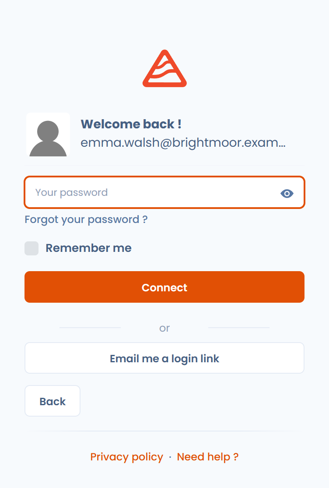
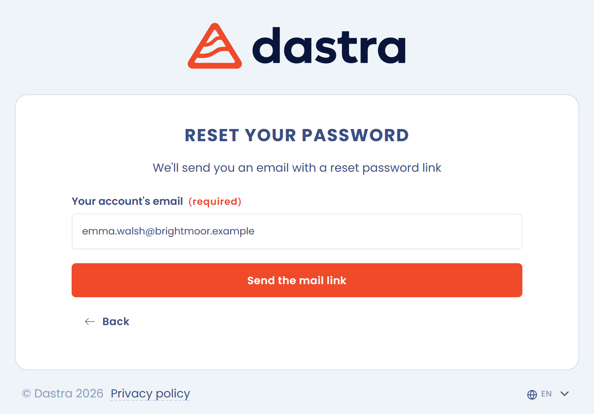
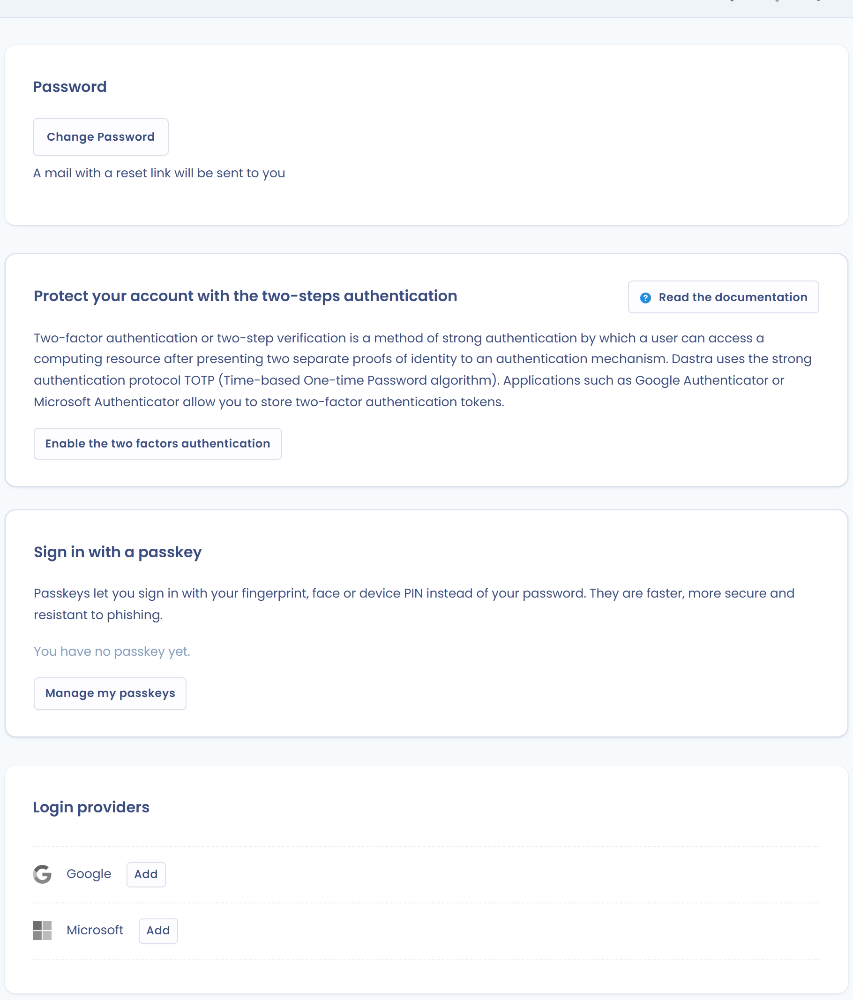

# Se connecter et gérer l'authentification

Cette page explique comment vous connecter à Dastra, comment réinitialiser votre mot de passe et comment renforcer la sécurité de votre compte : authentification forte, passkeys, sessions actives.

## Se connecter à Dastra

La connexion se fait en deux étapes : vous saisissez d'abord votre adresse e-mail, puis vous choisissez comment vous authentifier.

### Avec votre adresse e-mail et votre mot de passe

1. Rendez-vous sur [app.dastra.eu](https://app.dastra.eu).
2. Saisissez votre **Adresse e-mail professionnelle**, puis cliquez sur **Continuer**.
3. Saisissez **Votre mot de passe**, puis cliquez sur **Connexion**.

<figure><figcaption>
Première étape : l'adresse e-mail
</figcaption></figure>

<figure><figcaption>
Deuxième étape : le mot de passe et les autres modes de connexion
</figcaption></figure>


Cochez **Se souvenir de mon mot de passe** uniquement sur un appareil personnel.


### Avec un compte Google ou Microsoft

Sur la première étape, sous **Ou**, cliquez sur **Se connecter avec** suivi de Google ou de Microsoft, puis suivez la procédure du fournisseur. Vous pouvez associer un compte externe à votre compte Dastra dans **Sécurité du compte** > **Logins externes**.

### Avec le SSO

Si votre organisation a configuré l'[authentification unique (SSO)](../../features/settings/sso/README.md), connectez-vous avec votre fournisseur d'identité.

1. Sur la première étape, cliquez sur **Se connecter avec SSO**.
2. Saisissez votre **Identifiant SSO (e-mail ou nom d'utilisateur)**, puis cliquez sur **Continuer**.
3. Suivez la procédure d'authentification de votre organisation. Dastra vous redirige ensuite vers votre espace.

<figure><figcaption>
La connexion avec le SSO
</figcaption></figure>

Avec le SSO, vos identifiants restent chez votre fournisseur d'identité : Dastra ne reçoit pas votre mot de passe.

### Avec une passkey

Une passkey remplace le mot de passe par votre empreinte, votre visage ou le code PIN de votre appareil. Sur la deuxième étape, cliquez sur **Se connecter avec une passkey**.

Vous enregistrez vos passkeys dans **Sécurité du compte** > **Gérer mes passkeys**. Voir [Passkeys](../../security/passkey.md).

### Avec un lien d'accès envoyé par e-mail

Sur la deuxième étape, cliquez sur **Envoyer par mail le lien d'accès**. Dastra envoie à votre adresse e-mail un lien qui vous connecte sans mot de passe.

### Choisir la région d'hébergement

Lorsque votre environnement Dastra propose plusieurs régions d'hébergement, la page de connexion affiche un champ **Région d'hébergement** avec la région actuelle : **Région Europe (défaut)** ou **Bleu cloud France**. Cliquez sur le champ pour ouvrir l'autre région, puis connectez-vous à cet endroit.

Cliquez sur le bouton **?** à côté du champ (**En savoir plus sur les régions d'hébergement**) pour comparer les régions. Un tenant est hébergé dans une seule région, et les deux régions ne sont ni dupliquées ni synchronisées : un compte d'une région ne peut pas se connecter sur l'autre. Pour migrer un tenant existant vers l'autre région, utilisez **Contactez notre équipe commerciale** dans la même fenêtre. Consultez [Dastra sur Bleu](../../security/bleu.md) pour les adresses et les détails d'hébergement de chaque région.

## Réinitialiser votre mot de passe

1. Sur la deuxième étape de la connexion, cliquez sur **Vous avez oublié votre mot de passe ?**.
2. Saisissez l'adresse e-mail associée à votre compte.
3. Ouvrez l'e-mail que vous recevez et suivez le lien de réinitialisation.
4. Choisissez un nouveau mot de passe.

<figure><figcaption>
La page de réinitialisation du mot de passe
</figcaption></figure>

Si le lien ne fonctionne plus, recommencez la procédure. Une fois connecté, vous pouvez aussi cliquer sur **Changer de mot de passe** dans **Sécurité du compte** : Dastra vous envoie un e-mail avec un lien de réinitialisation.

## Gérer la sécurité de votre compte

Ouvrez le menu de votre profil en haut à droite, cliquez sur **Profil utilisateur**, puis sur **Sécurité du compte** dans le menu de gauche. La page regroupe :

* **Mot de passe** : le bouton **Changer de mot de passe** ;
* l'authentification forte, ou authentification à deux facteurs ;
* les passkeys ;
* les **Logins externes** ;
* les **Sessions actives** ;
* l'**Historique d'activités** de votre compte.

<figure><figcaption>
La page Sécurité du compte
</figcaption></figure>

### Activer l'authentification forte

L'authentification forte ajoute une étape à la connexion : un code à 6 chiffres généré par une application d'authentification sur votre téléphone.

1. Dans **Sécurité du compte**, cliquez sur **Activer l'authentification forte**.
2. Scannez le QR code avec une application d'authentification (Microsoft Authenticator, Google Authenticator, 1Password, etc.).
3. Saisissez le code généré pour confirmer l'activation.
4. Conservez le code de récupération affiché pendant l'activation.


Le code de récupération vous redonne accès à votre compte si vous perdez votre application d'authentification. Sans lui, vous devez demander au propriétaire de l'organisation de réinitialiser l'authentification forte de votre compte.


Une fois l'authentification forte activée, vous saisissez votre mot de passe puis le code à 6 chiffres de votre application. Voir [Authentification forte](../../security/mfa.md).

### Gérer les sessions actives

1. Dans **Sécurité du compte**, repérez la section **Sessions actives** : elle liste les appareils et navigateurs connectés à votre compte.
2. Cliquez sur **Déconnexion** en face de la session à fermer.

Fermez immédiatement toute session que vous ne reconnaissez pas.

## Bonnes pratiques de sécurité

* Utilisez un mot de passe long et unique pour Dastra.
* Ne partagez jamais vos identifiants, même en interne.
* Activez l'authentification forte ou enregistrez une passkey.
* Fermez votre session sur les appareils partagés ou publics.
* Vérifiez régulièrement vos sessions actives.

## Voir aussi

* [Paramétrer votre profil utilisateur](profile.md)
* [Notifications](../../features/settings/notifications.md)
* [Sécurité des données et de la plateforme](../../security/general.md)
