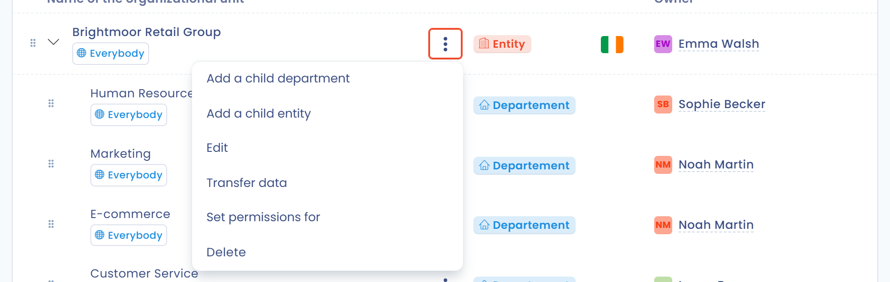

# Créer et paramétrer les unités organisationnelles



## Introduction

Les unités organisationnelles structurent votre espace de travail. Deux types d'unités organisationnelles peuvent être créés :

* les **entités**, qui correspondent à des entités juridiques et représentent un responsable du traitement ;
* les **départements**, qui permettent d'organiser les entités.

Dans Dastra, un espace de travail n'est pas une entité juridique : **un espace de travail peut faire référence à plusieurs entités juridiques** distinctes, comme dans un groupe. En revanche, il ne peut y avoir qu'un seul représentant légal par entité juridique.


Chaque entité dans Dastra est considérée comme un responsable du traitement.


## Accéder aux unités organisationnelles

Dans le menu de gauche, cliquez sur **Réglages espace de travail**, puis sur **Unités organisationnelles**.

<figure><figcaption>
Le menu Réglages espace de travail
</figcaption></figure>

L'écran de **création et de paramétrage** des unités organisationnelles s'ouvre. Il propose deux onglets : **Unités organisationnelles** (la liste) et **Organigramme**.

<figure><figcaption>
La liste des unités organisationnelles
</figcaption></figure>

## Créer ou modifier une entité

1. Cliquez sur **Créer une entité**.
2. Renseignez le **Nom de l'entité** et le **Pays**, qui sont obligatoires. Vous pouvez aussi indiquer le responsable (le représentant légal), le délégué à la protection des données et le représentant au sein de l'Union européenne, le cas échéant.
3. Cliquez sur **Enregistrer**.

<figure><figcaption>
Le formulaire de création d'une entité
</figcaption></figure>


Contrairement aux départements, le nombre d'entités (responsables du traitement) que vous pouvez créer dépend d'un quota lié à votre abonnement. Pour l'augmenter, [contactez le service commercial](https://www.dastra.eu/fr/contacts).


Pour modifier une entité, cliquez sur les trois points à droite de l'entité, puis sur **Modifier**. Réalisez les modifications et cliquez sur **Enregistrer**.

<figure><figcaption>
Le menu des trois points d'une unité organisationnelle
</figcaption></figure>

## Créer ou modifier un département

Pour créer un département, ouvrez le menu du bouton **Créer une entité**, cliquez sur **Créer un département** et renseignez les champs demandés.

Pour le modifier, cliquez sur les trois points à droite du département, puis sur **Modifier**, effectuez vos changements et cliquez sur **Enregistrer**.

## Ajouter des unités enfants

Le menu des trois points d'une unité propose aussi :

* **Ajouter un département enfant** : crée un département placé sous l'unité ;
* **Ajouter une entité enfant** : crée une entité placée sous l'unité, par exemple pour représenter la filiale d'une filiale.

## Supprimer une unité organisationnelle et transférer ses données

Une unité organisationnelle ne peut être supprimée tant que des éléments lui sont rattachés. Dans le menu des trois points, cliquez sur **Supprimer**, puis cliquez sur les éléments listés et assignez-les à une autre unité. Vous pouvez aussi cliquer sur **Transférer les données** pour déplacer vers une autre unité les types d'objets de votre choix, sans supprimer l'unité.

<figure><figcaption>
La suppression d'une unité organisationnelle
</figcaption></figure>


La suppression d'une unité organisationnelle est définitive. Les données associées sont transférées vers l'unité que vous choisissez.


## Importer et exporter des unités organisationnelles

Ouvrez le menu du bouton **Créer une entité** : il propose **Importer** et **Exporter**.

Pour importer, cliquez sur **Importer**, puis sur **Télécharger le modèle de fichier**. Remplissez le fichier et déposez-le dans le champ de dépôt. Le fichier peut être au format CSV (encodage UTF-8, séparateur `;`), TXT ou XLSX.

<figure><figcaption>
La fenêtre d'import
</figcaption></figure>

Deux colonnes sont obligatoires :

* `Id` : l'identifiant de l'unité, un texte unique dans le fichier (80 caractères maximum) ;
* `Label` : le nom de l'unité (80 caractères maximum).

Les autres colonnes sont facultatives :

* `ParentId` : l'`Id` de l'unité parente, s'il y en a une ;
* `CountryCode` : le pays, en code à 2 lettres ([ISO 3166](https://documentation.abes.fr/sudoc/formats/CodesPays.htm)). La valeur par défaut est `FR` ;
* `Type` : `Entity` pour une entité ou `Area` pour un département. La valeur par défaut est `Entity` ;
* `City`, `Address`, `ZipCode`, `MailAddress`, `PhoneNumber` et `ImmatriculationNumber` : les coordonnées de l'unité ;
* `RepresentativeName` et `RepresentativeType`, `DpoName` et `DpoType`, `ReferentName` et `ReferentType` : le nom et le type de l'acteur associé comme représentant, DPO ou responsable ;
* `OwnerEmail` : l'adresse e-mail du propriétaire de l'unité.


Limitez la hiérarchie à 7 niveaux (relations parent-enfant) pour que l'import soit traité correctement.


Exemple :

<table><thead><tr><th>Id</th><th>ParentId</th><th width="492">Label</th><th>CountryCode</th><th>Type</th></tr></thead><tbody><tr><td>20996</td><td></td><td>HOLDING</td><td>FR</td><td>Entity</td></tr><tr><td>21009</td><td>20996</td><td>Informatique</td><td>BE</td><td>Area</td></tr></tbody></table>

## Visualiser et paramétrer les unités depuis l'organigramme

L'onglet **Organigramme** affiche graphiquement vos entités et départements. Vous pouvez y réaliser la plupart des opérations disponibles dans la liste.

<figure><figcaption>
La vue Organigramme
</figcaption></figure>

## Limiter les accès au contenu d'une unité organisationnelle

Grâce aux équipes d'utilisateurs, vous pouvez limiter l'accès au contenu rattaché à une unité organisationnelle. Pour cela, rattachez des équipes à l'unité : dans le menu des trois points, cliquez sur **Définir les permissions pour** et ajoutez les utilisateurs ou les équipes autorisés.

Par défaut, une unité enfant hérite des permissions de son unité parente. Dès que vous ajoutez des permissions à l'unité enfant, elles remplacent celles qu'elle héritait.

### Accès restreint à une entité enfant uniquement

Vous pouvez ajouter un utilisateur ou une équipe **uniquement sur une entité enfant**, sans leur donner accès aux entités parentes. Ils accèdent alors **exclusivement aux données de cette entité**, ni à celles des entités parentes, ni à celles des entités sœurs.

Ce mode est utile pour déléguer la gestion d'une filiale ou d'un département à des utilisateurs locaux, sans leur exposer les données du groupe. Pour le configurer, ouvrez les permissions de l'entité concernée et ajoutez l'utilisateur ou l'équipe directement sur cette entité, sans les rattacher à l'entité parente.


Contrairement au mode standard, l'accès restreint à une entité enfant ne donne pas accès aux données des entités parentes.


## Aller plus loin


[teams.md](teams.md)

