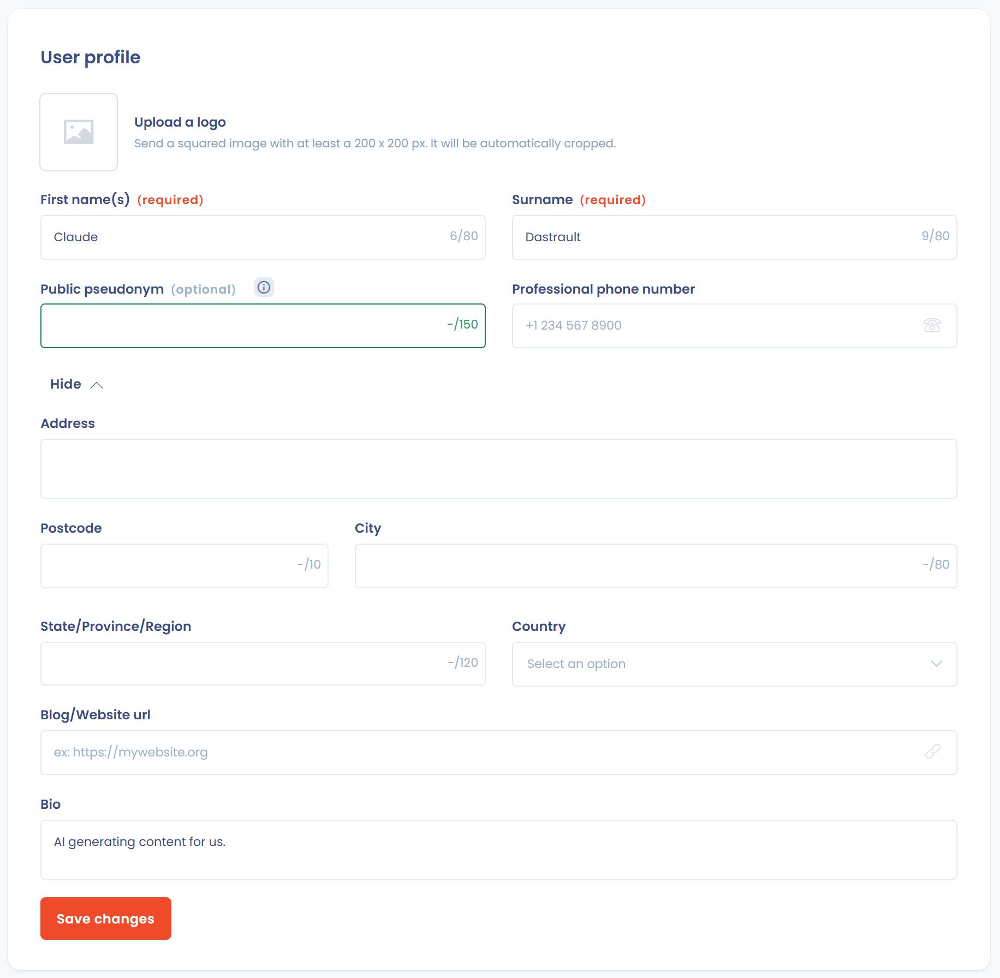
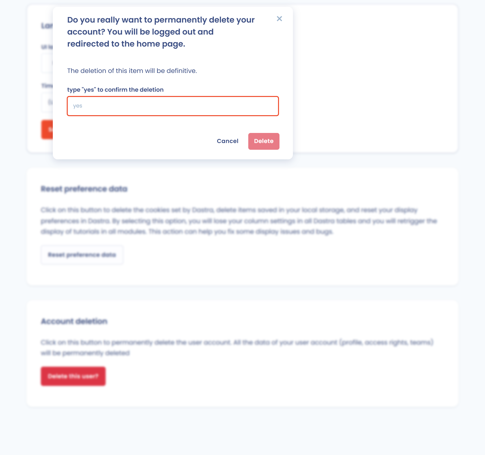

# Paramétrer votre profil utilisateur

Chaque utilisateur Dastra dispose d'un profil personnel : informations d'identification, langue et fuseau horaire, options liées à la confidentialité du compte. Ouvrez le menu de votre profil en haut à droite de l'écran, puis cliquez sur **Profil utilisateur**.

## Logo du profil

Vous pouvez ajouter un logo ou une photo de profil, visible dans Dastra à côté de votre nom. Cliquez sur **Envoyez un logo** et choisissez une image carrée d'au moins 200 x 200 px. Dastra la recadre automatiquement.

<figure><figcaption>
La page Profil utilisateur
</figcaption></figure>

## Informations personnelles

Les champs suivants peuvent être complétés ou mis à jour à tout moment. Les champs d'adresse, de site web et de bio sont masqués par défaut : cliquez sur **Afficher plus** pour les afficher. Cliquez sur **Enregistrer** pour valider.

| Champ | Description | Obligation |
| --- | --- | --- |
| **Prénom** | Votre prénom tel qu'il apparaît dans Dastra | Obligatoire |
| **Nom** | Votre nom de famille | Obligatoire |
| **Pseudonyme publique** | Pseudonyme utilisé dans le forum des utilisateurs (la communauté) et dans les messages des demandes d'exercice de droits adressés à l'extérieur. 4 caractères minimum : lettres, chiffres et tiret bas | Optionnel |
| **Numéro de téléphone** | Votre numéro de téléphone professionnel | Optionnel |
| **Adresse postale**, **Code postal**, **Ville**, **Région**, **Pays** | Vos coordonnées | Optionnel |
| **Blog/Site web url** | Lien vers votre site ou votre profil professionnel | Optionnel |
| **Biographie** | Courte description de votre rôle ou de votre fonction | Optionnel |

## Changer votre adresse e-mail

La section **Email du profil** affiche l'adresse associée à votre compte.

1. Cliquez sur **Changer d'adresse email**.
2. Saisissez votre nouvelle adresse e-mail, puis cliquez sur **Envoyer un lien de confirmation**.
3. Ouvrez l'e-mail envoyé à la nouvelle adresse et cliquez sur le lien de validation.

## Langue et fuseau horaire

La section **Langue & fuseau horaire** personnalise l'affichage de Dastra.

| Paramètre | Description |
| --- | --- |
| **Langue de l'interface** | Langue de l'application. Dix entrées sont proposées : English (US), English (UK), Français, Deutsch, Español, Italiano, Nederlands, Ελληνικά, Polski et Português |
| **Fuseau horaire** | Fuseau horaire utilisé pour afficher les dates et les heures |

Ces préférences ne changent que votre affichage personnel. Elles ne modifient pas la langue des autres membres de l'espace de travail.

<figure><figcaption>
Les sections e-mail, langue et préférences
</figcaption></figure>

## Réinitialiser les données de préférences

Le bouton **Réinitialiser les données de préférences** remet à zéro les préférences enregistrées sur votre navigateur. Il supprime :

* les cookies posés par Dastra ;
* les éléments enregistrés dans le stockage local du navigateur ;
* vos préférences d'affichage, dont les réglages de colonnes dans les tableaux ;
* l'historique des tutoriels déjà vus : ils s'affichent de nouveau dans tous les modules.

Cette action peut aider à résoudre certains problèmes d'affichage.


Vos préférences sont perdues et l'affichage de certains modules revient à ce que vous voyiez lors de votre première connexion.


## Suppression du compte utilisateur

Si vous souhaitez quitter définitivement Dastra, vous pouvez supprimer votre compte utilisateur dans la section **Suppression du compte**. Cette action supprime définitivement votre profil, vos droits d'accès et vos équipes. Elle vous déconnecte et vous redirige vers l'accueil.

<figure><figcaption>
La confirmation de suppression du compte
</figcaption></figure>


La suppression est irréversible. Aucune récupération n'est possible. Avant de supprimer votre compte, informez l'administrateur de votre organisation pour éviter toute perte de données.


## Bonnes pratiques

* Tenez vos coordonnées à jour pour assurer la continuité des communications.
* Choisissez un pseudonyme professionnel : il peut être lu par la communauté Dastra et par les personnes extérieures qui échangent avec vous dans une demande d'exercice de droits.

## Voir aussi

* [Se connecter et gérer l'authentification](login.md)
* [Notifications](../../features/settings/notifications.md)
* [Rôles et permissions](../../features/settings/roles.md)
