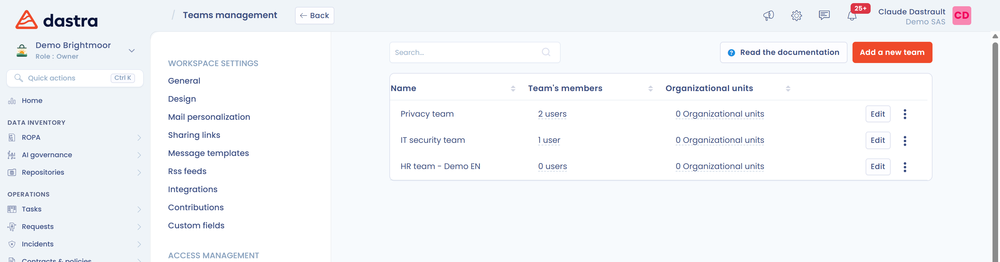

# Créer puis affecter des équipes

Dans Dastra, les utilisateurs sont regroupés par équipe. Les équipes sont ensuite affectées à des entités juridiques ou à des départements, ce qui donne un contrôle précis des rôles et des responsabilités.

## Créer une nouvelle équipe ou ajouter un utilisateur à une équipe

Dans le menu de gauche, cliquez sur **Réglages espace de travail**, puis sur **Equipes**.

<figure><figcaption>
La liste des équipes
</figcaption></figure>

Pour créer une équipe, cliquez sur **Ajouter une équipe**, donnez-lui un **Nom** et, si vous le souhaitez, une **Référence interne**.

Pour ajouter un utilisateur à une équipe existante, cliquez sur les trois points à droite de l'équipe puis sur **Modifier**, ou directement sur le nom de l'équipe. La liste des utilisateurs assignés à l'équipe s'affiche : ajoutez les utilisateurs souhaités ou envoyez une invitation à un nouvel utilisateur.

Pour supprimer une équipe, cliquez sur **Supprimer** dans le menu de l'équipe.

## Affecter une équipe à des unités organisationnelles

Une équipe donne accès au contenu des unités organisationnelles auxquelles elle est affectée. Vous pouvez l'affecter de deux façons.

* Depuis l'équipe : cliquez sur **Modifier**, puis cochez les unités organisationnelles dans la liste **Unités organisationnelles**.
* Depuis l'unité organisationnelle : dans **Réglages espace de travail** > **Unités organisationnelles**, cliquez sur les trois points de l'unité, puis sur **Définir les permissions pour**.

<figure><figcaption>
L'affectation d'une équipe à des unités organisationnelles
</figcaption></figure>


Dès qu'une unité organisationnelle a des permissions, seuls les utilisateurs et les équipes listés y accèdent. Pour les règles d'héritage entre unités parentes et enfants, voir [Limiter les accès au contenu d'une unité organisationnelle](organizational-units.md#limiter-les-acces-au-contenu-dune-unite-organisationnelle).

