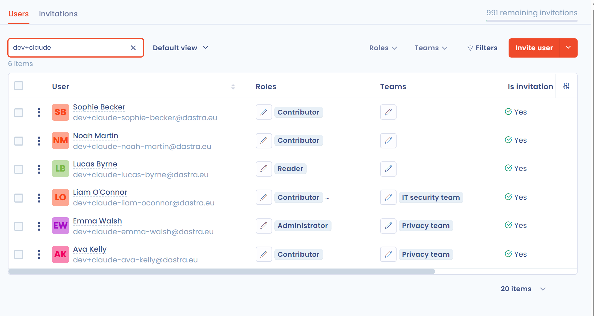

# Inviter des utilisateurs

## Invitez un utilisateur

Vous pouvez amener quelqu'un à collaborer sur vos espaces en l'invitant dans l'organisation à laquelle appartient l'espace.

1. Dans le menu de gauche, cliquez sur **Réglages espace de travail**, puis sur **Utilisateurs**.
2. Cliquez sur **Inviter un utilisateur**.
3. Saisissez l'adresse e-mail de la personne. Si cette adresse n'est pas déjà rattachée à l'organisation, cliquez dessus pour continuer.
4. Renseignez le formulaire d'invitation (voir le tableau ci-dessous), puis cliquez sur **Envoyer une invitation par e-mail**.

<figure><figcaption>
La page Utilisateurs des réglages de l'espace de travail
</figcaption></figure>

<figure><figcaption>
Le formulaire d'invitation
</figcaption></figure>

| Champ | Description |
| --- | --- |
| **Prénom** et **Nom** | Identité de la personne invitée |
| **Langue de l'interface** | Langue dans laquelle la personne voit Dastra |
| **Inviter dans tous les espaces de travail du compte** | Interrupteur : sans lui, vous choisissez l'espace de travail concerné |
| **Sélectionner le ou les rôles de l'utilisateur** | Voir [Gérer les rôles et permissions](roles.md) |
| **Sélectionner les équipes de l'utilisateur** | Voir [Créer puis affecter des équipes](teams.md) |
| **Mode de connexion par défaut** | Compte local (login et mot de passe) ou SSO, quand un SSO est configuré |
| **Message de bienvenue** | Texte ajouté à l'e-mail d'invitation |

Vous pouvez aussi cliquer sur **Inviter un membre** en bas de la barre latérale gauche : le même formulaire s'ouvre.

La personne invitée reçoit un e-mail contenant un lien qui lui donne accès à l'espace. Vous recevez un e-mail de notification quand elle clique sur le lien. Le lien d'invitation expire au bout de 10 jours.

Au lieu d'envoyer l'e-mail, vous pouvez cliquer sur **Générer un lien d'invitation** : Dastra affiche un lien que vous transmettez vous-même à la personne.

### Retrouvez les invitations en cours

Les invitations en cours se pilotent dans l'onglet **Invitations** de la page **Utilisateurs**.

<figure><figcaption>
L'onglet Invitations
</figcaption></figure>


Votre abonnement limite le nombre d'utilisateurs. Le quota compte les utilisateurs actifs et ceux liés à une invitation en attente ou expirée : supprimez l'utilisateur d'une invitation dont vous n'avez plus besoin pour libérer un emplacement. Lorsque la limite est atteinte, Dastra affiche **Vous avez atteint la limite de vos utilisateurs** et vous pouvez contacter l'équipe Dastra pour l'augmenter.


### Renvoyer un lien d'invitation

Si la personne invitée n'a pas cliqué sur le lien et que celui-ci a expiré, cliquez sur **Renvoyer** en face de l'invitation, puis confirmez.

### Créer puis affecter des équipes

Dans Dastra, les utilisateurs sont regroupés par équipe. Les équipes sont ensuite affectées à des entités ou à des départements, ce qui donne un contrôle précis des rôles et des responsabilités. Voir [Créer puis affecter des équipes](teams.md).

### Rôles proposés par défaut

Dastra propose cinq rôles de base. Leurs permissions détaillées sont décrites dans [Gérer les rôles et permissions](roles.md).

| Rôle | Identifiant |
| --- | --- |
| Administrateur | 1 |
| Contributeur | 2 |
| Lecteur | 3 |
| Auditeur | 11000 |
| Testeur de conformité | 11500 |


**Propriétaire de l'organisation et DPO ne sont pas des rôles.** Pour donner à un utilisateur déjà invité le statut de **propriétaire** de l'organisation, voir [Comment ajouter un propriétaire d'organisation ?](faq.md#comment-ajouter-un-proprietaire-dorganisation). Pour **changer de DPO**, voir [Comment changer de DPO ?](faq.md#comment-changer-de-dpo).


## Importer une grande liste d'utilisateurs

Pour importer une grande liste d'utilisateurs (minimum 50), vous passez par les équipes de Dastra. Vous pouvez demander l'import d'une liste jusqu'à 200 utilisateurs, dans la limite des utilisateurs disponibles.

**Les étapes à suivre :**

1. Ouvrez [https://app.dastra.eu/general-settings/users](https://app.dastra.eu/general-settings/users) et cliquez sur la flèche à droite du bouton **Inviter un utilisateur**, puis sur **Importer**.

<figure><figcaption>
Le menu d'import dans les paramètres de l'organisation
</figcaption></figure>

2. Créez un fichier par espace de travail, au format CSV, avec les colonnes suivantes séparées par des virgules.

De manière obligatoire :

* `Email` : l'adresse e-mail de l'utilisateur ;
* `GivenName` : son prénom ;
* `FamilyName` : son nom ;
* `Roles` : les identifiants des rôles dans Dastra, séparés par `|` ;
* `Teams` : les identifiants des équipes dans Dastra, séparés par `|`.

De manière optionnelle :

* `SSOConfigurationId` : l'identifiant du login SSO, le cas échéant.

Voici un modèle de fichier à télécharger et à remplir :


Modèle de fichier d'import


**Identifiants des rôles**

Les rôles de base ont les identifiants du tableau ci-dessus. Pour les rôles personnalisés que vous avez créés, l'identifiant est visible dans la console de développement de votre navigateur, dans l'onglet Réseau. Les rôles doivent être créés avant l'import.


Pour ouvrir la console sur Chrome : Cmd + Option + C (Mac) ou Ctrl + Maj + J (Windows).

Pour ouvrir la console sur Firefox : Cmd + Option + K (Mac) ou Ctrl + Maj + J (Windows).

Pour ouvrir la console sur Microsoft Edge : Ctrl + Maj + I.


**Identifiants des équipes**

Les équipes sont identifiées par leur numéro d'identifiant. Pour le récupérer, ouvrez l'équipe dans Dastra avec le bouton **Modifier** : le numéro figure dans le titre de la fenêtre.

<figure><figcaption>
Dans cet exemple, l'identifiant de l'équipe Test est 8019
</figcaption></figure>

Les équipes ne sont pas obligatoires dans Dastra. Celles que vous utilisez dans le fichier doivent être créées au préalable dans l'espace de travail.

**Identifiant de configuration SSO**

La colonne `SSOConfigurationId` est **optionnelle** : renseignez-la uniquement si vous souhaitez rattacher les utilisateurs importés à un login SSO déjà configuré dans votre organisation. Laissez-la vide pour une connexion classique par e-mail et mot de passe.

Comme pour les rôles personnalisés, cet identifiant se récupère depuis la **console de développement** de votre navigateur, dans l'onglet **Réseau** :

1. Ouvrez [la page de configuration des logins SSO](https://app.dastra.eu/general-settings/sso) (vous devez être propriétaire de l'organisation).
2. Ouvrez la console de développement (voir les raccourcis ci-dessus) et placez-vous sur l'onglet **Réseau**.
3. Cliquez sur l'icône crayon du login SSO concerné pour ouvrir la fenêtre **Modifier le login SSO**. Il s'agit d'une fenêtre modale : l'URL de la page reste `https://app.dastra.eu/general-settings/sso`.
4. Dans l'onglet **Réseau**, ouvrez la requête déclenchée à l'ouverture de la fenêtre et relevez la valeur du champ `scheme` (c'est aussi la fin de l'URL de la requête, après `ssoConfiguration/`) : c'est cette valeur à reporter dans la colonne `SSOConfigurationId`.


Le login SSO doit avoir été configuré au préalable. Voir la page [Authentification unique (SSO)](../../features/settings/sso/README.md).


3. Enregistrez votre fichier au format CSV UTF-8. Dans Excel, choisissez le type de fichier **CSV UTF-8 (délimité par des virgules)**.
4. Indiquez dans quel espace de travail importer les utilisateurs et déposez le fichier dans l'interface de dépôt.

<figure><figcaption>
L'interface de dépôt du fichier
</figcaption></figure>

L'équipe de Dastra reçoit votre demande et revient vers vous pour le suivi.
