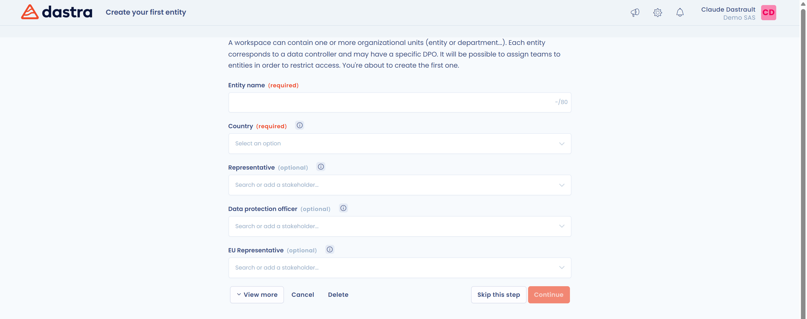
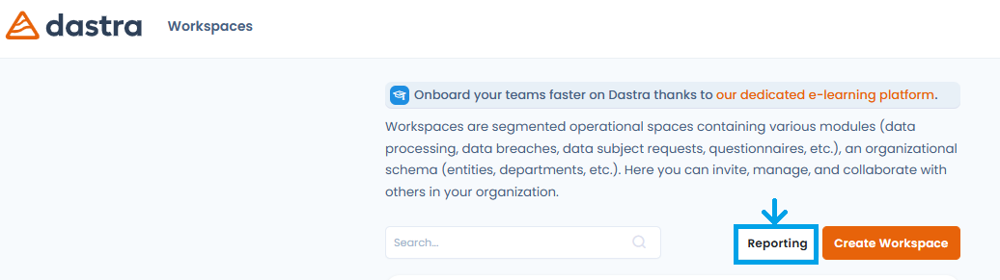
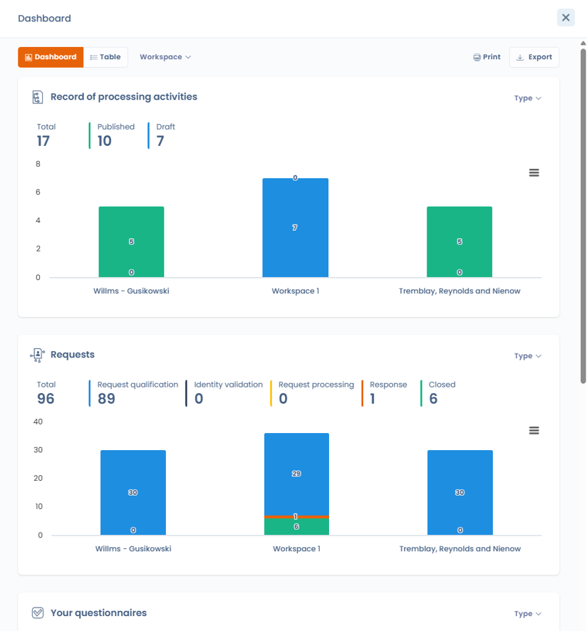

# Créer et paramétrer un espace de travail

Cette page explique comment créer un espace de travail, y inviter les premiers utilisateurs, déclarer votre première entité et naviguer entre vos espaces.



## Connectez-vous à Dastra

Commencez par vous connecter sur [app.dastra.eu](https://app.dastra.eu). Si vous n'avez pas encore de compte, demandez à un administrateur de votre organisation de vous inviter. Si votre organisation n'utilise pas encore Dastra, [demandez une démo](https://www.dastra.eu/fr/contacts/demo).

## Espace de travail

Un espace de travail est **une organisation permettant d'accueillir un ou plusieurs registres des traitements**. Vous pouvez créer un espace de travail par registre des traitements, par entité légale ou par succursale, selon votre choix. Pour les définitions des autres notions (organisation, unité organisationnelle, entité, département), voir [Les notions importantes](key-concepts.md).


Un espace de travail est un environnement dont les **données sont totalement cloisonnées** : les enregistrements d'un espace (traitements, actifs, demandes, etc.) ne sont jamais accessibles depuis le contexte d'un autre espace. Vous pouvez toutefois consulter des **statistiques consolidées** sur l'ensemble de vos espaces depuis le tableau de bord inter-espaces (voir [Statistiques inter-espaces de travail](workspace.md#statistiques-inter-espaces-de-travail)), et dupliquer des éléments (traitements, actifs, etc.) d'un espace à l'autre.


## Créez un espace de travail

Seuls les propriétaires de l'organisation peuvent créer un espace de travail.

1. Sur la page qui liste vos espaces de travail, cliquez sur **Créer espace de travail**.
2. Renseignez le **Nom de l'espace de travail**, qui est obligatoire.
3. Ajoutez, si vous le souhaitez, le **Logo de l'espace de travail** : une image carrée d'au moins 200 x 200 px, recadrée automatiquement.
4. Choisissez la langue dans la liste **Sélectionnez la langue utilisée dans cet espace de travail**.
5. Cliquez sur **Continuer**.

<figure><figcaption>
Le formulaire de création d'un espace de travail
</figcaption></figure>

Pour reprendre la configuration d'un espace existant, cochez **Cloner les paramètres d'un autre espace de travail**, choisissez l'**Espace de travail source** et cochez, si besoin, **Inclure les utilisateurs et les équipes**. Le choix de la langue disparaît : le nouvel espace reprend celle de l'espace source.


Une fois l'espace créé, vous pouvez configurer ses unités organisationnelles et inviter des utilisateurs.






### Invitez les premiers utilisateurs

Après la création, Dastra ouvre la page des utilisateurs du nouvel espace. Vous pouvez ajouter des utilisateurs existants de l'organisation ou inviter de nouveaux utilisateurs avec **Inviter un utilisateur**.

<figure><figcaption>
L'étape d'invitation des utilisateurs
</figcaption></figure>

Assignez à chaque utilisateur le rôle de votre choix, puis cliquez sur **Suivant**. Pour le détail des champs d'invitation, voir [Inviter des utilisateurs](users.md).

### Créez la première entité

Dans Dastra, un espace de travail n'est pas une entité juridique : il peut en regrouper plusieurs, comme dans un groupe. Chaque entité correspond à un responsable du traitement, et une entité n'a qu'un seul représentant légal.

Pour créer la première entité, renseignez son **Nom de l'entité** et son **Pays** : ce sont les deux champs obligatoires. Vous pouvez aussi indiquer son responsable, son représentant légal et, s'il a été désigné, son délégué à la protection des données.

<figure><figcaption>
Le formulaire de création de la première entité
</figcaption></figure>

Cliquez sur **Continuer** pour entrer dans votre espace. Vous pouvez aussi cliquer sur **Passer** et créer vos entités plus tard.

### Créez d'autres entités et des départements

Une fois votre espace ouvert, renseignez dès que possible les autres entités juridiques et les départements. Cela simplifie ensuite la gestion des traitements et l'attribution des droits aux utilisateurs.

1. Dans le menu de gauche, cliquez sur **Réglages espace de travail**, puis sur **Unités organisationnelles**.
2. Cliquez sur **Créer une entité** pour ajouter une entité juridique, ou ouvrez le menu du bouton pour choisir **Créer un département**.
3. Répétez l'opération jusqu'à ce que l'organigramme de votre structure soit représenté dans Dastra.

<figure><figcaption>
La vue Organigramme
</figcaption></figure>

Pour les départements enfants, les entités enfants, l'import et la suppression, voir [Créer et paramétrer les unités organisationnelles](organizational-units.md).



## Accédez à un espace de travail

1. Connectez-vous à l'application avec votre compte utilisateur.
2. Cliquez sur la tuile de votre espace de travail dans la liste qui s'affiche.

<figure><figcaption>
La liste des espaces de travail
</figcaption></figure>

Vous accédez alors à votre espace de travail. Pour changer d'espace à tout moment, cliquez sur le sélecteur d'espace de travail en haut de la barre latérale gauche.

<figure><figcaption>
Le sélecteur d'espace de travail
</figcaption></figure>

## Statistiques inter-espaces de travail

Le tableau de bord inter-espaces réunit sur une seule vue les indicateurs clés de tous vos espaces de travail. Les propriétaires y accèdent avec le bouton **Statistiques**, depuis la liste des espaces de travail.

<figure><figcaption>
Le bouton qui ouvre le tableau de bord inter-espaces depuis la liste des espaces de travail
</figcaption></figure>

Il consolide les indicateurs des principaux modules : registre des traitements (ROPA), demandes d'exercice de droits, incidents, questionnaires, systèmes d'IA et tâches. Les données sont présentées sous forme de widgets et de graphiques.

<figure><figcaption>
Indicateurs consolidés du registre des traitements et des demandes d'exercice de droits pour tous les espaces de travail
</figcaption></figure>

Des filtres dynamiques permettent d'affiner l'analyse par espace de travail, par unité organisationnelle et par type. Le bouton **Choisir une période** restreint les indicateurs à une période : sélectionnez une période prédéfinie (Aujourd'hui, Semaine en cours, Mois en cours, Année en cours, etc.) ou une date de début et une date de fin dans le calendrier, puis cliquez sur **Appliquer**. Sans période sélectionnée, les indicateurs portent sur l'ensemble des données ; le bouton **Réinitialiser** retire la période choisie. Le tableau de bord peut être imprimé et exporté.

## Aller plus loin

Suivez le tutoriel ci-dessous ou commencez à explorer Dastra par vous-même.


[README.md](../tutorial/README.md)

