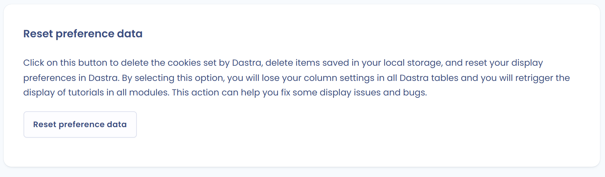

# Problèmes connus

## L'utilisateur invité ne reçoit pas les e-mails d'invitation

Vérifiez d'abord les points suivants :

* L'adresse e-mail de l'utilisateur (domaine, nom, etc.) est correcte. Si elle est incorrecte, l'interface n'affiche pas d'erreur.
* La boîte de réception de la personne n'est pas pleine.
* L'e-mail n'est pas dans le dossier des courriers indésirables. Dans de rares cas, le filtre anti-spam du serveur de messagerie du destinataire bloque l'e-mail envoyé par Dastra.

Si l'e-mail n'arrive toujours pas, générez un lien d'invitation :

1. Dans la liste des utilisateurs, cliquez sur **Inviter un utilisateur** et suivez les étapes.
2. À l'étape du mode d'invitation, sélectionnez **Générer un lien d'invitation**, puis cliquez sur le bouton **Générer un lien d'invitation**.

   <figure><figcaption>
Choix du lien d'invitation
</figcaption></figure>
3. Copiez le lien affiché sous **Lien d'invitation à envoyer directement à l'utilisateur**.

   <figure><figcaption>
Lien d'invitation généré
</figcaption></figure>

Transmettez ensuite le lien à l'utilisateur par la messagerie de votre entreprise ou depuis votre boîte mail.


L'utilisateur doit encore valider son adresse e-mail pour accéder à votre espace de travail.


## Résoudre les problèmes liés au cache de votre navigateur

Le navigateur utilise un cache et des cookies pour enregistrer des informations provenant des sites web. Les supprimer corrige certains problèmes, comme ceux liés au chargement d'applications telles que Dastra.

Essayez les solutions suivantes dans l'ordre :

1. **Actualisez la page sans utiliser le cache**, avec Ctrl + F5 (Windows) ou Cmd + Maj + R (Mac).
2. Si le problème persiste, **réinitialisez vos données de préférences**. Cette action supprime les cookies déposés par Dastra, efface les éléments enregistrés dans votre stockage local et réinitialise vos préférences d'affichage dans Dastra. Elle peut résoudre certains problèmes d'affichage.

Pour la lancer, ouvrez le menu de votre profil en haut à droite, cliquez sur **Profil utilisateur**, puis sur **Réinitialiser les données de préférences**.

<figure><figcaption>
Réinitialisation des données de préférences
</figcaption></figure>


Cette action supprime vos réglages de colonnes dans tous les tableaux de Dastra et relance l'affichage des tutoriels dans tous les modules.


Si ces deux actions ne résolvent pas votre problème, contactez le support depuis l'application : ouvrez le menu de votre profil, puis **Aides** > **Contacter le support** ou **Discutez avec nous sur le chat**.

## Erreur 401 lors de la connexion

**Scénario** : vous vous connectez à Dastra par l'adresse https://app.dastra.eu, vous saisissez vos identifiants et une page d'erreur s'affiche. Son titre est « Accès refusé (401) ».

<figure><figcaption>
Page d'erreur 401
</figcaption></figure>

**Solutions** :

1. **Vérifiez les paramètres d'horloge de votre ordinateur.** Activez la synchronisation de l'heure avec internet. Les délais d'expiration de vos jetons d'identification sont comparés à l'heure de votre machine : si elle n'est pas synchronisée avec celle du serveur, cette erreur apparaît. Pour configurer votre horloge, consultez les liens suivants :
   * [Mac](https://support.apple.com/fr-fr/guide/mac-help/mchlp2996/mac)
   * [PC](https://support.microsoft.com/fr-fr/windows/comment-d%C3%A9finir-l-heure-et-le-fuseau-horaire-dfaa7122-479f-5b98-2a7b-fa0b6e01b261)
2. **Utilisez l'adresse https://app.dastra.eu pour accéder à Dastra.** Vous pouvez l'enregistrer dans vos favoris. Le problème peut se produire lorsque vous accédez à Dastra par des adresses du domaine account.dastra.eu, souvent enregistrées automatiquement dans les suggestions d'adresses de votre navigateur.
3. **Supprimez les données du site et les cookies de votre navigateur.**

## Erreur 403 : ressource inaccessible

Le message « Ressource inaccessible (403) » indique que vous tentez d'accéder à une partie de Dastra sans l'autorisation nécessaire. Un administrateur a restreint l'accès à certains éléments ou modules dans votre espace de travail, selon les autorisations de votre rôle ou de votre équipe.

Pour résoudre le problème :

* Vérifiez que vous avez les autorisations nécessaires pour le module ou l'élément souhaité.
* Contactez l'un des administrateurs de votre espace de travail pour vérifier ou mettre à jour vos droits d'accès.

## Erreur 404 : élément introuvable

Le message « Erreur 404 » indique que l'élément auquel vous tentez d'accéder est introuvable. Il a pu être modifié, déplacé ou supprimé, par un autre utilisateur ou par vous.

Pour résoudre le problème :

* Vérifiez l'adresse (URL).
* Retrouvez l'élément depuis la liste de son module.

## Erreur 500

Cette erreur peut survenir ponctuellement. Elle est souvent causée par :

* des problèmes de connexion ;
* des problèmes liés à votre environnement (navigateur, extension, etc.) ;
* plusieurs personnes qui travaillent en même temps sur le même élément ;
* une action qui demande beaucoup de ressources au serveur.

Dans la plupart des cas, l'incident est temporaire : attendez quelques minutes avant de réessayer.

Si le problème se reproduit, envoyez un rapport de bug depuis **Aides** > **Contacter le support**, dans le menu de votre profil, afin que nos équipes puissent l'étudier.
