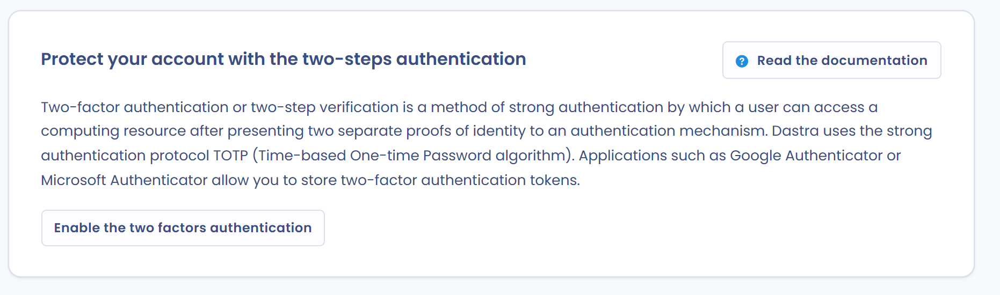

# Authentification forte

Dastra utilise la technologie [TOTP](https://en.wikipedia.org/wiki/Time-based_One-time_Password_algorithm) pour gérer l'[authentification multifacteur](https://fr.wikipedia.org/wiki/Double_authentification) des utilisateurs. Ils se connectent avec leur mot de passe habituel et un code à 6 chiffres fourni par une application d'authentification, telle que Microsoft Authenticator ou Google Authenticator.

Cette page explique comment activer l'authentification forte sur votre compte, puis comment la rendre obligatoire pour les utilisateurs de votre organisation.

## Activer l'authentification forte sur votre compte

1. Ouvrez le menu de votre profil en haut à droite, cliquez sur **Profil utilisateur**, puis sur **Sécurité du compte** dans le menu de gauche. Vous pouvez aussi ouvrir directement [https://app.dastra.eu/general-settings/account-security](https://app.dastra.eu/general-settings/account-security).
2. Dans la carte **Protéger votre compte avec l'authentification à deux facteurs**, cliquez sur **Activer l'authentification forte**.

<figure><figcaption>
La carte d'authentification à deux facteurs dans Sécurité du compte
</figcaption></figure>

3. Sur l'écran **Configuration de l'authentification forte**, installez une application d'authentification sur votre téléphone, si ce n'est pas déjà fait.
4. Scannez le QR code avec l'application. Si elle ne peut pas le scanner, saisissez le code affiché sous le texte.

<figure><figcaption>
L'écran de configuration : le QR code à scanner avec votre application
</figcaption></figure>

5. Cliquez sur **Continuer**. Dastra affiche alors votre code de restauration : conservez-le dans un endroit sûr.
6. À chaque connexion, saisissez votre mot de passe, puis le **code à 6 chiffres** fourni par votre application.

<figure><figcaption>
Exemple d'application d'authentification
</figcaption></figure>


Conservez précieusement le code de restauration. Si vous perdez votre application d'authentification, vous pouvez l'utiliser pour réinitialiser l'authentification forte : sur l'écran de saisie du code, cliquez sur **Impossible de vous connecter ?**. Sans ce code, votre compte reste verrouillé : rapprochez-vous alors du propriétaire de votre organisation pour qu'il réinitialise l'authentification forte de votre compte.


## Rendre l'authentification forte obligatoire

Les propriétaires de l'organisation peuvent obliger tous les utilisateurs internes, c'est-à-dire ceux que l'organisation gère, à utiliser l'authentification forte. Cette option fait partie des réglages de sécurité de l'organisation, réservés au plan Enterprise.

1. Ouvrez le menu de votre profil, cliquez sur **Configuration de l'organisation**, puis sur **Sécurité** dans le menu de gauche. Vous pouvez aussi ouvrir directement [https://app.dastra.eu/general-settings/security](https://app.dastra.eu/general-settings/security).
2. Dans la carte **Forcer les utilisateurs à utiliser l'authentification forte (A deux facteurs)**, activez l'interrupteur : il passe à **Actif**.

<figure><figcaption>
La carte pour rendre l'authentification forte obligatoire
</figcaption></figure>


À leur prochaine connexion, les utilisateurs concernés ne peuvent pas accéder à l'application tant qu'ils n'ont pas configuré l'authentification forte. Prévenez votre équipe et rappelez les bonnes pratiques de conservation du code de restauration. Une connexion par [passkey](passkey.md) avec vérification de l'utilisateur vaut déjà deux facteurs : elle ne demande pas de code à 6 chiffres.

